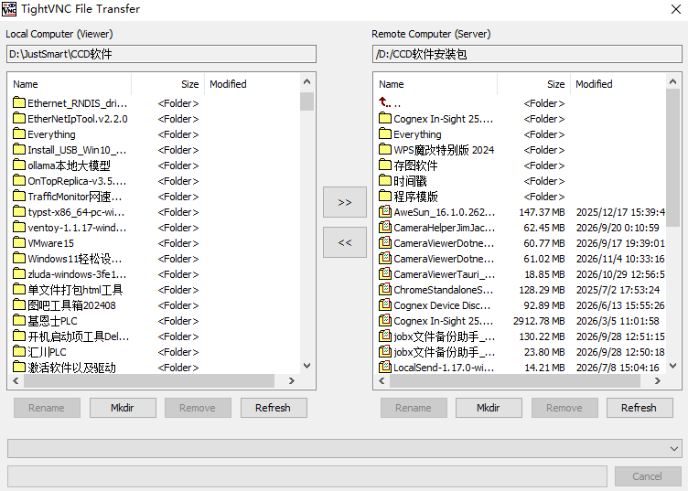

# LocalFileDropShellPy — 工控机文件/文件夹传送

面向**工控机与调试机**的本地文件传送工具，客户端与服务端一体。直接把文件或文件夹拖入窗口、
选择远程目标目录，一键传输。

- **TightVNC 通道复用优先**：工控机一般预装 TightVNC Server（监听 5900），探测到后直接发 RFB 文件传输扩展消息（`FC000106~FC00010B`），无需目标端启动本软件服务端
- **自托管 HTTP 回退**：目标端无 TightVNC 时自动启动 aiohttp 服务，两端均运行本软件
- **单工自动喷泉码**：通道判定为单工时切换 DCF2 容器 + decimen v3 Wire 帧格式
- 界面采用 Windows 95 风格（设计 token 来自 `02-windows-95.css`，图标 `assets/drop3.ico`）
- 渲染基于 pywebview（Windows 上为 WebView2）；拖放通过 Win32 `WM_DROPFILES` 原生实现

## 效果图（TightVNC File Transfer 通道复用原型）



左列 Local Computer、右列 Remote Computer、中间传输按钮；本软件在探测到目标端已安装 TightVNC Server 时复用同一传输通道，无需目标端启动额外进程。

## 传输路径

```
拖入文件/文件夹 + 选择远程目标目录
  → 探测 TightVNC (TCP 5900)
    → 存在：RFB 扩展消息 FC000106~FC00010B（无需目标端服务）
    → 不存在：自托管 aiohttp HTTP 服务 /upload /list /delete
  → 通道判定单工：包 DCF2 容器 → decimen v3 Wire 帧 → 发送
  → 完成（TightVNC 模式 MD5 块校验 / HTTP 模式 SHA-256 容器校验）
```

## 传输协议参考

### 1. TightVNC RFB 文件传输扩展（复用通道）

来源：TightVNC 2.8.90 `ft-common/FTMessage.h`、`ft-client-lib/FileTransferInterface.h`。

所有扩展消息以 `0xFC000000` 掩码识别（RFB 扩展消息前缀 `0xFC` + 3 字节消息 ID）。消息体：

```
UINT32 messageId        // 4 字节小端
UINT8[] messageBody     // 依 messageId 不同
```

`StringUTF8` 结构：`UINT32 size` + `UINT8 buffer[size]`；路径格式 Unix 风格：`/C:/folder1/folder2`，文件夹末尾无斜杠。

核心消息对（本软件复用场景）：

| 消息 ID | 名称 | 方向 | 用途 |
|---|---|---|---|
| `FC000102` | FILE_LIST_REQUEST | C→S | 枚举远程目录（带 compressionLevel） |
| `FC000103` | FILE_LIST_REPLY | S→C | 压缩块：filesCount + 每条 fileSize/modTime/fileFlags/relFilename |
| `FC000104` | MD5_REQUEST | C→S | 请求远程文件指定偏移块的 MD5 |
| `FC000105` | MD5_REPLY | S→C | 16 字节 MD5 摘要 |
| `FC000106` | UPLOAD_START_REQUEST | C→S | 开始上传 |
| `FC000107` | UPLOAD_START_REPLY | S→C | 确认 |
| `FC000108` | UPLOAD_DATA_REQUEST | C→S | 携带压缩块（CompressedBlock） |
| `FC000109` | UPLOAD_DATA_REPLY | S→C | 确认 |
| `FC00010A` | UPLOAD_END_REQUEST | C→S | 结束上传 |
| `FC00010B` | UPLOAD_END_REPLY | S→C | 确认 |
| `FC000111` | MKDIR_REQUEST | C→S | 远程创建目录 |
| `FC000113` | REMOVE_REQUEST | C→S | 远程删除文件 |
| `FC000119` | LAST_REQUEST_FAILED_REPLY | S→C | 兜底失败回复 |

`CompressedBlock` 结构（可选 zlib）：

```
UINT8 compressionLevel       // 0 = 不压缩，[1..9] = 压缩
UINT32 compressedSize
UINT32 uncompressedSize
UINT8 compressedData[compressedSize]
```

**通道复用策略**：启动时向目标端 `5900` 端口发 RFB 协议握手，协商安全类型后发送 `FC000102`；成功收到 `FC000103` 即判定为 TightVNC Server，后续所有文件传输直接走此通道，目标端**无需启动本软件服务端**。若连接被拒绝或返回非 RFB 响应，回退到自托管 HTTP。

### 2. 自托管 HTTP 协议（回退通道）

目标端无 TightVNC 时，发送端启动 aiohttp 服务（默认 8765）：

| 方法 | 路径 | 用途 |
|---|---|---|
| POST | `/upload` | 接收文件（multipart/form-data 或 raw bytes，带 sha256 头） |
| POST | `/mkdir` | 远程创建目录 |
| POST | `/delete` | 远程删除文件/文件夹 |
| GET  | `/list` | 枚举远程目录 |

### 3. 单工喷泉码

来源：AirFountainZulu / decimen v3（`qr/core/Wire.kt`、`qr/core/Container.kt`）。

**Wire 帧格式**（每帧自描述，无需握手，小端）：

```
偏移  长度  字段
0     1     magic 0xD1
1     1     magic 0xC3
2     1     version = 3
3     1     flags       低 4 位必须理解
4     2     sessionId   每次发送随机生成
6     4     seq         喷泉码 PRNG 种子输入
10    2     k           源块数
12    2     blockLen    每帧载荷字节数
14    4     totalLen    受保护容器（DCF2）总长度
18    4     payloadFnv  整个容器的 FNV-1a，完成后校验
22    blockLen  block   喷泉码编码块
```

**DCF2 文件容器**（喷泉码载荷不是裸文件，而是自描述容器，49 字节头部）：

```
偏移  长度  字段
0     4     magic "DCF2" = 44 43 46 32
4     1     compression  0=none 1=gzip
5     2     nameLength
7     2     typeLength
9     4     fileLength         原始文件长度
13    4     transmittedLength  实际承载长度（压缩后或原始）
17    32    sha256(原始文件)
49    nameLength  name UTF-8
49+nameLength  typeLength  type UTF-8
49+nameLength+typeLength  transmitted bytes
```

设计要点：
- 每帧带完整头部，接收端可在播放中途锁定流；发送端重启会产生新 `sessionId`，接收端自动重新开始
- gzip 仅在确实变小时启用（≥ 768 字节且非已压缩格式），熵编码媒体跳过
- 接收端还原并校验 `sha256` 通过前，不应向用户提供文件

## 拖放处理

Win32 `WM_DROPFILES` 原生拖放（关闭 WebView2 内置拖放），可拿到完整文件路径；
支持文件与文件夹混合拖入，文件夹递归扫描；输出路径为 Unix 风格 `/X:/...` 后交给传输层。

## 目录

| 路径 | 说明 |
|---|---|
| `assets/02-windows-95.css` | Windows 95 设计 token |
| `assets/drop3.ico` | 软件图标（Win95 风格，多尺寸） |
| `assets/screenshot1.png` | TightVNC File Transfer 通道复用原型图 |
| `src/localdropshell/app.py` | 入口（参数解析 / 事件挂接 / 传输调度） |
| `src/localdropshell/drop.py` | 拖放处理（文件/文件夹扫描） |
| `src/localdropshell/tightvnc.py` | RFB 扩展客户端（FC000106~FC00010B 消息对） |
| `src/localdropshell/fountain.py` | 喷泉码编解码（Wire 帧 + DCF2 容器） |
| `src/localdropshell/transfer.py` | 传输调度（TightVNC 优先 / HTTP 回退 / 单工判定） |
| `src/localdropshell/http.py` | aiohttp 自托管服务端 |
| `src/localdropshell/ui/` | pywebview 界面（菜单 / 列表 / 日志） |
| `build_exe.py` | PyInstaller 打包脚本（产物 `LocalFileDropShell_{时间戳}.exe`） |

## 开发 / 运行 / 打包

```bash
uv sync                                      # 安装依赖（pywebview / aiohttp / Pillow / tkinterdnd2，dev 组含 PyInstaller）
uv run local-drop-shell                      # 启动应用
uv run local-drop-shell --host 192.168.1.50 # 指定目标端
uv run local-drop-shell --folder D:/data      # 启动时直接载入本地文件夹
uv run local-drop-shell -v                   # 调试日志 + 开发者工具
uv run python build_exe.py                   # PyInstaller 打包 dist/LocalFileDropShell_{yyyyMMddHHmmss}.exe
```

- 依赖 Python 3.10+；Windows 下需要 WebView2 Runtime（Win10/11 一般已内置）
- 参考工程：
  - TightVNC 2.8.90 `ft-client-lib` / `ft-common` / `file-lib`（RFB 文件传输协议）
  - AirFountainZulu `qr/core/Wire.kt` / `Container.kt`（decimen v3 喷泉码）

## 设计决策

1. **TightVNC 通道优先**：工控机一般预装 TightVNC Server，探测到后直接复用 `FC000106~FC00010B` 文件传输通道；目标端无需启动本软件，大幅降低部署门槛
2. **自托管 HTTP 回退**：目标端无 TightVNC 时两端均运行本软件，aiohttp 服务端处理上传/枚举/删除
3. **单工喷泉码**：通道判定为单工时（仅单向可通）启用 DCF2 + decimen v3，自描述帧支持中途锁定，gzip 有条件启用，SHA-256 完成校验
4. **路径格式统一**：Unix 风格 `/X:/...`，与 TightVNC 文件传输协议保持一致
