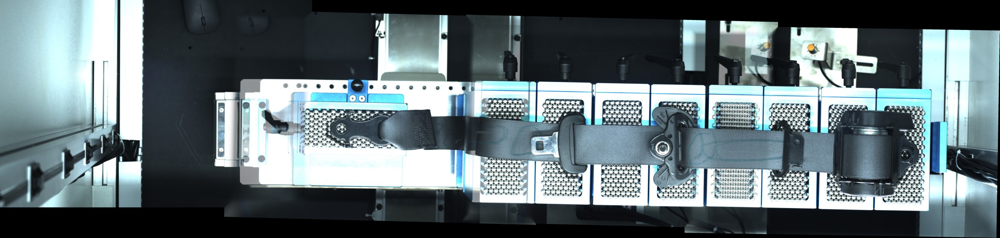

# PanoramaStitchingPy · 全景图像拼接

基于 **OpenCV、SIFT 特征配准与加权融合** 的多相机全景拼接项目。仓库既包含课程实验所需的柱面投影 Python 实现，也包含型号A 工装顶面四相机的实测拼接方案，以及可接入 JustSmart 主程序的 C# 异步工作进程。

[项目主页](index.html) · [现场拼接报告](assets/型号A_20261118_185337_712/stitch/拼接报告.md)

## 项目内容

| 路径 | 说明 |
| --- | --- |
| `src/panorama_stitch.py` | Lab7 通用实现：柱面投影、SIFT + RANSAC、ECC 精化、接缝式或羽化融合 |
| `src/hw7_pa.h` | 实验参考接口 |
| `assets/型号A_20261118_185337_712/stitch/` | 型号A TopCam1～4 现场脚本、完整结果、匹配图、接缝检查图和统计报告 |
| `src/PanoramaJobClient.cs` | 主程序侧非阻塞任务客户端，负责等待图片落盘、排队和状态展示 |
| `src/JustSmart.PanoramaWorker/` | .NET Framework 4.8 / OpenCvSharp 独立拼接工作进程 |
| `src/output/` | Lab7 两组数据的全景结果（运行脚本后生成） |
| `assets/multi-camera-image-stitching-main/` | 模块化参考实现：接缝优化、柱面投影、网格光照补偿 |
| `assets/panorama-stitching-main/` | 第三方全景拼接参考工程及多组示例数据 |
| `docs/`、`assets/压缩包/` | 算法资料、原始数据与参考源码压缩包 |

## 型号A 顶面相机结果

四张原始图像均为 **5472 × 3648**。文件编号并非实际空间顺序，经 SIFT 一致点诊断后，采用：

```text
TopCam4 → TopCam3 → TopCam2 → TopCam1
```

默认以 0.5 尺度处理，输出 **8762 × 2091** 的全景图；三组相邻画面的重叠率为 **24.2%～29.0%**。结果、匹配可视化和接缝检查图均已保存在现场脚本的 `output/` 目录。



复现命令：

```bash
cd assets/型号A_20261118_185337_712/stitch
uv run --no-project --with opencv-python --with numpy python stitch_topcam.py

# 使用原图分辨率处理
uv run --no-project --with opencv-python --with numpy python stitch_topcam.py --scale 1.0 --ramp 160
```

脚本生成 `topcam_panorama.jpg`、三张内点匹配图及 `stats.json`。报告中的预览图与接缝检查图为已有分析产物，脚本本身不会重新生成这两张检查图。

## Lab7 通用拼接

处理步骤：

1. 按 `K.txt` 中的焦距进行柱面投影，以逆向映射和双线性插值避免空洞；
2. 在相邻图像上提取 SIFT 特征，以 Lowe 2-NN ratio 筛选匹配；
3. 使用 RANSAC 估计相似变换，并可通过 ECC 做亚像素精化；
4. 累积相邻变换到统一画布，可选旋转校正；
5. 根据像素到有效区域边界的距离加权融合，默认采用高次幂接缝式权重，最后裁去黑边。

```bash
cd src

# 将 ../assets/压缩包/panorama-data1.zip、panorama-data2.zip 解压到当前目录后，一次处理两组数据
uv run --with opencv-python --with numpy python panorama_stitch.py

# 指定数据集与输出路径；目录内需包含图片和记录焦距的 K.txt
uv run --with opencv-python --with numpy python panorama_stitch.py \
  --data <数据目录> --out <输出.png>

# 可选参数示例
uv run --with opencv-python --with numpy python panorama_stitch.py \
  --data <数据目录> --out output/custom.png \
  --blend feather --ramp 40 --max-width 4000 --no-refine --no-rotation
```

输入图片按文件名排序，支持 JPG、JPEG、PNG、BMP、TIF、TIFF；请确保排序与物理拍摄顺序一致。默认输出到 `output/panorama-data1.png` 和 `output/panorama-data2.png`。

## 主程序集成

C# 工作进程面向工业检测场景，主流程不等待拼接完成：

```text
主程序检测完成
  → 等待原图稳定落盘
  → 内存队列提交任务
  → 懒启动 JustSmart.PanoramaWorker.exe
  → 本地命名管道 + protobuf 传输任务
  → 独立线程按 TopCam / SideBCam 分组拼接
  → 保存至 <SessionFolder>/StitchedImage
```

- 输入只传图片路径，不通过管道传图像数据；每组图像须按物理从左到右排列。
- 输出命名为 `LineAVI_<时间戳>_<组名>_Stitched.<扩展名>`，支持 PNG、BMP、JPG。
- 特征匹配不可靠时，工作进程使用灰度归一化互相关模板搜索兜底；SideBCam 第一对允许尺度搜索。
- 工作进程无连接空闲 10 分钟后退出；日志位于系统临时目录的 `JustSmart_PanoramaWorker.log`，任务状态位于 `JustSmart_PanoramaStatus/`。
- 构建目标为 **.NET Framework 4.8、x64**，依赖 OpenCvSharp 4.11 和 Google.Protobuf 3.17.1。项目输出路径指向解决方案中的 `JustSmart.App`，因此需在主程序解决方案环境中构建部署。

## 像素级融合加速：AVX2 与 AMD GPU

`src/JustSmart.PanoramaWorker/avx2/` 与 `src/JustSmart.PanoramaWorker/rocm/` 是独立于 C# 主流程的融合内核实验，目标相同：Deghost 单对逐像素融合，包括增益应用、缝合带 smoothstep 过渡和色差一致性选择。基准中增益、缝合线与色差图均为预计算，配准与 DP 缝合线不计入耗时。

### 编译方式

两个目录沿用 SUMMARY 的 Zig 构建方式（Zig 0.16，通过 `uv tool install ziglang` 安装）：

```powershell
cd src/JustSmart.PanoramaWorker/avx2
python-zig build -Doptimize=ReleaseFast    # 产出 zig-out/bin/fusion_avx2.exe

cd ../rocm
python-zig build -Doptimize=ReleaseFast    # 产出 zig-out/bin/fusion_opencl.exe
```

- `build.zig` 使用 `addCSourceFile` + `link_libcpp`，C++17；AVX2 使用 `-mavx2 -O3`。
- `rocm` 目录通过 `LoadLibrary("OpenCL.dll")` 动态获取函数指针，无需 OpenCL.lib。
- 本机 Radeon 630 为 gfx804，ROCm 6.4 的 `hipInfo` 报告无可用设备，因此 GPU 后端实际使用 AMD 驱动自带的 OpenCL 2.0 运行时。
- Zig 构建的控制台程序在输出被重定向时需要 `setvbuf(stdout, NULL, _IONBF, 0)`，否则缓冲区不会及时刷新。

### 基准结果

输入为型号A TopCam4→3、3→2、2→1 三对图像在 0.5 尺度下配准后的图层（画布 8763×2092），每组 15 次取中位数：

| 实现 | 4→3 | 3→2 | 2→1 | 合计 |
| --- | --- | --- | --- | --- |
| 标量 C++ | 131.00 ms | 122.84 ms | 119.51 ms | 373.35 ms |
| AVX2 | 52.55 ms | 55.30 ms | 52.52 ms | 160.37 ms |
| AMD GPU（内核） | 7.31 ms | 7.26 ms | 7.31 ms | 21.88 ms |

- AVX2 相对标量 **2.33×**；GPU 内核相对标量 **17.1×**，相对 AVX2 **7.3×**。
- 输出核对：AVX2 与标量、GPU 与 AVX2 的最大差均为 1，属于浮点与舍入差异。
- GPU 单对上传约 151–168 ms、回读约 84–86 ms，端到端约 250–260 ms，单次任务仍慢于 AVX2；GPU 仅在数据常驻显存或批量任务摊薄传输时占优。

## 算法边界

当前现场方案针对近平面工装检测面优化，不适用于任意视差场景。不同深度的物体仍可能错位；重复纹理、弱纹理和不足的图像重叠会降低配准可靠性。现有 TopCam 脚本未做亮度增益补偿，部分接缝仍可能出现亮度跳变。更高画质可考虑单应配准、离线相机标定、多频段融合及光照补偿。

## 许可证

项目采用 [MIT License](LICENSE)，版权所有 JustSmartAuto。第三方参考工程及资料保留各自原有许可与版权。
