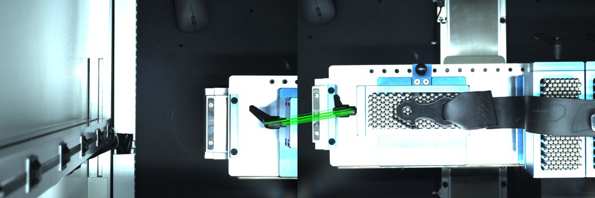
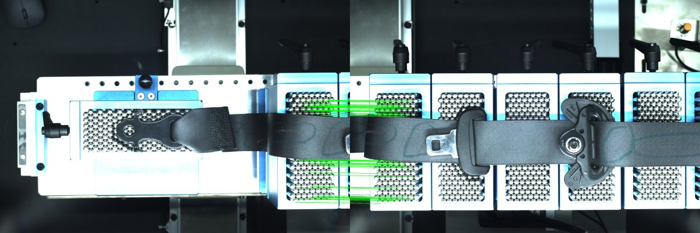
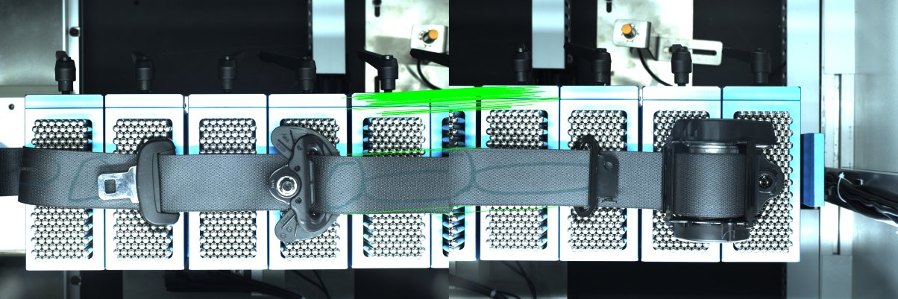
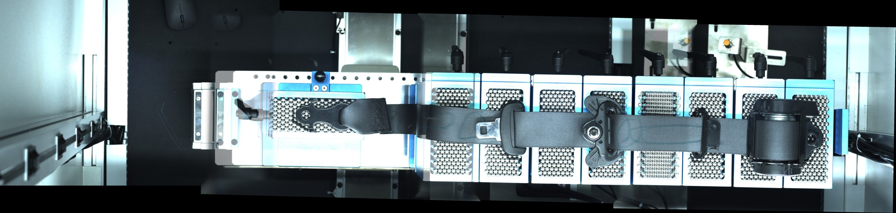
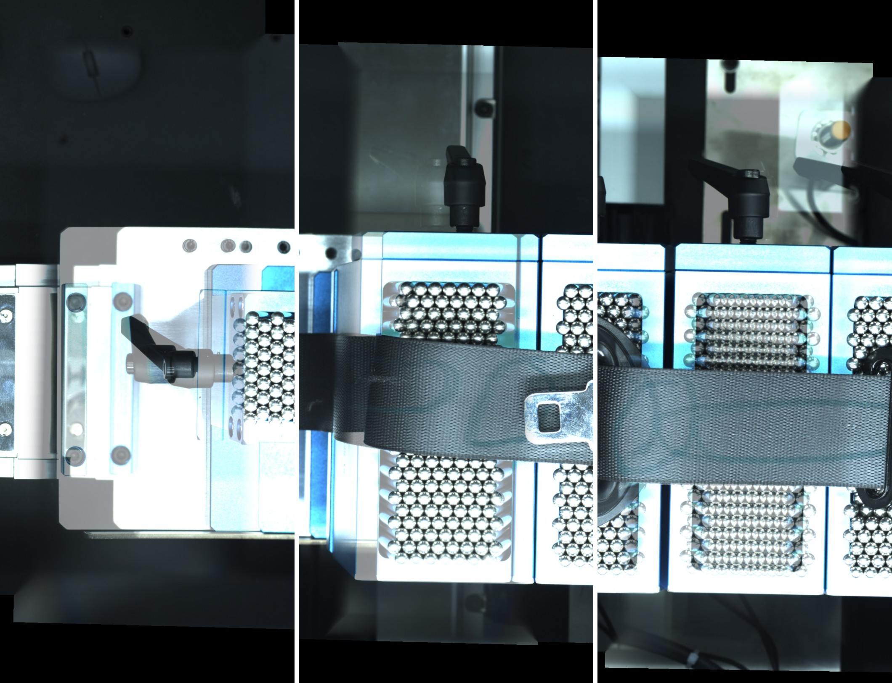

# 型号A 顶面四相机（TopCam1~4）SIFT 拼接报告

- 数据批次：`型号A_20261118_185337_712`
- 采集时间：2026-11-18 18:53:39
- 拼接脚本：[stitch_topcam.py](stitch_topcam.py)
- 输出目录：`output/`

## 1. 输入图像

| 文件名 | 相机 | 分辨率 |
| --- | --- | --- |
| `LineAVI_20261118_185339_TopCam1.jpg` | TopCam1 | 5472 × 3648 |
| `LineAVI_20261118_185339_TopCam2.jpg` | TopCam2 | 5472 × 3648 |
| `LineAVI_20261118_185339_TopCam3.jpg` | TopCam3 | 5472 × 3648 |
| `LineAVI_20261118_185339_TopCam4.jpg` | TopCam4 | 5472 × 3648 |

四台顶面相机沿工装长轴并排安装。**文件编号与物理排列顺序不一致**，实际从左到右为：

```
TopCam4  →  TopCam3  →  TopCam2  →  TopCam1
（工装左端）                      （工装右端）
```

该顺序由相邻图像对的 SIFT 一致点数量确定：按 4-3-2-1 排列时相邻对内点数分别为 21 / 81 / 125，而其余方向组合（如 1-2、4-2）最多只有 5~8 个一致点，属于重复工装纹理造成的误匹配。

## 2. 算法流程

1. **预处理**：灰度化后做 CLAHE（clipLimit=2.0，8×8 网格），提升亮面金属的局部对比度。
2. **SIFT 特征**：`nfeatures=20000`，`contrastThreshold=0.004`（降低阈值以在低纹理台面上取得足够特征点）。
3. **特征匹配**：`BFMatcher(NORM_L2)` + 2-近邻，采用 Lowe ratio 判据 `m.distance < 0.75 · n.distance`。
4. **粗配准**：`estimateAffinePartial2D`（RANSAC，重投影阈值 4.0 px，maxIters=50000，confidence=0.9995）估计 4 自由度相似变换（平移 + 旋转 + 尺度）。
5. **多区域候选**：由于 TopCam4 视野大面积是空台面，整幅匹配内点不足。对每一对图像并行尝试 4 个候选区域（全幅、A 右侧 40%/50%/60% vs B 左侧同比例），把局部偏移折算回全图后再统一评估。
6. **按 ECC 相关系数选优**：重复工装（球阵列、通孔板）会让内点数失效，因此以 `findTransformECC`（MOTION_EUCLIDEAN）精化后的相关系数 `cc` 作为最终选择依据。
7. **ECC 亚像素精化**：以 SIFT+RANSAC 结果为初值，将配准误差压到亚像素级。
8. **变换链累积**：以 TopCam4 为画布原点，逐级左乘把各相机映射到统一坐标系，取所有图像四角的外接矩形作为画布。
9. **羽化融合**：每幅图像的权重取"到自身有效区域边界的距离"（`distanceTransform`），在 `ramp=80` px 内线性过渡并取 4 次幂，使接缝处权重迅速衰减为单图贡献，避免多层平均产生的重影。
10. **裁黑边**：按非黑像素外接框裁切。

处理尺度为原图的 0.5（`--scale 0.5`），以兼顾速度与精度。

## 3. 匹配与配准结果

| 图像对 | 关键点 A/B | 粗匹配 good | 内点 | 内点率 | ECC 相关系数 | dx (px) | dy (px) | 旋转 | 尺度 | 重叠宽度 | 重叠率 |
| --- | --- | --- | --- | --- | --- | --- | --- | --- | --- | --- | --- |
| TopCam4 → TopCam3 | 16864 / 8907 | 154 | 21 | 0.136 | 0.6898 | −2010.5 | −30.8 | −1.48° | 1.000 | 725.5 px | 26.5% |
| TopCam3 → TopCam2 | 20000 / 20000 | 531 | 81 | 0.153 | 0.6890 | −2075.1 | +4.0 | +0.13° | 1.000 | 660.9 px | 24.2% |
| TopCam2 → TopCam1 | 20000 / 20000 | 637 | 125 | 0.196 | 0.4975 | −1943.5 | −62.9 | +0.41° | 1.000 | 792.5 px | 29.0% |

（数值为 0.5 尺度下的像素，`dx/dy` 表示同一物点在右相机中的坐标减去左相机中的坐标。）

特征点匹配可视化（只画 RANSAC 内点）：

| TopCam4–TopCam3 | TopCam3–TopCam2 | TopCam2–TopCam1 |
| --- | --- | --- |
|  |  |  |

## 4. 拼接结果

| 项目 | 数值 |
| --- | --- |
| 全景尺寸 | 8762 × 2091（0.5 尺度） |
| 等效原始像素 | 约 17524 × 4182 |
| 输出文件 | `output/topcam_panorama.jpg`（约 2.5 MB） |
| 重叠率 | 24% ~ 29% |



安全带、夹具、通孔金属板的球阵列在整幅全景中连续贯通，未出现重复拼接或多份工装。

## 5. 接缝质量检查

三处接缝（4|3、3|2、2|1）原尺寸检查：



| 接缝 | 结论 |
| --- | --- |
| TopCam4 \| TopCam3 | 夹具（扳手、压紧块、球阵列）边缘单一锐利，无重影；存在亮度跳变 |
| TopCam3 \| TopCam2 | 球阵列行列连续，安全带纹理对接自然，接缝不可见 |
| TopCam2 \| TopCam1 | 安全带与卷收器连续；背景（离焦区域）存在轻微重影 |

### 4→3 配准的歧义裁决

该对图像存在两个 RANSAC 候选解：

| 候选 | dx / dy / 旋转 | 现象 |
| --- | --- | --- |
| A（采用） | −2010.5 / −30.8 / −1.48° | 夹具与球阵列边缘单一、锐利 |
| B | −1684 / −108 / 0° | 50/50 叠加时金属压块与球阵列出现两份错开的轮廓 |

将 TopCam3 分别按两个候选叠加到 TopCam4 上做半透明对比，候选 B 在夹具区域出现明显双影（压块轮廓偏移约 25 px、球阵列呈双网格），候选 A 夹具清晰无重影，故采用候选 A。此外候选 A 的位移与其余两对（−2075、−1943）一致，而 B 明显偏小。

需要说明：在候选 A 下，桌面上的鼠标在重叠区出现位置差。这是**视差**而非配准错误——鼠标位于桌面，与夹具顶面不在同一深度，两台不在同一位置的相机对低位物体的成像位移不同。全景以夹具面（检测基准面）为准对齐，桌面物体出现位移属预期现象。

## 6. 问题与局限

1. **TopCam4 有效纹理少**：视野大部分为空台面，整幅匹配内点仅 21 个，必须依赖右侧局部区域，鲁棒性弱于其余两对。
2. **TopCam2→TopCam1 的 ECC 相关系数仅 0.4975**：重叠区以安全带织带为主，近似周期性纹理，像素相关性天然偏低；内点 125 个且接缝目视连续，判定配准可用。
3. **亮度差异未补偿**：四台相机曝光/光源不一致，接缝处可见亮度台阶（4|3 处最明显）。本流程未做增益补偿或直方图匹配。
4. **相似变换的局限**：模型只含平移/旋转/尺度，未建模透视。近平面场景足够，但不同高度的物体（桌面、工装立面）会有残余错位。
5. **画布黑角**：因 TopCam4 相对画布有 −1.48° 旋转，全景左下/右下角存在少量黑边，已按外接矩形裁切，但斜边无法完全去除。

## 7. 改进建议

- 对接缝两侧做增益补偿（重叠区均值/直方图匹配），消除亮度台阶。
- 将融合改为多频段（Laplacian pyramid）混合，可同时兼顾亮度过渡与高频细节保留。
- 若后续需要毫米级量测，改用单应（`estimateHomography`）按夹具平面配准，或对相机做离线标定后使用固定变换，避免逐帧估计带来的抖动。
- TopCam4 建议在工装左端增加可识别的标定特征，提升该对配准的稳定性。

## 8. 复现方式

```powershell
uv run --no-project --with opencv-python --with numpy python stitch_topcam.py
# 全分辨率：
uv run --no-project --with opencv-python --with numpy python stitch_topcam.py --scale 1.0 --ramp 160
```

主要参数：`RATIO=0.75`、`RANSAC_THRESH=4.0`、`MIN_INLIERS=20`、`ramp=80`、`sharpness=4`。

## 9. 产出文件

| 文件 | 说明 |
| --- | --- |
| `output/topcam_panorama.jpg` | 全景拼接结果 8762 × 2091 |
| `output/topcam_panorama_preview.jpg` | 报告用缩略图（宽 2400） |
| `output/seam_check.jpg` | 三处接缝检查图 |
| `output/match_4_3.jpg`、`match_3_2.jpg`、`match_2_1.jpg` | 内点匹配可视化 |
| `output/stats.json` | 匹配与配准全部数值 |
