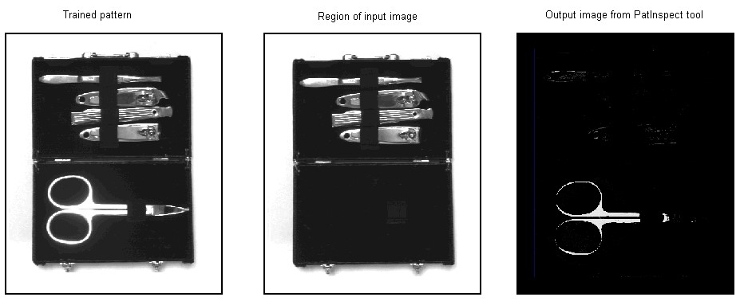
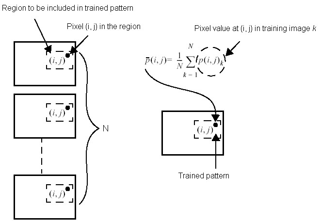
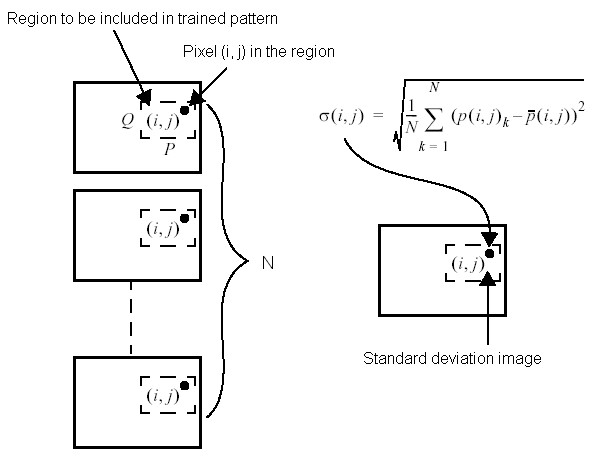
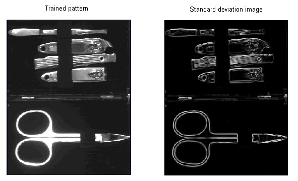
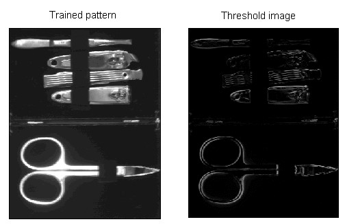
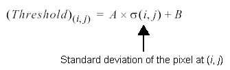
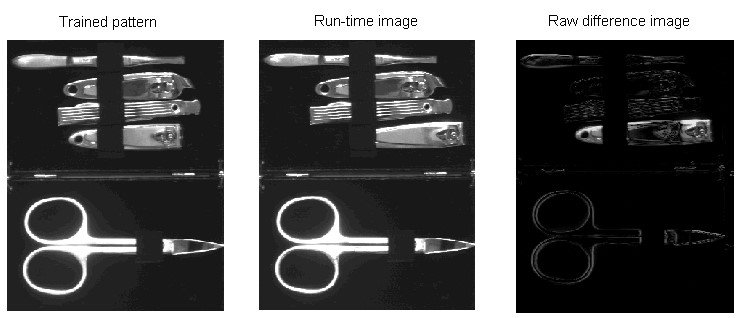
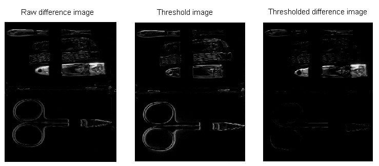

# PatInspect Theory

> **来源**：Cognex VisionPro 帮助文档 · PatInspect Theory（PDF 打印稿，共 4 页）
> **版权**：Copyright © 2013 Cognex Corporation All Rights Reserved
> **整理说明**：正文保留英文原文；图片按原文位置提取并保留；图片中的公式另附 LaTeX 转写。

This topic contains the following sections.

- [The Trained Pattern](#the-trained-pattern)
- [The Standard Deviation Image](#the-standard-deviation-image)
- [The Threshold Image](#the-threshold-image)
- [Image Normalization](#image-normalization)
- [PatInspect Analysis](#patinspect-analysis)
- [PMAlign Tool for Alignment](#pmalign-tool-for-alignment)
- [Interpolation Mode](#interpolation-mode)

The PatInspect tool compares the features contained within a region of an input image against the features stored in a trained pattern and generates an output image highlighting the differences between them. The output image highlights potential defects in the input image, such as missing or mislocated features, erroneous or unwanted marks on an object, or surfaces of the wrong color.

For example, the following figure shows a trained pattern, a region of an input image, and the output image generated by a PatInspect tool:

*图 1：训练图案（左）、输入图像中的区域（中）与 PatInspect 工具生成的输出图像（右）。*

The output image can then be analyzed with other vision tools, such as a Blob tool or a Histogram tool, to collect more information about potential defects.

## The Trained Pattern

The PatInspect tool compares a region of a run-time image against a trained pattern in order to locate potential defects. Before you can use a PatInspect tool to analyze run-time images you must first create the trained pattern, which is stored along with other PatInspect configuration parameters.

Using a method of statistical training, you create the trained pattern using actual images of the objects you want to inspect with your vision application. Creating the trained pattern from multiple images allows you to build a trained pattern that compensates for allowable lighting variations within your run-time images, both in the background and reflected from the objects under inspection. The images can be stored in an image-database file or you can acquire live images from your production environment. In either case, the training images you use to create a trained pattern must closely resemble the images you expect to capture as your vision application operates, with regards to background, lighting, and object placement. In addition, the images must be free of defects so that they generate a trained pattern representing an ideal example of the objects your vision application will examine.

To create the trained pattern, the PatInspect tool accepts a training image and averages it into the current trained pattern, if one exists, using the formula illustrated in the following figure:

$$\bar{p}(i,j) = \frac{1}{N}\sum_{k=1}^{N} p(i,j)_k$$

*公式 1：训练图案在像素 $(i,j)$ 处的值 $\bar{p}(i,j)$。其中 $N$ 为训练图像数量，$p(i,j)_k$ 为第 $k$ 张训练图像在像素 $(i,j)$ 处的像素值。*

Although it is possible to create a trained pattern from a single training image, using multiple images allows you to build a trained pattern that compensates for allowable lighting variations and minor variations of object placement within your run-time images. You should generate a trained pattern from a single image only when your production environment can guarantee a consistent light source and that the objects under inspection will never undergo an allowable change in appearance.

There is no upper limit on the number of images you can use to create the trained pattern, although the pattern will vary less and less with each image you add.

## The Standard Deviation Image

Using the trained pattern, the PatInspect tool generates a standard deviation image, an image where each pixel is a measure of the standard deviation of pixel values among the statistical training images. The standard deviation image is an indication of the expected degree of variability of each pixel in the trained pattern.

The PatInspect tool generates the standard deviation image with the formula shown in the following figure:

$$\sigma(i,j) = \sqrt{\frac{1}{N}\sum_{k=1}^{N}\left(p(i,j)_k - \bar{p}(i,j)\right)^2}$$

*公式 2：标准差图像在像素 $(i,j)$ 处的值 $\sigma(i,j)$，即该像素在全部训练图像中的标准差。*

If you create a trained pattern using a single input image, the PatInspect tool generates a pseudo-standard deviation image using the Sobel Edge tool, where the lighter pixels represent the expected border between features. For example, the following figure shows a trained pattern and the pseudo-standard deviation image it generates:

*图 2：训练图案（左）与由 Sobel Edge 工具生成的伪标准差图像（右）。*

Using scale and offset coefficient values that the tool supports, you can change the information in the pseudo-standard deviation image. Increasing the scale coefficient increases the size of edges in the image, while increasing the offset coefficient increases the overall brightness of the image. If a PatInspect tool consistently reports false defects with outlines or borders of your run-time images, try adjusting the Sobel coefficient values.

Changing the Sobel coefficient values has no effect if you use the statistical training method to create the trained pattern.

## The Threshold Image

For each input image you use to create a trained pattern, the PatInspect tool recalculates the standard deviation image, and then uses the current standard deviation image to generate a threshold image. The following figure shows a trained pattern and the threshold image it generates:

*图 3：训练图案（左）与其生成的阈值图像（右）。*

The PatInspect tool generates the threshold image with the formula shown in the following figure:

$$(\text{Threshold})_{(i,j)} = A \times \sigma(i,j) + B$$

*公式 3：阈值图像在像素 $(i,j)$ 处的值。$\sigma(i,j)$ 为该像素的标准差，$A$ 为阈值比例系数（scale coefficient），$B$ 为偏移系数（offset coefficient）。*

Where A and B represent a scale coefficient and an offset coefficient, respectively. Increasing the threshold scale increases the contrast of edge information, while increasing the threshold offset increases the overall brightness. If a PatInspect tool consistently reports false defects with large areas of your run-time images, try adjusting the threshold coefficient values.

The PatInspect tool uses the threshold image to determine if any pixel in a run-time image should be considered a defect pixel.

## Image Normalization

The PatInspect tool is very sensitive to changes in lighting. Even a small variation in the ambient light level can cause the tool to treat brighter or darker pixels in the run-time image as defects. To compensate for varying light levels, the tool can perform an image normalization operation on the run-time image before analyzing it for differences. Image normalization can lower or raise the value of nondefect pixels to the same levels stored in the trained pattern.

As you configure a PatInspect tool you must choose one of the following types of image normalization:

*Table 1. Image Normalization Methods*

| Method | Description |
| --- | --- |
| Identity | The identity method actually performs no normalization of the run-time image at all. You might use the identity method temporarily as you design and test your vision application to see what type of defects the tool will catch in various test images. |
| Histogram Equalization | The histogram equalization method compares the histogram of the trained pattern with a histogram of the run-time image and adjusts the pixel values of the run-time image so that the histograms match.  Use the histogram equalization method when defects are expected to be small or when slight lighting changes can occur in your production environment. This method, however, can be inadequate when the defects in your run-time images are large. |
| Mean and Standard Deviation | The mean and standard deviation method compares the histograms of the trained pattern and the run-time image and adjusts the values in the run-time image so that the mean and standard deviation of the histograms match.  Use the mean and standard deviation method when defects can be of moderate size or when lighting changes in your production environment can be substantial. |
| Match Tails | The match tails method adjusts the values of the pixels between the left and right tails of the run-time image so that they equal the pixel values between the tails of the trained pattern.  Use the match tails method when lighting conditions can generate intense glare or shadow within run-time images. |
| Robust Line Fit | The robust line fit method adjusts the values of the pixels by choosing a best fit line histogram equalization function. The robust line fit method tolerates larger defects than the other normalization methods, but requires more processing time.  Use the robust line fit method when defects can represent 25% or more of the run-time image and the defect pixel values can be outside the left and right tails of the reference image. |
| Local Correction or Enhanced Local Correction | The local correction methods work by dividing the image into a set of rectangular neighborhoods, then normalizing each neighborhood separately. If you specify one of the local correction methods, you must also specify the height and width of the neighborhood to use.  The local correction methods allow you handle cases where a slight intensity gradient exists across the image and the other normalization methods provide good normalization for only part of the image.  The enhanced method provides better normalization, but takes longer to run. |

## PatInspect Analysis

To analyze a run-time image, the tool first calculates the match image, which is the portion of the run-time the tool will compare against the trained pattern. The match image is determined by the shape of the training region you choose.

Next, the tool performs an image normalization operation on the match image, and then generates a raw difference image, as shown in the following figure, as the absolute difference between the trained pattern and the match image:

*图 4：训练图案（左）、运行图像（中）与原始差分图像（右）。*

Then, the tool compares each pixel of the threshold image to the raw difference image. If the pixel value in the raw difference image is greater than the corresponding pixel value of the threshold image, then the current offset value (Sobel offset for a single image pattern or Threshold offset for a statistically trained pattern) is subtracted from the raw image pixel and the result (not less than 0) is stored in the thresholded difference image. If the pixel value in the raw difference image is less than the corresponding pixel value of the threshold image, a value of 0 is stored in the thresholded difference image. For example, the following figure shows a raw difference image, the threshold image, and the thresholded difference image a PatInspect tool generates with no offset value:

*图 5：原始差分图像（左）、阈值图像（中）与阈值化差分图像（右）。*

It is this thresholded difference image that you can pass to other vision tools, such as a Blob tool or a Histogram tool, to generate more information about the number and types of defects present in the run-time image.

## PMAlign Tool for Alignment

In many vision applications, the position of the object under inspection can change in position, rotation, or scale from one inspection to the next. If the Pose (a description of how the object is mapped when the trained pattern is compared to the run-time image) changes with each inspection, the tool can easily inspect the wrong area of the image and return many false results.

The PatInspect tool cannot perform any type of region alignment prior to performing an analysis and generating results. To ensure that the PatInspect tool places the region in the correct area of the run-time image for each inspection, another vision tool must first locate the object and report its Pose to the PatInspect tool. The PMAlign tool is ideally suited for this task, and Cognex recommends you use a PMAlign tool with the PatMax algorithm to locate the object before you use a PatInspect tool. The Pose from the PMAlign tool can be passed directly to the PatInspect tool, ensuring that the PatInspect tool analyzes the correct area of the image for each inspection.

It is also possible to use a Fixture tool and pass the Pose information from a PMAlign tool to the Fixture parameter of the Fixture tool, and then use the output image the Fixture tool generates as the input image to the PatInspect tool.

Regardless of whether you use a PMAlign tool by itself or combine a PMAlign tool with a Fixture tool, you must ensure that the PMAlign origin stays in synch with the PatInspect origin. Otherwise, the PatInspect tool will not properly place its region when performing statistical training or executing an inspection. The topic How To Use the PatInspect tool demonstrates using a PMAlign tool to locate the object before each PatInspect analysis of the run-time image.

## Interpolation Mode

The PatInspect tool supports two interpolation modes: Bilinear and Compatibility. By default, the tool uses Bilinear mode, which is suitable for most applications. In addition, you must use choose Bilinear mode to take advantage of a multi-core PC. The non-default mode, Compatibility, can be used for older applications that use a PatInspect tool.

---

Copyright © 2013 Cognex Corporation All Rights Reserved
