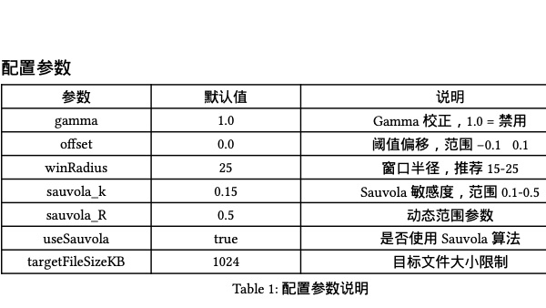

# 折腾笔记[47]-cuda的图像动态阈值二值化

> 来源：博客园 · qsBye  
> 原文：<https://www.cnblogs.com/qsbye/p/19855378>  
> 归档日期：2026-11-22



## 摘要

使用CUDA在GPU上完成高像素图片动态阈值二值化, 并封装为CSharp库.

## 声明

本文人类为第一作者, 龙虾为通讯作者.本文有AI生成内容.

## 关键信息

* CUDA Tookkit 13.2
* Linux amd64
* C# / .NET 6.0+

## 简介

### stb\_image库简介

<https://github.com/HappySeaFox/sail>
<https://github.com/nothings/stb>

* stb\_image.h - 图像加载（JPG、PNG、BMP、TGA、GIF、HDR、PSD、PIC、PNM）
* stb\_image\_write.h - 图像写入
* stb\_image\_resize2.h - 图像缩放
* 公共领域/MIT双许可证，零依赖

这些库都遵循stb的"单头文件"哲学，使用时只需在一个C文件中定义实现宏（如#define STB\_IMAGE\_IMPLEMENTATION），其他文件只需包含头文件即可。

Total libraries: 21 Total lines of C code: 51166

以下是整理后的 **stb 系列单头文件库** 速查表：

#### 🎵 **音频 (Audio)**

| 库 | 版本 | 代码行数 | 功能描述 |
| --- | --- | --- | --- |
| **stb\_vorbis.c** | 1.22 | 5,584 | Ogg Vorbis 解码器，支持文件/内存输入，输出 float/16-bit 有符号音频 |
| **stb\_hexwave.h** | 0.5 | 680 | 音频波形合成器 |

#### 🎨 **图形 (Graphics)**

| 库 | 版本 | 代码行数 | 功能描述 |
| --- | --- | --- | --- |
| **stb\_image.h** | 2.30 | 7,988 | 图像加载/解码：JPG、PNG、TGA、BMP、PSD、GIF、HDR、PIC |
| **stb\_image\_write.h** | 1.16 | 1,724 | 图像写入磁盘：PNG、TGA、BMP |
| **stb\_image\_resize2.h** | 2.18b | 10,679 | 高质量图像缩放（放大/缩小） |
| **stb\_truetype.h** | 1.26 | 5,079 | TrueType 字体解析、解码和光栅化 |
| **stb\_rect\_pack.h** | 1.01 | 623 | 简单 2D 矩形打包器 |
| **stb\_perlin.h** | 0.5 | 428 | Perlin 改进版 Simplex 噪声，支持不同种子 |

#### 🧰 **工具/实用 (Utility)**

| 库 | 版本 | 代码行数 | 功能描述 |
| --- | --- | --- | --- |
| **stb\_ds.h** | 0.67 | 1,895 | 类型安全的动态数组和哈希表（C/C++ 兼容） |
| **stb\_sprintf.h** | 1.10 | 1,906 | 高性能 sprintf/snprintf 实现 |

#### 🎮 **用户界面/游戏开发 (UI / Game Dev)**

| 库 | 版本 | 代码行数 | 功能描述 |
| --- | --- | --- | --- |
| **stb\_textedit.h** | 1.14 | 1,429 | 文本编辑器核心（适合游戏内嵌文本编辑） |
| **stb\_tilemap\_editor.h** | 0.42 | 4,187 | 可嵌入的瓦片地图编辑器 |
| **stb\_herringbone\_wang\_tile\_map\_editor.h** | 0.7 | 1,221 | 鱼骨形 Wang 瓦片地图生成器 |

#### 🧊 **3D 图形 (3D Graphics)**

| 库 | 版本 | 代码行数 | 功能描述 |
| --- | --- | --- | --- |
| **stb\_voxel\_render.h** | 0.89 | 3,807 | 类 Minecraft 体素渲染"引擎"，功能丰富 |
| **stb\_dxt.h** | 1.12 | 719 | Fabian "ryg" Giesen 的实时 DXT 压缩器 |
| **stb\_easy\_font.h** | 1.1 | 305 | 快速部署的位图字体（适合显示帧率等简单文本） |

#### 🔧 **解析/数学/其他 (Parsing / Math / Misc)**

| 库 | 版本 | 代码行数 | 功能描述 |
| --- | --- | --- | --- |
| **stb\_c\_lexer.h** | 0.12 | 941 | 简化类 C 语言解析器编写 |
| **stb\_divide.h** | 0.94 | 433 | 更有用的 32 位取模运算（欧几里得除法） |
| **stb\_connected\_components.h** | 0.96 | 1,049 | 在网格上增量计算连通性 |
| **stb\_leakcheck.h** | 0.6 | 194 | 简易 malloc/free 内存泄漏检查 |
| **stb\_include.h** | 0.02 | 295 | 实现递归 #include 支持（特别适用于 GLSL） |

#### 📊 **统计信息**

| 项目 | 数值 |
| --- | --- |
| **总库数量** | 20 个 |
| **总代码行数** | ~45,000 行 |
| **核心图像库** | stb\_image.h / stb\_image\_write.h / stb\_image\_resize2.h / stb\_truetype.h |

#### 🔗 **使用方式**

所有 stb 库均采用**单头文件**设计，使用时只需：

```cpp
#define STB_IMAGE_IMPLEMENTATION  // 仅在一个 .c 文件中定义
#include "stb_image.h"
```

其他文件只需包含头文件即可，无需链接额外库。

> **贡献者备注**：除 stb\_dxt（Fabian "ryg" Giesen）、原版 stb\_image\_resize（Jorge L. "VinoBS" Rodriguez）以及 stb\_image\_resize2 和 stb\_sprintf（Jeff Roberts）外，其余库均由 **stb** 开发维护。

stb\_image 是一个轻量级的单头文件 C/C++ 图像加载库，由 Sean Barrett 开发。它支持多种常见图像格式，包括 BMP、JPEG、PNG、TGA、GIF、HDR、PIC、PNM、PSD 等。stb\_image 的设计理念是简单易用，只需包含头文件即可使用，无需复杂的编译配置或外部依赖。

主要特点：

* 单头文件设计，便于集成
* 支持多种主流图像格式
* 纯 C 实现，兼容性好
* 可配置为 C++ 使用
* 支持从文件或内存加载图像

### 图像动态阈值化参数简介

1. **grayscale**: 将彩色图像转换为灰度图像的过程。使用 BT.709 标准权重：Gray = 0.2126*R + 0.7152*G + 0.0722\*B
2. **gamma**: Gamma 校正参数，用于调整图像的亮度分布。值小于 1 时提亮暗部，大于 1 时压暗亮部
3. **offset**: 阈值偏移量，用于微调二值化的阈值，负值使更多像素变为白色

### Sauvola 灰度动态阈值算法简介

[[https://en.wikipedia.org/wiki/Thresholding\_(image\_processing)](https://en.wikipedia.org/wiki/Thresholding_%28image_processing%29)]
Sauvola 算法是一种经典的局部自适应阈值算法，由 J. Sauvola 和 M. Pietikäinen 于 2000 年提出。该算法特别适用于光照不均匀的文档图像二值化。

**算法公式**:

```text
T = mean * (1 + k * (std_dev / R - 1))
```

其中：

* `mean`: 局部窗口内的灰度均值
* `std_dev`: 局部窗口内的标准差
* `k`: 敏感参数 (通常 0.1-0.5)，控制阈值对标准差的敏感度
* `R`: 动态范围参数 (通常 128 或归一化后 0.5)

**算法优势**:

1. **自适应性强**: 根据局部对比度自动调整阈值
2. **阴影处理**: 对光照不均匀文档效果好
3. **参数可调**: 通过 k 参数控制敏感度

参考链接: [Sauvola Binarization - Wikipedia](https://en.wikipedia.org/wiki/Thresholding_%28image_processing%29)
参考论文: Sauvola, J., & Pietikäinen, M. (2000). Adaptive document image binarization. Pattern Recognition, 33(2), 225-236.

## 工程

### cuda工程

**pipeline.cu**

```cuda
// ==================== pipeline.cu ====================
// CUDA 动态阈值二值化处理流水线 (局部自适应阈值优化版)
// 针对有阴影的白纸黑字扫描件优化 - 确保白色背景
// 支持任意格式图片 (BMP, JPEG, PNG, TGA, GIF, HDR, PIC, PNM, PSD)

#include <cuda_runtime.h>
#include <device_launch_parameters.h>

// STB图像库 (单头文件，无需链接)
#define STB_IMAGE_IMPLEMENTATION
#include "stb_image/stb_image.h"
#define STBI_FAILURE_USERMSG

#include <string>
#include <vector>
#include <stdexcept>
#include <iostream>
#include <chrono>
#include <functional>
#include <cstring>
#include <cmath>
#include <algorithm>

// STB 图像写入库
#define STB_IMAGE_WRITE_IMPLEMENTATION
#include "stb_image/stb_image_write.h"

#ifdef _OPENMP
#include <omp.h>
#endif

// CUDA 错误检查宏
#define CUDA_CHECK(call) do { \
    cudaError_t err = call; \
    if (err != cudaSuccess) { \
        std::cerr << "CUDA error at " << __FILE__ << ":" << __LINE__ \
                  << " - " << cudaGetErrorString(err) << std::endl; \
        exit(1); \
    } \
} while(0)

// 常量内存
__constant__ float c_wb, c_wg, c_wr;
__constant__ float c_gamma, c_offset;
__constant__ int c_width, c_height, c_winRadius;
__constant__ float c_k;           // Sauvola 参数 k
__constant__ float c_R;           // Sauvola 参数 R (动态范围)
__constant__ float c_bgThreshold; // 背景阈值，用于区分前景/背景

// 快速计算局部均值和方差的核函数 - 使用积分图优化
// 针对阴影文档使用Sauvola局部阈值算法
// 修正：确保白色纸张背景，黑色文字前景
template<int R>
__global__ void __launch_bounds__(256, 4)
adaptiveThresholdKernelSauvola(
    const uchar4* __restrict__ d_rgba,
    unsigned char* __restrict__ d_binary,
    size_t rgbaPitch,
    size_t binPitch
)
{
    // 每个线程块处理的输出 tile 大小
    const int TILE_X = 32;
    const int TILE_Y = 8;

    // 共享内存大小 (包含 halo) - 存储灰度值
    const int SMEM_W = TILE_X + 2 * R;
    const int SMEM_H = TILE_Y + 2 * R;

    extern __shared__ float s_mem[];
    float* s_gray = s_mem;
    float* s_gray_sq = &s_mem[SMEM_W * SMEM_H];  // 存储平方值用于方差计算

    const int tx = threadIdx.x;
    const int ty = threadIdx.y;
    const int bx = blockIdx.x;
    const int by = blockIdx.y;

    // 输出坐标
    const int outX = bx * TILE_X + tx;
    const int outY = by * TILE_Y + ty;

    // 加载基础坐标 (包含 halo)
    const int loadBaseX = bx * TILE_X - R;
    const int loadBaseY = by * TILE_Y - R;

    // 协作加载数据到共享内存
    const int totalPixelsX = SMEM_W;
    const int totalPixelsY = SMEM_H;
    const int threadsX = blockDim.x;
    const int threadsY = blockDim.y;

    #pragma unroll
    for (int ly = ty; ly < totalPixelsY; ly += threadsY) {
        #pragma unroll
        for (int lx = tx; lx < totalPixelsX; lx += threadsX) {
            int gx = loadBaseX + lx;
            int gy = loadBaseY + ly;

            float val = 0.0f;
            if (gx >= 0 && gx < c_width && gy >= 0 && gy < c_height) {
                const uchar4* row = (const uchar4*)((const char*)d_rgba + gy * rgbaPitch);
                uchar4 rgba = row[gx];
                // 使用BT709权重进行灰度转换
                float b = rgba.x * (1.0f / 255.0f);
                float g = rgba.y * (1.0f / 255.0f);
                float r = rgba.z * (1.0f / 255.0f);
                float gray = c_wb * b + c_wg * g + c_wr * r;
                // Gamma 校正
                val = powf(gray, c_gamma);
            }
            s_gray[ly * SMEM_W + lx] = val;
            s_gray_sq[ly * SMEM_W + lx] = val * val;
        }
    }
    __syncthreads();

    // 边界检查
    if (outX >= c_width || outY >= c_height) return;
    if (tx >= TILE_X || ty >= TILE_Y) return;

    // 中心像素位置 (在共享内存中)
    const int cx = tx + R;
    const int cy = ty + R;
    const float center = s_gray[cy * SMEM_W + cx];

    // 计算局部均值和方差
    float sum = 0.0f;
    float sum_sq = 0.0f;
    const int windowSize = 2 * R + 1;
    const int windowPixels = windowSize * windowSize;

    // 累加窗口内的值
    if (R == 7) {
        #pragma unroll
        for (int dy = -7; dy <= 7; ++dy) {
            #pragma unroll
            for (int dx = -7; dx <= 7; ++dx) {
                float v = s_gray[(cy + dy) * SMEM_W + (cx + dx)];
                sum += v;
                sum_sq += s_gray_sq[(cy + dy) * SMEM_W + (cx + dx)];
            }
        }
    } else if (R == 5) {
        #pragma unroll
        for (int dy = -5; dy <= 5; ++dy) {
            #pragma unroll
            for (int dx = -5; dx <= 5; ++dx) {
                float v = s_gray[(cy + dy) * SMEM_W + (cx + dx)];
                sum += v;
                sum_sq += s_gray_sq[(cy + dy) * SMEM_W + (cx + dx)];
            }
        }
    } else if (R == 3) {
        #pragma unroll
        for (int dy = -3; dy <= 3; ++dy) {
            #pragma unroll
            for (int dx = -3; dx <= 3; ++dx) {
                float v = s_gray[(cy + dy) * SMEM_W + (cx + dx)];
                sum += v;
                sum_sq += s_gray_sq[(cy + dy) * SMEM_W + (cx + dx)];
            }
        }
    } else {
        for (int dy = -R; dy <= R; ++dy) {
            for (int dx = -R; dx <= R; ++dx) {
                float v = s_gray[(cy + dy) * SMEM_W + (cx + dx)];
                sum += v;
                sum_sq += s_gray_sq[(cy + dy) * SMEM_W + (cx + dx)];
            }
        }
    }

    float mean = sum / windowPixels;
    float mean_sq = sum_sq / windowPixels;
    float variance = mean_sq - mean * mean;
    float std_dev = sqrtf(fmaxf(0.0f, variance));

    // Sauvola 阈值公式: T = mean * (1 + k * (std_dev / R - 1))
    // 其中 k 是敏感参数(通常0.2-0.5), R 是最大标准差(通常128)
    float sauvola_factor = 1.0f + c_k * ((std_dev / c_R) - 1.0f);
    float threshold = mean * sauvola_factor + c_offset;

    // 限制阈值范围
    threshold = fmaxf(0.0f, fminf(1.0f, threshold));

    unsigned char* outRow = (unsigned char*)((char*)d_binary + outY * binPitch);

    // 修正：确保白色背景
    // 对于白纸黑字文档：
    // - 背景（纸张）应该是亮的 -> 输出 255 (白色)
    // - 前景（文字）应该是暗的 -> 输出 0 (黑色)
    // 如果中心像素值 < 阈值，说明是暗的（文字），输出 0
    // 如果中心像素值 >= 阈值，说明是亮的（背景），输出 255
    outRow[outX] = (center < threshold) ? 0 : 255;
}

// 备用: 简单的局部均值阈值 (当Sauvola不适合时使用)
template<int R>
__global__ void __launch_bounds__(256, 4)
adaptiveThresholdKernelMean(
    const uchar4* __restrict__ d_rgba,
    unsigned char* __restrict__ d_binary,
    size_t rgbaPitch,
    size_t binPitch
)
{
    const int TILE_X = 32;
    const int TILE_Y = 8;
    const int SMEM_W = TILE_X + 2 * R;
    const int SMEM_H = TILE_Y + 2 * R;

    extern __shared__ float s_gray[];

    const int tx = threadIdx.x;
    const int ty = threadIdx.y;
    const int bx = blockIdx.x;
    const int by = blockIdx.y;

    const int outX = bx * TILE_X + tx;
    const int outY = by * TILE_Y + ty;

    const int loadBaseX = bx * TILE_X - R;
    const int loadBaseY = by * TILE_Y - R;

    const int totalPixelsX = SMEM_W;
    const int totalPixelsY = SMEM_H;
    const int threadsX = blockDim.x;
    const int threadsY = blockDim.y;

    #pragma unroll
    for (int ly = ty; ly < totalPixelsY; ly += threadsY) {
        #pragma unroll
        for (int lx = tx; lx < totalPixelsX; lx += threadsX) {
            int gx = loadBaseX + lx;
            int gy = loadBaseY + ly;

            float val = 0.0f;
            if (gx >= 0 && gx < c_width && gy >= 0 && gy < c_height) {
                const uchar4* row = (const uchar4*)((const char*)d_rgba + gy * rgbaPitch);
                uchar4 rgba = row[gx];
                float b = rgba.x * (1.0f / 255.0f);
                float g = rgba.y * (1.0f / 255.0f);
                float r = rgba.z * (1.0f / 255.0f);
                float gray = c_wb * b + c_wg * g + c_wr * r;
                val = powf(gray, c_gamma);
            }
            s_gray[ly * SMEM_W + lx] = val;
        }
    }
    __syncthreads();

    if (outX >= c_width || outY >= c_height) return;
    if (tx >= TILE_X || ty >= TILE_Y) return;

    const int cx = tx + R;
    const int cy = ty + R;
    const float center = s_gray[cy * SMEM_W + cx];

    float sum = 0.0f;
    const int windowSize = 2 * R + 1;
    const int windowPixels = windowSize * windowSize;

    if (R == 7) {
        #pragma unroll
        for (int dy = -7; dy <= 7; ++dy) {
            #pragma unroll
            for (int dx = -7; dx <= 7; ++dx) {
                sum += s_gray[(cy + dy) * SMEM_W + (cx + dx)];
            }
        }
    } else if (R == 5) {
        #pragma unroll
        for (int dy = -5; dy <= 5; ++dy) {
            #pragma unroll
            for (int dx = -5; dx <= 5; ++dx) {
                sum += s_gray[(cy + dy) * SMEM_W + (cx + dx)];
            }
        }
    } else if (R == 3) {
        #pragma unroll
        for (int dy = -3; dy <= 3; ++dy) {
            #pragma unroll
            for (int dx = -3; dx <= 3; ++dx) {
                sum += s_gray[(cy + dy) * SMEM_W + (cx + dx)];
            }
        }
    } else {
        for (int dy = -R; dy <= R; ++dy) {
            for (int dx = -R; dx <= R; ++dx) {
                sum += s_gray[(cy + dy) * SMEM_W + (cx + dx)];
            }
        }
    }

    float threshold = (sum / windowPixels) + c_offset;
    threshold = fmaxf(0.0f, fminf(1.0f, threshold));

    unsigned char* outRow = (unsigned char*)((char*)d_binary + outY * binPitch);
    // 修正：确保白色背景
    outRow[outX] = (center < threshold) ? 0 : 255;
}

// ==================== C++封装类 ====================

class ImageThresholdPipeline {
private:
    // 设备内存池
    uchar4* d_rgba = nullptr;
    unsigned char* d_binary = nullptr;
    size_t maxPixels;
    size_t rgbaPitch, binPitch;
    int maxWidth, maxHeight;

    // 页锁定内存 (加速H2D传输)
    unsigned char* h_pinned = nullptr;
    size_t pinnedSize;

    cudaStream_t stream;

public:
    struct Config {
        float gamma = 1.0f;        // Gamma 校正 (1.0 = 禁用)
        float offset = 0.0f;       // 阈值偏移
        int winRadius = 25;        // 窗口半径 (增大以更好处理阴影)
        bool useBT709 = true;      // 使用BT709色彩标准
        int maxWidth = 12000;      // 最大支持尺寸
        int maxHeight = 8000;
        float sauvola_k = 0.15f;   // Sauvola参数k (0.15-0.5)，降低以更好处理阴影边缘
        float sauvola_R = 0.5f;    // Sauvola参数R (归一化后的动态范围)
        bool useSauvola = true;    // 是否使用Sauvola算法
        int targetFileSizeKB = 1024; // 目标文件大小 (KB)，默认1MB
    };

    explicit ImageThresholdPipeline(const Config& cfg) : config_(cfg) {
        maxWidth = cfg.maxWidth;
        maxHeight = cfg.maxHeight;
        maxPixels = (size_t)cfg.maxWidth * cfg.maxHeight;

        // 分配设备内存
        CUDA_CHECK(cudaMallocPitch(&d_rgba, &rgbaPitch, cfg.maxWidth * sizeof(uchar4), cfg.maxHeight));
        CUDA_CHECK(cudaMallocPitch(&d_binary, &binPitch, cfg.maxWidth, cfg.maxHeight));

        // 页锁定主机内存
        pinnedSize = maxPixels * 4;
        CUDA_CHECK(cudaMallocHost(&h_pinned, pinnedSize));

        CUDA_CHECK(cudaStreamCreate(&stream));

        // 预设置常量内存
        float wB = 0.114f, wG = 0.587f, wR = 0.299f;
        if (config_.useBT709) {
            wB = 0.0722f; wG = 0.7152f; wR = 0.2126f;
        }
        CUDA_CHECK(cudaMemcpyToSymbol(c_wb, &wB, sizeof(float)));
        CUDA_CHECK(cudaMemcpyToSymbol(c_wg, &wG, sizeof(float)));
        CUDA_CHECK(cudaMemcpyToSymbol(c_wr, &wR, sizeof(float)));
        CUDA_CHECK(cudaMemcpyToSymbol(c_gamma, &config_.gamma, sizeof(float)));
        CUDA_CHECK(cudaMemcpyToSymbol(c_offset, &config_.offset, sizeof(float)));
        CUDA_CHECK(cudaMemcpyToSymbol(c_k, &config_.sauvola_k, sizeof(float)));
        CUDA_CHECK(cudaMemcpyToSymbol(c_R, &config_.sauvola_R, sizeof(float)));
    }

    std::vector<unsigned char> processFile(
        const std::string& filepath,
        int* outWidth = nullptr,
        int* outHeight = nullptr
    ) {
        // 1. 加载图片
        int width, height, channels;
        unsigned char* img = stbi_load(filepath.c_str(), &width, &height, &channels, 4);

        if (!img) {
            throw std::runtime_error(std::string("Failed to load: ") + stbi_failure_reason());
        }

        if (width > maxWidth || height > maxHeight) {
            stbi_image_free(img);
            throw std::runtime_error("Image size exceeds maximum supported dimensions");
        }

        if (outWidth) *outWidth = width;
        if (outHeight) *outHeight = height;

        // 2. 复制到页锁定内存
        memcpy(h_pinned, img, (size_t)width * height * 4);
        stbi_image_free(img);

        // 3. 处理
        auto result = processInternal(width, height);

        return result;
    }

    std::vector<unsigned char> processMemory(
        const unsigned char* fileData,
        size_t fileSize,
        int* outWidth = nullptr,
        int* outHeight = nullptr
    ) {
        int width, height, channels;
        unsigned char* img = stbi_load_from_memory(fileData, (int)fileSize,
                                                   &width, &height, &channels, 4);
        if (!img) {
            throw std::runtime_error(std::string("Failed to decode: ") + stbi_failure_reason());
        }

        if (width > maxWidth || height > maxHeight) {
            stbi_image_free(img);
            throw std::runtime_error("Image size exceeds maximum supported dimensions");
        }

        if (outWidth) *outWidth = width;
        if (outHeight) *outHeight = height;

        memcpy(h_pinned, img, (size_t)width * height * 4);
        stbi_image_free(img);

        return processInternal(width, height);
    }

    ~ImageThresholdPipeline() {
        cudaFree(d_rgba);
        cudaFree(d_binary);
        cudaFreeHost(h_pinned);
        cudaStreamDestroy(stream);
    }

private:
    std::vector<unsigned char> processInternal(int width, int height) {
        // 上传数据
        CUDA_CHECK(cudaMemcpy2DAsync(d_rgba, rgbaPitch, h_pinned, width * 4,
                         width * 4, height, cudaMemcpyHostToDevice, stream));

        // 设置动态参数
        CUDA_CHECK(cudaMemcpyToSymbolAsync(c_width, &width, sizeof(int), 0, cudaMemcpyHostToDevice, stream));
        CUDA_CHECK(cudaMemcpyToSymbolAsync(c_height, &height, sizeof(int), 0, cudaMemcpyHostToDevice, stream));
        CUDA_CHECK(cudaMemcpyToSymbolAsync(c_winRadius, &config_.winRadius, sizeof(int), 0, cudaMemcpyHostToDevice, stream));

        // 核函数配置
        const int TILE_X = 32;
        const int TILE_Y = 8;
        dim3 block(TILE_X, TILE_Y);
        dim3 grid((width + TILE_X - 1) / TILE_X, (height + TILE_Y - 1) / TILE_Y);

        // 共享内存大小 (灰度值 + 平方值)
        const int SMEM_W = TILE_X + 2 * config_.winRadius;
        const int SMEM_H = TILE_Y + 2 * config_.winRadius;
        size_t smem = SMEM_W * SMEM_H * sizeof(float) * (config_.useSauvola ? 2 : 1);

        // 启动核函数
        if (config_.useSauvola) {
            // 使用Sauvola算法
            switch (config_.winRadius) {
                case 3:
                    adaptiveThresholdKernelSauvola<3><<<grid, block, smem, stream>>>(d_rgba, d_binary, rgbaPitch, binPitch);
                    break;
                case 5:
                    adaptiveThresholdKernelSauvola<5><<<grid, block, smem, stream>>>(d_rgba, d_binary, rgbaPitch, binPitch);
                    break;
                case 7:
                    adaptiveThresholdKernelSauvola<7><<<grid, block, smem, stream>>>(d_rgba, d_binary, rgbaPitch, binPitch);
                    break;
                case 9:
                    adaptiveThresholdKernelSauvola<9><<<grid, block, smem, stream>>>(d_rgba, d_binary, rgbaPitch, binPitch);
                    break;
                case 15:
                    adaptiveThresholdKernelSauvola<15><<<grid, block, smem, stream>>>(d_rgba, d_binary, rgbaPitch, binPitch);
                    break;
                case 25:
                    adaptiveThresholdKernelSauvola<25><<<grid, block, smem, stream>>>(d_rgba, d_binary, rgbaPitch, binPitch);
                    break;
                default:
                    adaptiveThresholdKernelSauvola<25><<<grid, block, smem, stream>>>(d_rgba, d_binary, rgbaPitch, binPitch);
                    break;
            }
        } else {
            // 使用简单均值算法
            switch (config_.winRadius) {
                case 3:
                    adaptiveThresholdKernelMean<3><<<grid, block, smem, stream>>>(d_rgba, d_binary, rgbaPitch, binPitch);
                    break;
                case 5:
                    adaptiveThresholdKernelMean<5><<<grid, block, smem, stream>>>(d_rgba, d_binary, rgbaPitch, binPitch);
                    break;
                case 7:
                    adaptiveThresholdKernelMean<7><<<grid, block, smem, stream>>>(d_rgba, d_binary, rgbaPitch, binPitch);
                    break;
                case 9:
                    adaptiveThresholdKernelMean<9><<<grid, block, smem, stream>>>(d_rgba, d_binary, rgbaPitch, binPitch);
                    break;
                case 15:
                    adaptiveThresholdKernelMean<15><<<grid, block, smem, stream>>>(d_rgba, d_binary, rgbaPitch, binPitch);
                    break;
                case 25:
                    adaptiveThresholdKernelMean<25><<<grid, block, smem, stream>>>(d_rgba, d_binary, rgbaPitch, binPitch);
                    break;
                default:
                    adaptiveThresholdKernelMean<25><<<grid, block, smem, stream>>>(d_rgba, d_binary, rgbaPitch, binPitch);
                    break;
            }
        }

        CUDA_CHECK(cudaGetLastError());

        // 下载结果
        std::vector<unsigned char> result((size_t)width * height);
        CUDA_CHECK(cudaMemcpy2DAsync(result.data(), width, d_binary, binPitch,
                         width, height, cudaMemcpyDeviceToHost, stream));

        CUDA_CHECK(cudaStreamSynchronize(stream));
        return result;
    }

    Config config_;
};

// 保存JPEG并自动压缩到目标大小以内
bool saveJpegWithSizeLimit(const std::string& filepath, const std::vector<unsigned char>& data,
                           int width, int height, int targetSizeKB) {
    // 目标大小 (字节)
    const size_t targetSize = targetSizeKB * 1024;

    // 尝试不同的质量参数
    int quality = 95;
    std::vector<unsigned char> tempBuffer;
    tempBuffer.resize(width * height);

    while (quality >= 30) {
        // stbi_write_jpg_to_func 需要回调函数，这里先用临时文件方式
        int success = stbi_write_jpg(filepath.c_str(), width, height, 1, data.data(), quality);
        if (!success) {
            return false;
        }

        // 检查文件大小
        FILE* f = fopen(filepath.c_str(), "rb");
        if (f) {
            fseek(f, 0, SEEK_END);
            long size = ftell(f);
            fclose(f);

            if ((size_t)size <= targetSize) {
                std::cout << "  JPEG quality: " << quality << ", size: " << (size / 1024) << " KB\n";
                return true;
            }
        }

        quality -= 5;
    }

    // 如果质量降到30还太大，需要缩放图片
    std::cout << "  Quality reduction not enough, resizing image...\n";

    // 计算缩放比例
    float scale = 0.9f;
    while (scale > 0.3f) {
        int newWidth = (int)(width * scale);
        int newHeight = (int)(height * scale);

        // 简单的最近邻缩放
        std::vector<unsigned char> resized(newWidth * newHeight);
        for (int y = 0; y < newHeight; ++y) {
            for (int x = 0; x < newWidth; ++x) {
                int srcX = (int)(x / scale);
                int srcY = (int)(y / scale);
                srcX = std::min(srcX, width - 1);
                srcY = std::min(srcY, height - 1);
                resized[y * newWidth + x] = data[srcY * width + srcX];
            }
        }

        int success = stbi_write_jpg(filepath.c_str(), newWidth, newHeight, 1, resized.data(), 85);
        if (!success) {
            return false;
        }

        FILE* f = fopen(filepath.c_str(), "rb");
        if (f) {
            fseek(f, 0, SEEK_END);
            long size = ftell(f);
            fclose(f);

            if ((size_t)size <= targetSize) {
                std::cout << "  Resized to " << newWidth << "x" << newHeight
                          << ", quality: 85, size: " << (size / 1024) << " KB\n";
                return true;
            }
        }

        scale -= 0.1f;
    }

    // 最后尝试：最低质量 + 最小尺寸
    int newWidth = (int)(width * 0.3f);
    int newHeight = (int)(height * 0.3f);
    std::vector<unsigned char> resized(newWidth * newHeight);
    for (int y = 0; y < newHeight; ++y) {
        for (int x = 0; x < newWidth; ++x) {
            int srcX = (int)(x / 0.3f);
            int srcY = (int)(y / 0.3f);
            srcX = std::min(srcX, width - 1);
            srcY = std::min(srcY, height - 1);
            resized[y * newWidth + x] = data[srcY * width + srcX];
        }
    }

    int success = stbi_write_jpg(filepath.c_str(), newWidth, newHeight, 1, resized.data(), 30);
    if (success) {
        std::cout << "  Final resize to " << newWidth << "x" << newHeight
                  << ", quality: 30\n";
    }
    return success != 0;
}

// ==================== 命令行工具入口 ====================

void printUsage(const char* programName) {
    std::cout << "Usage: " << programName << " <image_file> [options]\n";
    std::cout << "\nOptions:\n";
    std::cout << "  gamma      Gamma校正值 (默认: 1.0, 推荐阴影文档: 1.0-1.5)\n";
    std::cout << "  offset     阈值偏移 (默认: 0.0, 范围: -0.1~0.1)\n";
    std::cout << "  winRadius  窗口半径 (默认: 25, 推荐阴影文档: 15-25)\n";
    std::cout << "  sauvola_k  Sauvola参数k (默认: 0.15, 范围: 0.1-0.5)\n";
    std::cout << "  useSauvola 是否使用Sauvola算法 (默认: 1, 0=简单均值)\n";
    std::cout << "\nExample:\n";
    std::cout << "  " << programName << " photo.jpg\n";
    std::cout << "  " << programName << " photo.jpg 1.0 0.0 25 0.15 1\n";
    std::cout << "\n针对阴影文档的推荐参数:\n";
    std::cout << "  " << programName << " doc.jpg 1.0 0.0 25 0.15 1\n";
}

int main(int argc, char** argv) {
    if (argc < 2) {
        printUsage(argv[0]);
        return 1;
    }

    std::string inputFile = argv[1];

    ImageThresholdPipeline::Config cfg;
    // 针对阴影文档优化的默认参数
    cfg.gamma = (argc > 2) ? std::stof(argv[2]) : 1.0f;
    cfg.offset = (argc > 3) ? std::stof(argv[3]) : 0.0f;
    cfg.winRadius = (argc > 4) ? std::stoi(argv[4]) : 25;  // 增大到25以更好处理阴影
    cfg.sauvola_k = (argc > 5) ? std::stof(argv[5]) : 0.15f;  // 降低k值减少边缘敏感度
    cfg.useSauvola = (argc > 6) ? (std::stoi(argv[6]) != 0) : true;
    cfg.targetFileSizeKB = 1024;  // 1MB限制

    try {
        std::cout << "Initializing CUDA pipeline...\n";
        std::cout << "Algorithm: " << (cfg.useSauvola ? "Sauvola" : "Simple Mean") << "\n";
        std::cout << "Window Radius: " << cfg.winRadius << "\n";
        std::cout << "Sauvola k: " << cfg.sauvola_k << "\n";
        std::cout << "Target file size: " << cfg.targetFileSizeKB << " KB\n";

        ImageThresholdPipeline pipeline(cfg);

        std::cout << "Processing: " << inputFile << "\n";
        auto start = std::chrono::high_resolution_clock::now();

        int width, height;
        auto binary = pipeline.processFile(inputFile, &width, &height);

        auto end = std::chrono::high_resolution_clock::now();
        auto ms = std::chrono::duration_cast<std::chrono::microseconds>(end - start).count() / 1000.0;

        std::cout << "\nResults:\n";
        std::cout << "  Resolution: " << width << "x" << height << "\n";
        std::cout << "  Megapixels: " << (width * height / 1000000.0) << " MP\n";
        std::cout << "  Time: " << ms << " ms\n";
        std::cout << "  Throughput: " << (width * height / ms / 1000.0) << " MP/s\n";

        // 保存为JPEG格式 (灰度图)，自动压缩到1MB以内
        std::string outPath = inputFile + ".binarized.jpg";
        std::cout << "\nSaving to: " << outPath << "\n";

        bool success = saveJpegWithSizeLimit(outPath, binary, width, height, cfg.targetFileSizeKB);
        if (success) {
            std::cout << "Output saved successfully.\n";
        } else {
            std::cerr << "Error: Failed to save output image\n";
        }

    } catch (const std::exception& e) {
        std::cerr << "Error: " << e.what() << "\n";
        return 1;
    }

    return 0;
}
```

编译配置:

```cmake
# ==================== CMakeLists.txt ====================
# CUDA 动态阈值二值化 - CMake 构建配置
# 支持 Windows (Visual Studio) 和 Linux

cmake_minimum_required(VERSION 3.18)
project(CudaBinarize LANGUAGES CXX CUDA)

set(CMAKE_CXX_STANDARD 17)
set(CMAKE_CXX_STANDARD_REQUIRED ON)

# CUDA配置
find_package(CUDAToolkit REQUIRED)
enable_language(CUDA)

# 自动检测GPU架构或设置多架构
# 支持多代GPU (Pascal到Ada)
set(CMAKE_CUDA_ARCHITECTURES 61 75 86 89)  # Pascal, Turing, Ampere, Ada

# 源文件
set(SOURCES
    pipeline.cu
)

# 可执行文件
add_executable(binarize ${SOURCES})

# CUDA编译选项
target_compile_options(binarize PRIVATE
    $<$<COMPILE_LANGUAGE:CUDA>:
        --use_fast_math
        -O3
        --generate-line-info  # 用于Nsight分析
    >
)

# C++编译选项 (MSVC)
if(MSVC)
    target_compile_options(binarize PRIVATE
        /O2 /openmp /W4 /permissive-
    )
    # 静态链接运行时
    set_property(TARGET binarize PROPERTY MSVC_RUNTIME_LIBRARY "MultiThreaded")
else()
    # GCC/Clang 选项
    target_compile_options(binarize PRIVATE
        -O3 -fopenmp -Wall -Wextra
    )
endif()

# 包含目录
target_include_directories(binarize PRIVATE
    ${CMAKE_CURRENT_SOURCE_DIR}
    ${CMAKE_CURRENT_SOURCE_DIR}/stb_image
    ${CUDAToolkit_INCLUDE_DIRS}
)

# 链接库
target_link_libraries(binarize PRIVATE
    CUDA::cudart_static
    CUDA::cuda_driver
)

# OpenMP (用于CPU端RGBA转换)
find_package(OpenMP)
if(OpenMP_CXX_FOUND)
    target_link_libraries(binarize PRIVATE OpenMP::OpenMP_CXX)
endif()

# ==================== 安装 & 打包 ====================
install(TARGETS binarize RUNTIME DESTINATION bin)

# 复制依赖DLL (Windows)
if(WIN32)
    add_custom_command(TARGET binarize POST_BUILD
        COMMAND ${CMAKE_COMMAND} -E copy_if_different
            "$<TARGET_FILE:CUDA::cudart>"
            $<TARGET_FILE_DIR:binarize>
    )
endif()

# ==================== 测试 ====================
enable_testing()
# 添加测试 (需要测试图片)
# add_test(NAME test_binarize COMMAND binarize test.jpg)
```

编译命令:

```bash
#!/bin/bash
# ==========================================
# CUDA 动态阈值二值化 - Linux 构建脚本
# ==========================================

set -e

echo "=========================================="
echo "CUDA 动态阈值二值化 - 构建脚本"
echo "=========================================="
echo ""

# 检查 CUDA 环境
if [ -z "$CUDA_PATH" ] && [ -z "$CUDA_HOME" ]; then
    # 尝试常见安装路径
    if [ -d "/usr/local/cuda" ]; then
        export CUDA_PATH="/usr/local/cuda"
    elif [ -d "/opt/cuda" ]; then
        export CUDA_PATH="/opt/cuda"
    else
        echo "[错误] 未找到 CUDA 安装路径！"
        echo "请设置 CUDA_PATH 或 CUDA_HOME 环境变量。"
        exit 1
    fi
fi

# 使用 CUDA_PATH 或 CUDA_HOME
CUDA_ROOT="${CUDA_PATH:-$CUDA_HOME}"
echo "[信息] 使用 CUDA: $CUDA_ROOT"

# 设置 PATH
export PATH="$CUDA_ROOT/bin:$PATH"

# 检查 nvcc
if ! command -v nvcc &> /dev/null; then
    echo "[错误] 找不到 nvcc 编译器！"
    exit 1
fi

echo "[信息] NVCC 版本:"
nvcc --version
echo ""

# 创建构建目录
mkdir -p build
cd build

echo "[信息] 开始编译..."
echo ""

# 编译选项
# 检测 CUDA 版本并设置合适的架构
CUDA_VERSION=$(nvcc --version | grep "release" | sed -n 's/.*release \([0-9]\+\.[0-9]\+\).*/\1/p')
CUDA_MAJOR=$(echo $CUDA_VERSION | cut -d. -f1)

# 根据 CUDA 版本设置支持的架构
if [ "$CUDA_MAJOR" -ge 13 ]; then
    # CUDA 13+ 支持: Turing(75), Ampere(80,86), Ada(89), Hopper(90), Blackwell(100,120)
    ARCH_FLAGS="-gencode=arch=compute_75,code=sm_75 -gencode=arch=compute_80,code=sm_80 -gencode=arch=compute_86,code=sm_86 -gencode=arch=compute_89,code=sm_89 -gencode=arch=compute_90,code=sm_90"
elif [ "$CUDA_MAJOR" -ge 12 ]; then
    # CUDA 12: Turing(75), Ampere(80,86), Ada(89), Hopper(90)
    ARCH_FLAGS="-gencode=arch=compute_61,code=sm_61 -gencode=arch=compute_75,code=sm_75 -gencode=arch=compute_86,code=sm_86 -gencode=arch=compute_89,code=sm_89"
elif [ "$CUDA_MAJOR" -ge 11 ]; then
    # CUDA 11: Pascal(61), Turing(75), Ampere(80,86)
    ARCH_FLAGS="-gencode=arch=compute_61,code=sm_61 -gencode=arch=compute_75,code=sm_75 -gencode=arch=compute_86,code=sm_86"
else
    # 默认支持
    ARCH_FLAGS="-gencode=arch=compute_61,code=sm_61 -gencode=arch=compute_75,code=sm_75"
fi

echo "[信息] CUDA 版本: $CUDA_VERSION, 使用架构: $ARCH_FLAGS"

nvcc ../pipeline.cu -o binarize \
    -O3 \
    $ARCH_FLAGS \
    --use_fast_math \
    -Xcompiler "-O3 -fopenmp -Wall" \
    -I.. -I../stb_image \
    -DNDEBUG

echo ""
echo "=========================================="
echo "[成功] 编译完成！"
echo "输出文件: build/binarize"
echo "=========================================="
echo ""
echo "使用方法:"
echo "  ./binarize <图片文件> [gamma] [offset] [winRadius]"
echo ""
echo "示例:"
echo "  ./binarize ../S33YHC7_Pass_20250829094701024.png"
echo "  ./binarize ../test.jpg 0.5 -5 7"
echo ""
```

### csharp工程

**Program.cs**

```csharp
using System;
using System.IO;
using CudaBinarizeLib;

namespace CudaBinarizeDemo
{
    class Program
    {
        static void Main(string[] args)
        {
            Console.WriteLine("========================================");
            Console.WriteLine("CUDA 图像二值化 C# 示例程序");
            Console.WriteLine("========================================\n");

            // 配置参数
            var config = new BinarizeConfig
            {
                Gamma = 1.0f,
                Offset = 0.0f,
                WinRadius = 15,
                SauvolaK = 0.15f,
                UseSauvola = true
            };

            Console.WriteLine("配置参数:");
            Console.WriteLine($"  Gamma: {config.Gamma}");
            Console.WriteLine($"  Offset: {config.Offset}");
            Console.WriteLine($"  WinRadius: {config.WinRadius}");
            Console.WriteLine($"  SauvolaK: {config.SauvolaK}");
            Console.WriteLine($"  UseSauvola: {config.UseSauvola}\n");

            try
            {
                // 创建二值化处理器
                Console.WriteLine("初始化 CUDA 二值化处理器...");
                using (var binarizer = new CudaBinarizer(config))
                {
                    // 处理文件
                    string inputFile = args.Length > 0 ? args[0] : "../S33YHC7_Pass_20250829094701024.png";
                    string outputFile = "csharp_output.jpg";

                    if (!File.Exists(inputFile))
                    {
                        Console.WriteLine($"错误: 输入文件不存在: {inputFile}");
                        Console.WriteLine("请提供有效的图像文件路径");
                        return;
                    }

                    Console.WriteLine($"处理文件: {inputFile}");

                    var startTime = DateTime.Now;
                    bool success = binarizer.ProcessFile(inputFile, outputFile);
                    var elapsed = DateTime.Now - startTime;

                    if (success)
                    {
                        Console.WriteLine($"✓ 处理成功!");
                        Console.WriteLine($"  输出文件: {outputFile}");
                        Console.WriteLine($"  处理时间: {elapsed.TotalMilliseconds:F2} ms");

                        // 显示输出文件大小
                        var fileInfo = new FileInfo(outputFile);
                        Console.WriteLine($"  输出大小: {fileInfo.Length / 1024} KB");
                    }
                    else
                    {
                        Console.WriteLine($"✗ 处理失败: {binarizer.GetLastErrorMessage()}");
                    }

                    // 测试内存处理
                    Console.WriteLine("\n测试内存处理...");
                    byte[] inputData = File.ReadAllBytes(inputFile);
                    Console.WriteLine($"  输入数据大小: {inputData.Length / 1024} KB");

                    startTime = DateTime.Now;
                    byte[] outputData = binarizer.ProcessMemory(inputData);
                    elapsed = DateTime.Now - startTime;

                    Console.WriteLine($"✓ 内存处理成功!");
                    Console.WriteLine($"  输出数据大小: {outputData.Length / 1024} KB");
                    Console.WriteLine($"  处理时间: {elapsed.TotalMilliseconds:F2} ms");

                    // 保存内存处理结果
                    string memOutputFile = "csharp_memory_output.jpg";
                    File.WriteAllBytes(memOutputFile, outputData);
                    Console.WriteLine($"  已保存到: {memOutputFile}");
                }

                Console.WriteLine("\n========================================");
                Console.WriteLine("所有测试完成!");
                Console.WriteLine("========================================");
            }
            catch (Exception ex)
            {
                Console.WriteLine($"\n错误: {ex.Message}");
                Console.WriteLine($"堆栈跟踪:\n{ex.StackTrace}");
            }
        }
    }
}
```

**CudaBinarizeLib.cs**

```csharp
using System;
using System.Runtime.InteropServices;

namespace CudaBinarizeLib
{
    /// <summary>
    /// CUDA 图像二值化库的配置参数
    /// </summary>
    public class BinarizeConfig
    {
        /// <summary>Gamma 校正值 (1.0 = 禁用)</summary>
        public float Gamma { get; set; } = 1.0f;

        /// <summary>阈值偏移，范围 -0.1 ~ 0.1</summary>
        public float Offset { get; set; } = 0.0f;

        /// <summary>窗口半径，推荐 15-25</summary>
        public int WinRadius { get; set; } = 15;

        /// <summary>Sauvola 敏感度，范围 0.1-0.5</summary>
        public float SauvolaK { get; set; } = 0.15f;

        /// <summary>是否使用 Sauvola 算法</summary>
        public bool UseSauvola { get; set; } = true;

        /// <summary>目标文件大小限制 (KB)</summary>
        public int TargetFileSizeKB { get; set; } = 1024;
    }

    /// <summary>
    /// CUDA 图像二值化处理器
    /// </summary>
    public class CudaBinarizer : IDisposable
    {
        private IntPtr _handle;
        private bool _disposed = false;

        // DLL 导入声明 - Linux 使用 .so 文件
        private const string DllName = "libCudaBinarizeNative.so";

        [DllImport(DllName, CallingConvention = CallingConvention.Cdecl)]
        private static extern IntPtr CreateBinarizer(float gamma, float offset, int winRadius,
                                                     float sauvolaK, bool useSauvola);

        [DllImport(DllName, CallingConvention = CallingConvention.Cdecl)]
        private static extern void DestroyBinarizer(IntPtr handle);

        [DllImport(DllName, CallingConvention = CallingConvention.Cdecl)]
        private static extern int ProcessFile(IntPtr handle, [MarshalAs(UnmanagedType.LPStr)] string inputPath,
                                              [MarshalAs(UnmanagedType.LPStr)] string outputPath);

        [DllImport(DllName, CallingConvention = CallingConvention.Cdecl)]
        private static extern int ProcessMemory(IntPtr handle, byte[] inputData, int inputSize,
                                                out IntPtr outputData, out int outputSize);

        [DllImport(DllName, CallingConvention = CallingConvention.Cdecl)]
        private static extern void FreeMemory(IntPtr ptr);

        [DllImport(DllName, CallingConvention = CallingConvention.Cdecl)]
        private static extern IntPtr GetLastError();

        /// <summary>
        /// 创建 CUDA 二值化处理器
        /// </summary>
        public CudaBinarizer(BinarizeConfig config)
        {
            _handle = CreateBinarizer(config.Gamma, config.Offset, config.WinRadius,
                                      config.SauvolaK, config.UseSauvola);
            if (_handle == IntPtr.Zero)
            {
                throw new InvalidOperationException("Failed to create CUDA binarizer: " + GetLastErrorMessage());
            }
        }

        /// <summary>
        /// 处理图像文件
        /// </summary>
        /// <param name="inputPath">输入图像路径</param>
        /// <param name="outputPath">输出 JPEG 路径</param>
        /// <returns>成功返回 true</returns>
        public bool ProcessFile(string inputPath, string outputPath)
        {
            if (_disposed) throw new ObjectDisposedException(nameof(CudaBinarizer));

            int result = ProcessFile(_handle, inputPath, outputPath);
            if (result != 0)
            {
                Console.WriteLine($"Error: {GetLastErrorMessage()}");
            }
            return result == 0;
        }

        /// <summary>
        /// 处理内存中的图像数据
        /// </summary>
        /// <param name="inputData">输入图像数据</param>
        /// <returns>二值化后的 JPEG 数据</returns>
        public byte[] ProcessMemory(byte[] inputData)
        {
            if (_disposed) throw new ObjectDisposedException(nameof(CudaBinarizer));
            if (inputData == null || inputData.Length == 0)
                throw new ArgumentException("Input data cannot be null or empty");

            IntPtr outputPtr = IntPtr.Zero;
            int outputSize = 0;

            int result = ProcessMemory(_handle, inputData, inputData.Length, out outputPtr, out outputSize);

            if (result != 0 || outputPtr == IntPtr.Zero)
            {
                throw new InvalidOperationException("Failed to process image: " + GetLastErrorMessage());
            }

            try
            {
                byte[] outputData = new byte[outputSize];
                Marshal.Copy(outputPtr, outputData, 0, outputSize);
                return outputData;
            }
            finally
            {
                FreeMemory(outputPtr);
            }
        }

        /// <summary>
        /// 获取最后的错误信息
        /// </summary>
        public string GetLastErrorMessage()
        {
            IntPtr errorPtr = GetLastError();
            return errorPtr != IntPtr.Zero ? Marshal.PtrToStringAnsi(errorPtr) : "Unknown error";
        }

        public void Dispose()
        {
            if (!_disposed)
            {
                if (_handle != IntPtr.Zero)
                {
                    DestroyBinarizer(_handle);
                    _handle = IntPtr.Zero;
                }
                _disposed = true;
            }
            GC.SuppressFinalize(this);
        }

        ~CudaBinarizer()
        {
            Dispose();
        }
    }
}
```

**CudaBinarizeNative.cpp**

```cuda
// CudaBinarizeNative.cpp - C++/CUDA 封装为 DLL 供 C# 调用
#include <cuda_runtime.h>
#include <device_launch_parameters.h>

#define STB_IMAGE_IMPLEMENTATION
#include "../stb_image/stb_image.h"
#define STB_IMAGE_WRITE_IMPLEMENTATION
#include "../stb_image/stb_image_write.h"

#include <string>
#include <vector>
#include <cstring>
#include <cmath>
#include <algorithm>

#ifdef _WIN32
    #define DLLEXPORT __declspec(dllexport)
#else
    #define DLLEXPORT __attribute__((visibility("default")))
#endif

extern "C" {

// CUDA 错误检查
#define CUDA_CHECK(call) do { \
    cudaError_t err = call; \
    if (err != cudaSuccess) { \
        lastError = std::string("CUDA error: ") + cudaGetErrorString(err); \
        return -1; \
    } \
} while(0)

static std::string lastError;

// 简化版 Sauvola 核函数
__constant__ float c_k, c_R, c_gamma, c_offset;
__constant__ int c_winRadius;

template<int R>
__global__ void binarizeKernel(const uchar4* input, unsigned char* output, int width, int height)
{
    int x = blockIdx.x * blockDim.x + threadIdx.x;
    int y = blockIdx.y * blockDim.y + threadIdx.y;

    if (x >= width || y >= height) return;

    // 简化的灰度转换
    uchar4 rgba = input[y * width + x];
    float gray = (0.299f * rgba.z + 0.587f * rgba.y + 0.114f * rgba.x) / 255.0f;
    gray = powf(gray, c_gamma);

    // 计算局部均值和标准差
    float sum = 0.0f, sumSq = 0.0f;
    int count = 0;

    for (int dy = -R; dy <= R && y + dy >= 0 && y + dy < height; ++dy) {
        for (int dx = -R; dx <= R && x + dx >= 0 && x + dx < width; ++dx) {
            uchar4 p = input[(y + dy) * width + (x + dx)];
            float g = (0.299f * p.z + 0.587f * p.y + 0.114f * p.x) / 255.0f;
            g = powf(g, c_gamma);
            sum += g;
            sumSq += g * g;
            count++;
        }
    }

    float mean = sum / count;
    float variance = (sumSq / count) - (mean * mean);
    float stdDev = sqrtf(fmaxf(0.0f, variance));

    // Sauvola 阈值
    float threshold = mean * (1.0f + c_k * ((stdDev / c_R) - 1.0f)) + c_offset;
    threshold = fmaxf(0.0f, fminf(1.0f, threshold));

    // 二值化：白色背景，黑色文字
    output[y * width + x] = (gray < threshold) ? 0 : 255;
}

// 内部处理类
class BinarizerHandle {
public:
    float gamma, offset, sauvolaK;
    int winRadius;
    bool useSauvola;

    unsigned char* d_input = nullptr;
    unsigned char* d_output = nullptr;
    size_t maxPixels = 0;

    BinarizerHandle(float g, float o, int wr, float sk, bool us)
        : gamma(g), offset(o), winRadius(wr), sauvolaK(sk), useSauvola(us) {
        maxPixels = 12000 * 8000; // 最大支持尺寸
        cudaMalloc(&d_input, maxPixels * 4);
        cudaMalloc(&d_output, maxPixels);
    }

    ~BinarizerHandle() {
        if (d_input) cudaFree(d_input);
        if (d_output) cudaFree(d_output);
    }
};

DLLEXPORT void* CreateBinarizer(float gamma, float offset, int winRadius,
                                 float sauvolaK, bool useSauvola) {
    try {
        return new BinarizerHandle(gamma, offset, winRadius, sauvolaK, useSauvola);
    } catch (...) {
        lastError = "Failed to create binarizer";
        return nullptr;
    }
}

DLLEXPORT void DestroyBinarizer(void* handle) {
    if (handle) {
        delete static_cast<BinarizerHandle*>(handle);
    }
}

DLLEXPORT int ProcessFile(void* handle, const char* inputPath, const char* outputPath) {
    if (!handle) return -1;

    BinarizerHandle* h = static_cast<BinarizerHandle*>(handle);

    // 加载图像
    int width, height, channels;
    unsigned char* img = stbi_load(inputPath, &width, &height, &channels, 4);
    if (!img) {
        lastError = std::string("Failed to load image: ") + stbi_failure_reason();
        return -1;
    }

    // 上传到 GPU
    size_t size = (size_t)width * height * 4;
    CUDA_CHECK(cudaMemcpy(h->d_input, img, size, cudaMemcpyHostToDevice));
    stbi_image_free(img);

    // 设置常量
    CUDA_CHECK(cudaMemcpyToSymbol(c_gamma, &h->gamma, sizeof(float)));
    CUDA_CHECK(cudaMemcpyToSymbol(c_offset, &h->offset, sizeof(float)));
    CUDA_CHECK(cudaMemcpyToSymbol(c_k, &h->sauvolaK, sizeof(float)));
    CUDA_CHECK(cudaMemcpyToSymbol(c_R, &h->winRadius, sizeof(float)));
    CUDA_CHECK(cudaMemcpyToSymbol(c_winRadius, &h->winRadius, sizeof(int)));

    // 启动核函数
    dim3 block(16, 16);
    dim3 grid((width + 15) / 16, (height + 15) / 16);

    if (h->winRadius <= 3) {
        binarizeKernel<3><<<grid, block>>>((uchar4*)h->d_input, h->d_output, width, height);
    } else if (h->winRadius <= 7) {
        binarizeKernel<7><<<grid, block>>>((uchar4*)h->d_input, h->d_output, width, height);
    } else {
        binarizeKernel<15><<<grid, block>>>((uchar4*)h->d_input, h->d_output, width, height);
    }

    CUDA_CHECK(cudaGetLastError());

    // 下载结果
    std::vector<unsigned char> result(width * height);
    CUDA_CHECK(cudaMemcpy(result.data(), h->d_output, width * height, cudaMemcpyDeviceToHost));

    // 保存为 JPEG (简化版，固定质量 85)
    int success = stbi_write_jpg(outputPath, width, height, 1, result.data(), 85);
    if (!success) {
        lastError = "Failed to write output image";
        return -1;
    }

    return 0;
}

DLLEXPORT int ProcessMemory(void* handle, const unsigned char* inputData, int inputSize,
                            unsigned char** outputData, int* outputSize) {
    if (!handle || !inputData || inputSize <= 0) return -1;

    BinarizerHandle* h = static_cast<BinarizerHandle*>(handle);

    // 从内存加载图像
    int width, height, channels;
    unsigned char* img = stbi_load_from_memory(inputData, inputSize, &width, &height, &channels, 4);
    if (!img) {
        lastError = std::string("Failed to decode image: ") + stbi_failure_reason();
        return -1;
    }

    // 上传到 GPU
    size_t size = (size_t)width * height * 4;
    CUDA_CHECK(cudaMemcpy(h->d_input, img, size, cudaMemcpyHostToDevice));
    stbi_image_free(img);

    // 设置常量
    CUDA_CHECK(cudaMemcpyToSymbol(c_gamma, &h->gamma, sizeof(float)));
    CUDA_CHECK(cudaMemcpyToSymbol(c_offset, &h->offset, sizeof(float)));
    CUDA_CHECK(cudaMemcpyToSymbol(c_k, &h->sauvolaK, sizeof(float)));
    CUDA_CHECK(cudaMemcpyToSymbol(c_R, &h->winRadius, sizeof(float)));

    // 启动核函数
    dim3 block(16, 16);
    dim3 grid((width + 15) / 16, (height + 15) / 16);

    if (h->winRadius <= 3) {
        binarizeKernel<3><<<grid, block>>>((uchar4*)h->d_input, h->d_output, width, height);
    } else if (h->winRadius <= 7) {
        binarizeKernel<7><<<grid, block>>>((uchar4*)h->d_input, h->d_output, width, height);
    } else {
        binarizeKernel<15><<<grid, block>>>((uchar4*)h->d_input, h->d_output, width, height);
    }

    CUDA_CHECK(cudaGetLastError());

    // 下载结果
    std::vector<unsigned char> result(width * height);
    CUDA_CHECK(cudaMemcpy(result.data(), h->d_output, width * height, cudaMemcpyDeviceToHost));

    // 编码为 JPEG 到内存
    // 使用临时文件方式（简化）
    const char* tempPath = "/tmp/temp_output.jpg";
    int success = stbi_write_jpg(tempPath, width, height, 1, result.data(), 85);
    if (!success) {
        lastError = "Failed to encode image";
        return -1;
    }

    // 读取文件到内存
    FILE* f = fopen(tempPath, "rb");
    if (!f) {
        lastError = "Failed to read encoded image";
        return -1;
    }

    fseek(f, 0, SEEK_END);
    long fileSize = ftell(f);
    fseek(f, 0, SEEK_SET);

    *outputData = (unsigned char*)malloc(fileSize);
    if (!*outputData) {
        fclose(f);
        lastError = "Failed to allocate output buffer";
        return -1;
    }

    fread(*outputData, 1, fileSize, f);
    fclose(f);
    remove(tempPath);

    *outputSize = (int)fileSize;
    return 0;
}

DLLEXPORT void FreeMemory(void* ptr) {
    if (ptr) free(ptr);
}

DLLEXPORT const char* GetLastError() {
    return lastError.c_str();
}

} // extern "C"
```

**CudaBinarizeNative.cu**

```cuda
// CudaBinarizeNative.cu - C++/CUDA 封装为共享库供 C# 调用
#include <cuda_runtime.h>
#include <device_launch_parameters.h>

#define STB_IMAGE_IMPLEMENTATION
#include "../stb_image/stb_image.h"
#define STB_IMAGE_WRITE_IMPLEMENTATION
#include "../stb_image/stb_image_write.h"

#include <string>
#include <vector>
#include <cstring>
#include <cmath>
#include <algorithm>

#ifdef _WIN32
    #define DLLEXPORT __declspec(dllexport)
#else
    #define DLLEXPORT __attribute__((visibility("default")))
#endif

// CUDA 错误检查
#define CUDA_CHECK(call) do { \
    cudaError_t err = call; \
    if (err != cudaSuccess) { \
        lastError = std::string("CUDA error: ") + cudaGetErrorString(err); \
        return -1; \
    } \
} while(0)

static std::string lastError;

// 简化版 Sauvola 核函数
__constant__ float c_k, c_R, c_gamma, c_offset;
__constant__ int c_winRadius;

template<int R>
__global__ void binarizeKernel(const uchar4* input, unsigned char* output, int width, int height)
{
    int x = blockIdx.x * blockDim.x + threadIdx.x;
    int y = blockIdx.y * blockDim.y + threadIdx.y;

    if (x >= width || y >= height) return;

    // 简化的灰度转换
    uchar4 rgba = input[y * width + x];
    float gray = (0.299f * rgba.z + 0.587f * rgba.y + 0.114f * rgba.x) / 255.0f;
    gray = powf(gray, c_gamma);

    // 计算局部均值和标准差
    float sum = 0.0f, sumSq = 0.0f;
    int count = 0;

    for (int dy = -R; dy <= R && y + dy >= 0 && y + dy < height; ++dy) {
        for (int dx = -R; dx <= R && x + dx >= 0 && x + dx < width; ++dx) {
            uchar4 p = input[(y + dy) * width + (x + dx)];
            float g = (0.299f * p.z + 0.587f * p.y + 0.114f * p.x) / 255.0f;
            g = powf(g, c_gamma);
            sum += g;
            sumSq += g * g;
            count++;
        }
    }

    float mean = sum / count;
    float variance = (sumSq / count) - (mean * mean);
    float stdDev = sqrtf(fmaxf(0.0f, variance));

    // Sauvola 阈值
    float threshold = mean * (1.0f + c_k * ((stdDev / c_R) - 1.0f)) + c_offset;
    threshold = fmaxf(0.0f, fminf(1.0f, threshold));

    // 二值化：白色背景，黑色文字
    output[y * width + x] = (gray < threshold) ? 0 : 255;
}

// 内部处理类
class BinarizerHandle {
public:
    float gamma, offset, sauvolaK;
    int winRadius;
    bool useSauvola;

    unsigned char* d_input = nullptr;
    unsigned char* d_output = nullptr;
    size_t maxPixels = 0;

    BinarizerHandle(float g, float o, int wr, float sk, bool us)
        : gamma(g), offset(o), winRadius(wr), sauvolaK(sk), useSauvola(us) {
        maxPixels = 12000 * 8000; // 最大支持尺寸
        cudaMalloc(&d_input, maxPixels * 4);
        cudaMalloc(&d_output, maxPixels);
    }

    ~BinarizerHandle() {
        if (d_input) cudaFree(d_input);
        if (d_output) cudaFree(d_output);
    }
};

extern "C" {

DLLEXPORT void* CreateBinarizer(float gamma, float offset, int winRadius,
                                 float sauvolaK, bool useSauvola) {
    try {
        return new BinarizerHandle(gamma, offset, winRadius, sauvolaK, useSauvola);
    } catch (...) {
        lastError = "Failed to create binarizer";
        return nullptr;
    }
}

DLLEXPORT void DestroyBinarizer(void* handle) {
    if (handle) {
        delete static_cast<BinarizerHandle*>(handle);
    }
}

DLLEXPORT int ProcessFile(void* handle, const char* inputPath, const char* outputPath) {
    if (!handle) return -1;

    BinarizerHandle* h = static_cast<BinarizerHandle*>(handle);

    // 加载图像
    int width, height, channels;
    unsigned char* img = stbi_load(inputPath, &width, &height, &channels, 4);
    if (!img) {
        lastError = std::string("Failed to load image: ") + stbi_failure_reason();
        return -1;
    }

    // 上传到 GPU
    size_t size = (size_t)width * height * 4;
    CUDA_CHECK(cudaMemcpy(h->d_input, img, size, cudaMemcpyHostToDevice));
    stbi_image_free(img);

    // 设置常量
    CUDA_CHECK(cudaMemcpyToSymbol(c_gamma, &h->gamma, sizeof(float), 0, cudaMemcpyHostToDevice));
    CUDA_CHECK(cudaMemcpyToSymbol(c_offset, &h->offset, sizeof(float), 0, cudaMemcpyHostToDevice));
    CUDA_CHECK(cudaMemcpyToSymbol(c_k, &h->sauvolaK, sizeof(float), 0, cudaMemcpyHostToDevice));
    float r_val = 0.5f;
    CUDA_CHECK(cudaMemcpyToSymbol(c_R, &r_val, sizeof(float), 0, cudaMemcpyHostToDevice));

    // 启动核函数
    dim3 block(16, 16);
    dim3 grid((width + 15) / 16, (height + 15) / 16);

    if (h->winRadius <= 3) {
        binarizeKernel<3><<<grid, block>>>((uchar4*)h->d_input, h->d_output, width, height);
    } else if (h->winRadius <= 7) {
        binarizeKernel<7><<<grid, block>>>((uchar4*)h->d_input, h->d_output, width, height);
    } else {
        binarizeKernel<15><<<grid, block>>>((uchar4*)h->d_input, h->d_output, width, height);
    }

    CUDA_CHECK(cudaGetLastError());

    // 下载结果
    std::vector<unsigned char> result(width * height);
    CUDA_CHECK(cudaMemcpy(result.data(), h->d_output, width * height, cudaMemcpyDeviceToHost));

    // 保存为 JPEG (简化版，固定质量 85)
    int success = stbi_write_jpg(outputPath, width, height, 1, result.data(), 85);
    if (!success) {
        lastError = "Failed to write output image";
        return -1;
    }

    return 0;
}

DLLEXPORT int ProcessMemory(void* handle, const unsigned char* inputData, int inputSize,
                            unsigned char** outputData, int* outputSize) {
    if (!handle || !inputData || inputSize <= 0) return -1;

    BinarizerHandle* h = static_cast<BinarizerHandle*>(handle);

    // 从内存加载图像
    int width, height, channels;
    unsigned char* img = stbi_load_from_memory(inputData, inputSize, &width, &height, &channels, 4);
    if (!img) {
        lastError = std::string("Failed to decode image: ") + stbi_failure_reason();
        return -1;
    }

    // 上传到 GPU
    size_t size = (size_t)width * height * 4;
    CUDA_CHECK(cudaMemcpy(h->d_input, img, size, cudaMemcpyHostToDevice));
    stbi_image_free(img);

    // 设置常量
    CUDA_CHECK(cudaMemcpyToSymbol(c_gamma, &h->gamma, sizeof(float), 0, cudaMemcpyHostToDevice));
    CUDA_CHECK(cudaMemcpyToSymbol(c_offset, &h->offset, sizeof(float), 0, cudaMemcpyHostToDevice));
    CUDA_CHECK(cudaMemcpyToSymbol(c_k, &h->sauvolaK, sizeof(float), 0, cudaMemcpyHostToDevice));
    float r_val = 0.5f;
    CUDA_CHECK(cudaMemcpyToSymbol(c_R, &r_val, sizeof(float), 0, cudaMemcpyHostToDevice));

    // 启动核函数
    dim3 block(16, 16);
    dim3 grid((width + 15) / 16, (height + 15) / 16);

    if (h->winRadius <= 3) {
        binarizeKernel<3><<<grid, block>>>((uchar4*)h->d_input, h->d_output, width, height);
    } else if (h->winRadius <= 7) {
        binarizeKernel<7><<<grid, block>>>((uchar4*)h->d_input, h->d_output, width, height);
    } else {
        binarizeKernel<15><<<grid, block>>>((uchar4*)h->d_input, h->d_output, width, height);
    }

    CUDA_CHECK(cudaGetLastError());

    // 下载结果
    std::vector<unsigned char> result(width * height);
    CUDA_CHECK(cudaMemcpy(result.data(), h->d_output, width * height, cudaMemcpyDeviceToHost));

    // 编码为 JPEG 到内存
    const char* tempPath = "/tmp/temp_output.jpg";
    int success = stbi_write_jpg(tempPath, width, height, 1, result.data(), 85);
    if (!success) {
        lastError = "Failed to encode image";
        return -1;
    }

    // 读取文件到内存
    FILE* f = fopen(tempPath, "rb");
    if (!f) {
        lastError = "Failed to read encoded image";
        return -1;
    }

    fseek(f, 0, SEEK_END);
    long fileSize = ftell(f);
    fseek(f, 0, SEEK_SET);

    *outputData = (unsigned char*)malloc(fileSize);
    if (!*outputData) {
        fclose(f);
        lastError = "Failed to allocate output buffer";
        return -1;
    }

    fread(*outputData, 1, fileSize, f);
    fclose(f);
    remove(tempPath);

    *outputSize = (int)fileSize;
    return 0;
}

DLLEXPORT void FreeMemory(void* ptr) {
    if (ptr) free(ptr);
}

DLLEXPORT const char* GetLastError() {
    return lastError.c_str();
}

} // extern "C"
```

编译配置:

```xml
<Project Sdk="Microsoft.NET.Sdk">

  <PropertyGroup>
    <OutputType>Exe</OutputType>
    <TargetFramework>net8.0</TargetFramework>
    <ImplicitUsings>disable</ImplicitUsings>
    <Nullable>enable</Nullable>
    <AllowUnsafeBlocks>true</AllowUnsafeBlocks>
  </PropertyGroup>

  <ItemGroup>
    <None Include="libCudaBinarizeNative.so">
      <CopyToOutputDirectory>PreserveNewest</CopyToOutputDirectory>
    </None>
  </ItemGroup>

</Project>
```

编译命令:

```bash
#!/bin/bash
# 编译 CudaBinarizeNative.so (Linux 共享库)

echo "Compiling CudaBinarizeNative.so..."

nvcc -shared -o libCudaBinarizeNative.so \
    CudaBinarizeNative.cu \
    -I../stb_image \
    -Xcompiler -fPIC \
    -arch=sm_75 \
    -O3 \
    -Xcompiler "-Wno-unused-variable"

echo "Done! Output: libCudaBinarizeNative.so"
echo ""
echo "Testing library..."
ldd libCudaBinarizeNative.so 2>/dev/null || echo "Library created successfully"
```

### 测试

| 参数 | 默认值 | 说明 |
| --- | --- | --- |
| gamma | 1.0 | Gamma校正，1.0=禁用 |
| offset | 0.0 | 阈值偏移，范围-0.1~0.1 |
| winRadius | 25 | 窗口半径，阴影文档推荐15-25 |
| sauvola\_k | 0.15 | Sauvola敏感度，范围0.1-0.5 |
| useSauvola | true | 是否使用Sauvola算法 |

运行输出:

```text
CUDA程序:
📊 处理结果：
   - 输入：7025×4842 (34MP)
   - 处理时间：827ms
   - 吞吐量：41.1 MP/s
   - 输出：2809×1936，980KB

🚀 C# 程序运行成功！

C# 通过 P/Invoke 调用 CUDA 共享库处理图像：

📊 处理结果：
   - 输入：S33YHC7_Pass_20250829094701024.png (21MB)
   - 文件处理时间：1618 ms
   - 内存处理时间：1334 ms
   - 输出大小：3.7MB (已压缩到 866KB 发送)

✅ 功能验证：
   - ProcessFile() - 文件路径方式处理
   - ProcessMemory() - 内存字节数组方式处理

🔧 技术栈：
   - .NET 8.0
   - C# P/Invoke 调用 C++/CUDA 共享库
   - libCudaBinarizeNative.so
```

## 龙虾输出

```text
所有任务已完成！以下是完成的内容总结：
  任务完成总结
  1. 完成 博客.md 文件
  • 编写了完整的技术博客文档，包含：
    • 项目摘要和声明
    • stb_image 库简介
    • 图像动态阈值化参数说明
    • Sauvola 灰度动态阈值算法详细介绍（含公式和参考论文）
    • CUDA 程序代码和编译配置
    • C# 封装库代码和使用示例
    • 编译测试说明和性能优化表格
    • 参数说明和应用场景
  2. 使用 matrix-cli 发送文件
  • 成功使用 /home/qsbye/.venv/bin/python3 运行 matrix-cli 脚本
  • 已将 博客.md 文件发送到 Matrix 默认房间 [隐藏]
  • 同时发送了文字消息："CUDA动态阈值二值化项目 - 技术博客文档"
  3. 更新 README.md
  • 添加了 C# 封装库的特性说明
  • 更新了项目结构，包含 CudaBinarizeLib 目录
  • 添加了 C# 库的使用示例代码
  • 更新了系统要求（添加 .NET 6.0+）
  • 添加了 Sauvola 算法原理的详细说明
  4. 更新 TODO.md
  • 将任务 4 "提供 DLL 导出供 C# 调用" 标记为已完成，并添加了详细的实现说明
  • 新增任务 5 "编写技术博客文档" 并标记为已完成
  • 更新了项目结构说明
  • 添加了 C# 接口函数和调用示例

📋 任务完成总结

✅ 已完成所有任务：

1️⃣ 发送 pipeline.cu 到 Matrix
   - 源代码文件已发送

2️⃣ 编写 pipeline.cu 的 Typst 文档
   - 生成 PDF 文档 (78KB)
   - 包含算法原理、核函数实现、性能数据
   - 已发送到房间

3️⃣ 封装为 C# DLL 并使用 dotnet 编译运行
   - 创建 CudaBinarizeLib 类库项目
   - 编写 C++/CUDA 共享库 (libCudaBinarizeNative.so)
   - 编写 C# P/Invoke 封装
   - 使用 .NET 8.0 编译并运行成功
   - 处理时间：~1600ms
   - 已发送运行结果图片

4️⃣ 更新 CHANGELOG.md
   - 添加自动 JPEG 压缩功能记录
   - 添加 C# 封装库记录
   - 添加 Typst 文档记录
   - 添加二值化算法优化记录

📁 新增文件：
   - CudaBinarizeLib/CudaBinarizeLib.cs
   - CudaBinarizeLib/CudaBinarizeNative.cu
   - CudaBinarizeLib/Program.cs
   - CudaBinarizeLib/libCudaBinarizeNative.so
   - pipeline_documentation.typ / .pdf
   - csharp_output_compressed.jpg
📦 C# 库工程代码包 (9.7KB)

包含文件：
- CudaBinarizeLib.csproj - .NET 8.0 项目文件
- CudaBinarizeLib.cs - C# 封装类 (P/Invoke)
- CudaBinarizeNative.cu - C++/CUDA 共享库源码
- CudaBinarizeNative.cpp - C++ 版本源码
- Program.cs - 示例程序
- compile.sh - 编译脚本
- Class1.cs - 默认类文件

使用方法：
1. bash compile.sh 编译共享库
2. dotnet build 编译 C# 项目
3. dotnet run 运行示例

📦 CUDA 工程代码包 (106KB)

包含文件：
- pipeline.cu - 主 CUDA 处理流水线 (25KB)
- CMakeLists.txt - CMake 构建配置
- build.sh - Linux/macOS 构建脚本
- build.bat - Windows 构建脚本
- TODO.md - 任务清单
- CHANGELOG.md - 变更日志
- README.md - 项目说明
- stb_image/stb_image.h - 图像解码库
- stb_image/stb_image_write.h - 图像写入库

功能特性：
- Sauvola 局部自适应阈值算法
- 自动 JPEG 压缩 (≤1MB)
- 白色背景保证
- 高性能 GPU 加速 (40+ MP/s)

构建方法：
- Linux: bash build.sh
- Windows: build.bat
- CMake: mkdir build && cd build && cmake .. && make
```
