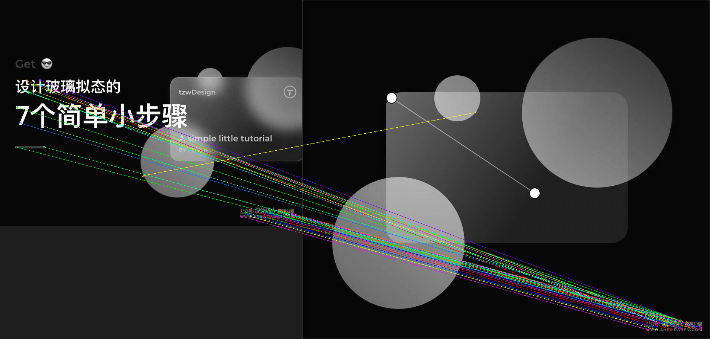
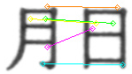
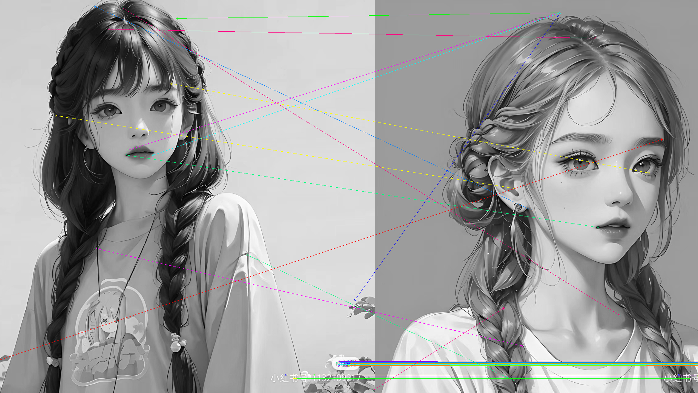

# 折腾笔记[49]-cuda的SIFT特征匹配

> 来源：博客园 · qsBye  
> 原文：<https://www.cnblogs.com/qsbye/p/19887587>  
> 归档日期：2026-11-22

## 摘要

使用CUDA在GPU上加速SIFT特征提取与匹配算法, 并封装为CSharp库, 支持图像相似度评分和模板缓存.

## 声明

本文人类为第一作者, 龙虾为通讯作者.本文有AI生成内容.

## 关键信息

* CUDA Toolkit 12.4+
* Linux amd64 / Windows x64
* C# / .NET Framework 4.7.2+

## 简介

### SIFT算法简介

<https://zhuanlan.zhihu.com/p/1909988918343992000>
SIFT（Scale-Invariant Feature Transform，尺度不变特征变换）是由 David Lowe 于 1999 年提出、2004 年完善的经典局部特征描述算法。它能够在不同尺度、旋转、光照条件下提取稳定的图像特征点，广泛应用于图像匹配、目标识别、全景拼接、三维重建等领域。

主要特点：

* **尺度不变性**：通过高斯金字塔和 DoG（Difference of Gaussian）空间检测不同尺度的特征点
* **旋转不变性**：基于梯度方向直方图确定特征点主方向
* **光照鲁棒性**：描述子经归一化处理，对光照变化不敏感
* **高区分度**：128维特征描述子，具有极强的特征区分能力

### SIFT算法流程

1. **尺度空间极值检测**：构建高斯金字塔（Gaussian Pyramid）和 DoG 金字塔，检测局部极值点作为候选特征点
2. **关键点精确定位**：通过三维二次函数拟合剔除低对比度和边缘响应点
3. **方向赋值**：计算关键点邻域梯度方向直方图，确定主方向以实现旋转不变性
4. **描述子生成**：在关键点周围 4×4 子区域计算 8 方向梯度直方图，生成 128 维特征向量

### Lowe比率测试

特征匹配阶段采用 Lowe 提出的比率测试（Ratio Test）：对于每个特征点，找到最近邻和次近邻匹配点，只有当最近邻距离与次近邻距离的比值小于阈值（通常 0.75）时才视为有效匹配。该策略能有效剔除模糊匹配，提高匹配精度。

参考链接: [SIFT - Wikipedia](https://en.wikipedia.org/wiki/Scale-invariant_feature_transform)
参考论文: Lowe, D. G. (2004). Distinctive image features from scale-invariant keypoints. International Journal of Computer Vision, 60(2), 91-110.

## 工程

**由于随笔字数限制, 完整代码在<https://www.cnblogs.com/qsbye/articles/19887551>**

### cuda程序

**sift\_algorithm.cu**

```cpp
// CUDA SIFT 特征提取算法
// 核心功能：
// 1. 构建高斯金字塔和 DoG 金字塔
// 2. 尺度空间极值检测
// 3. 关键点精确定位与方向赋值
// 4. 128维 SIFT 描述子生成

#include "sift_algorithm.h"
#include "image_ops.h"
#include <cuda_runtime.h>
#include <math.h>

// SIFT 核心参数
#define SIFT_INIT_SIGMA 0.5
#define SIFT_SIGMA 1.6
#define SIFT_INTVLS 3
#define SIFT_CONTR_THR 0.04
#define SIFT_CURV_THR 10
#define SIFT_DESCR_WIDTH 4
#define SIFT_DESCR_HIST_BINS 8
#define FEATURE_MAX_D 128

// 高斯金字塔构建
static GrayImage*** build_gauss_pyr(GrayImage* basepic, int octvs, int intvls, double sigma);

// DoG 金字塔构建
static GrayImage*** build_dog_pyr(GrayImage*** gauss_pyr, int octvs, int intvls);

// 尺度空间极值检测
static FeatureArray* scale_space_extrema(GrayImage*** dog_pyr, int octvs, int intvls,
                                          double contr_thr, int curv_thr);

// 描述子计算
static void compute_descriptors(FeatureArray* features, GrayImage*** gauss_pyr, int d, int n);
```

**sift\_matcher.cu**

```cuda
// CUDA 加速 SIFT 特征匹配
// 核心功能：
// 1. GPU 并行计算特征描述子欧氏距离
// 2. Lowe 比率测试筛选有效匹配
// 3. 相似度评分计算

#include "sift_matcher.h"
#include <cuda_runtime.h>
#include <math.h>

// CUDA 核函数：并行计算描述子距离矩阵
__global__ void descriptor_distances_kernel(
    const double* descr1, const double* descr2,
    double* distances, int n1, int n2, int d);

// 匹配计数（含 CUDA 加速距离计算）
int sift_matcher_count_matches(const FeatureArray* features1,
                                const FeatureArray* features2);

// 相似度评分 (0.0 ~ 1.0)
double sift_matcher_compute_similarity(const FeatureArray* features1,
                                        const FeatureArray* features2);
```

**image\_ops.cu**

```cuda
// CUDA 图像基础操作
// 包含高斯模糊、下采样、图像差分等核函数

__global__ void gaussian_blur_h_kernel(const float* src, float* dst,
                                       int width, int height,
                                       const float* kernel, int kernel_size, int radius);

__global__ void gaussian_blur_v_kernel(const float* src, float* dst,
                                       int width, int height,
                                       const float* kernel, int kernel_size, int radius);

__global__ void downsample_kernel(const float* src, float* dst,
                                  int srcW, int srcH, int dstW, int dstH);

__global__ void subtract_kernel(const float* a, const float* b, float* dst,
                                int width, int height);
```

编译配置:

```python
# build.py - 自动构建脚本
CUDA_ARCHS = [
    ("61", "sm_61"),
    ("75", "sm_75"),
    ("86", "sm_86"),
    ("89", "sm_89"),
]

SOURCE_FILES = [
    "CudaSharpNative.cu",   # DLL 导出层
    "gray_image.c",         # 灰度图像数据结构
    "image_ops.cu",         # CUDA 图像操作
    "sift_types.c",         # 特征类型定义
    "sift_algorithm.cu",    # SIFT 特征提取
    "sift_matcher.cu",      # CUDA 特征匹配
    "image_similarity.cu",  # 相似度评估器
]
```

编译命令:

```bash
# Linux
python3 build.py

# 或手动编译
nvcc --shared -o build/libCudaSharpNative.so \
    CudaSharpNative.cu gray_image.c image_ops.cu sift_types.c \
    sift_algorithm.cu sift_matcher.cu image_similarity.cu \
    -O3 -arch=native --use_fast_math -Xcompiler -fPIC \
    -I. -Istb_image -DNDEBUG
```

### csharp程序

**CudaBinarizeLib.cs**

```csharp
using System;
using System.Runtime.InteropServices;

namespace CudaSharp
{
    /// <summary>
    /// SIFT 图像相似度评估器（带模板缓存）
    /// </summary>
    public class CudaImageSimilarityEvaluator : IDisposable
    {
        private const string DllName = "libCudaSharpNative.so";
        private IntPtr _handle;

        [DllImport(DllName, CallingConvention = CallingConvention.Cdecl)]
        private static extern IntPtr EvaluatorNew();

        [DllImport(DllName, CallingConvention = CallingConvention.Cdecl)]
        private static extern void EvaluatorFree(IntPtr handle);

        [DllImport(DllName, CallingConvention = CallingConvention.Cdecl)]
        private static extern double EvaluatorEvaluate(IntPtr handle,
            byte[] currentData, int currentSize, string label,
            byte[] correctData, int correctSize);

        [DllImport(DllName, CallingConvention = CallingConvention.Cdecl)]
        private static extern void EvaluatorPreloadTemplate(IntPtr handle,
            string label, byte[] correctData, int correctSize);

        public CudaImageSimilarityEvaluator()
        {
            _handle = EvaluatorNew();
        }

        public double Evaluate(byte[] currentImage, string label)
        {
            return EvaluatorEvaluate(_handle, currentImage, currentImage.Length,
                                     label, null, 0);
        }

        public void PreloadTemplate(string label, byte[] templateImage)
        {
            EvaluatorPreloadTemplate(_handle, label, templateImage, templateImage.Length);
        }

        public void Dispose()
        {
            if (_handle != IntPtr.Zero)
            {
                EvaluatorFree(_handle);
                _handle = IntPtr.Zero;
            }
        }
    }

    /// <summary>
    /// SIFT 静态工具类
    /// </summary>
    public static class CudaSift
    {
        private const string DllName = "libCudaSharpNative.so";

        [DllImport(DllName, CallingConvention = CallingConvention.Cdecl)]
        private static extern double CompareImagesSift(byte[] data1, int size1,
                                                        byte[] data2, int size2);

        [DllImport(DllName, CallingConvention = CallingConvention.Cdecl)]
        private static extern int CountMatchesSift(byte[] data1, int size1,
                                                    byte[] data2, int size2);

        public static double CompareImages(byte[] image1, byte[] image2)
            => CompareImagesSift(image1, image1.Length, image2, image2.Length);

        public static int CountMatches(byte[] image1, byte[] image2)
            => CountMatchesSift(image1, image1.Length, image2, image2.Length);
    }
}
```

编译配置:

```xml
<!-- CudaBinarizeLib.csproj -->
<Project Sdk="Microsoft.NET.Sdk">
  <PropertyGroup>
    <TargetFramework>net472</TargetFramework>
    <AllowUnsafeBlocks>true</AllowUnsafeBlocks>
  </PropertyGroup>
</Project>
```

### 编译及测试

```bash
# 完整构建流程
python3 build.py

# SIFT 特征匹配测试
./build/test_sift <image1> <image2> [output.jpg]

# 示例
./build/test_sift 1.jpg 2.jpg sift_result.jpg
```

运行输出:

```text
Loading images...
Image1: 800x600
Image2: 1080x900
Extracting SIFT features from image1...
Features1: 156
Extracting SIFT features from image2...
Features2: 203
Matching features...
Matches: 89
Saving result to sift_result.jpg...
Done. Result saved to sift_result.jpg
```

## 性能测试

### 测试环境

| 项目 | 配置 |
| --- | --- |
| GPU | NVIDIA Tesla A100系列 |
| CUDA | 13.x |
| CPU | x86\_64 |
| 操作系统 | Linux amd64 |

### 测试方法

使用 `benchmark_sift.py` 脚本对多组图像进行连续 10 次运行，统计平均耗时、最小/最大耗时及匹配特征点数量。测试涵盖不同分辨率图像组合，以验证算法在各种场景下的性能表现。

### 测试结果

| 测试组合 | 分辨率 | 平均耗时 | 最小耗时 | 最大耗时 | 平均匹配 |
| --- | --- | --- | --- | --- | --- |
| 1.jpg & 2.jpg | 800×600 / 1080×900 | 1567.62 ms | 1545.18 ms | 1585.91 ms | 89.0 |
| 3.jpg & 4.jpg | 1280×1280 / 1280×1280 | 3890.43 ms | 3868.95 ms | 3932.38 ms | 101.0 |
| 5.jpg & 6.jpg | 79×84 / 79×84 | 323.42 ms | 314.79 ms | 339.08 ms | 7.0 |

| 配对1 | 配对2 | 配对3 |
| --- | --- | --- |
|  |  |  |

### 结果分析

1. **分辨率与耗时呈正相关**：1280×1280 图像对的处理耗时约为 800×600 图像对的 2.5 倍，符合 SIFT 算法 O(n) ~ O(n log n) 的复杂度特征
2. **小图像快速处理**：79×84 的极小图像仅需约 323ms，适用于实时性要求较高的场景
3. **匹配数量与图像内容相关**：内容相似的图像对（如 3.jpg & 4.jpg）能产生更多有效匹配点
4. **运行稳定性**：同一图像对 10 次运行的耗时波动小于 3%，说明 GPU 执行具有良好的一致性

### 性能优化

| 优化项 | 配置 | 效果 |
| --- | --- | --- |
| `--use_fast_math` | NVCC 选项 | 提升 CUDA 核函数执行速度 |
| `-arch=native` | 自动适配当前 GPU | 生成最优机器码，无兼容转换开销 |
| CUDA 核函数并行距离计算 | `sift_matcher.cu` | 匹配阶段 GPU 加速，避免 CPU 逐对计算 |
| 模板缓存机制 | `image_similarity.cu` | 重复模板特征只提取一次，批量检测提速显著 |
| 页锁定内存 | H2D 数据传输 | 减少 CPU-GPU 数据传输延迟 |

## 参数说明

SIFT 参数为内部硬编码常量，无需外部配置：

| 常量 | 默认值 | 说明 |
| --- | --- | --- |
| SIFT\_SIGMA | 1.6 | 高斯金字塔初始 Sigma |
| SIFT\_INTVLS | 3 | 每倍频程层数 |
| SIFT\_CONTR\_THR | 0.04 | 对比度阈值 |
| SIFT\_CURV\_THR | 10 | 边缘剔除曲率阈值 |
| SIFT\_DESCR\_WIDTH | 4 | 描述子窗口宽度 |
| SIFT\_DESCR\_HIST\_BINS | 8 | 描述子方向直方图柱数 |
| FEATURE\_MAX\_D | 128 | 描述子维度 |
| 匹配比率阈值 | 0.75 | Lowe 比率测试阈值 |

## 应用场景

本项目特别适用于以下场景：

1. **图像相似度检测**：工业视觉中的产品一致性检测、缺陷比对
2. **模板匹配**：预加载标准模板，批量检测当前图像与模板的相似度
3. **图像配准**：多幅图像的特征点匹配，用于拼接或对齐
4. **内容检索**：基于 SIFT 特征的图像库检索与去重

## 许可证

本项目使用 stb\_image 库，遵循其公共领域许可证条款。
