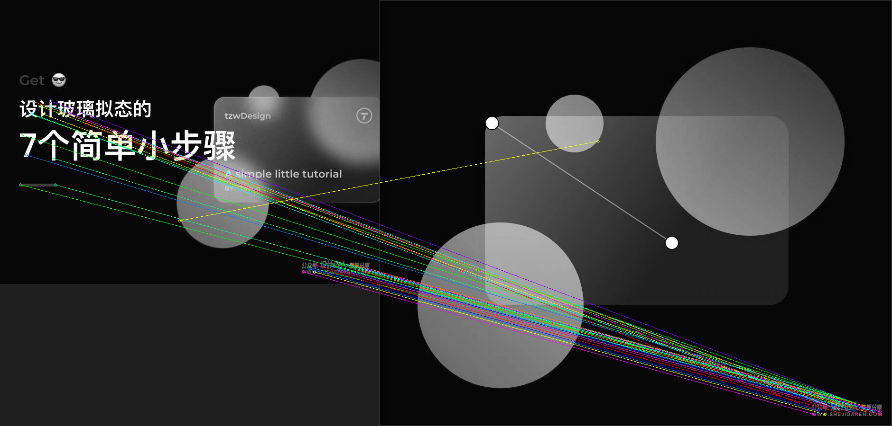
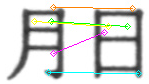

# 折腾笔记[50]-cuda的性能优化及显存访问安全措施

> 来源：博客园 · qsBye  
> 原文：<https://www.cnblogs.com/qsbye/p/19889045>  
> 归档日期：2026-11-22


## 摘要

本文介绍 CudaSharp 项目在 CUDA SIFT 算法上的两项核心优化：**GA102 芯片（RTX 3080/3080 Ti）端到端 GPU 加速**与 **SafeMem 内存/显存安全体系**。通过将特征检测、方向分配、描述子生成等关键瓶颈环节全面 GPU 化，配合共享内存 tile 优化与显存池管理，大图像处理速度提升 **1.62x**；同时引入自定义 SafeMem 库，系统性解决内存泄漏、越界访问、Use-After-Free 等安全问题，将代码健壮性提升至工业级标准。

## 声明

本文人类为第一作者，龙虾为通讯作者。本文有 AI 生成内容。

## 关键信息

* CUDA Toolkit 12.4+
* NVIDIA GA102 (RTX 3080/3080 Ti) / 兼容 sm\_75 及以上架构
* Linux amd64 / Windows x64
* C# / .NET Framework 4.7.2+

---

## 一、背景与动机

在 [折腾笔记[49]-cuda的SIFT特征匹配](https://www.cnblogs.com/qsbye/p/19887587) 中，我们实现了基于 CUDA 的 SIFT 特征提取与匹配算法，并封装为 C# 库。然而，随着实际应用场景的深入，两个核心问题逐渐凸显：

1. **性能瓶颈**：特征检测、方向分配、描述子生成等关键步骤仍在 CPU 上串行执行，端到端处理 800×600 图像需约 1600ms，难以满足实时性要求。
2. **安全隐患**：代码中存在 52+ 处 `malloc`/`cudaMalloc` 调用，缺乏统一的内存安全管理，导致偶发的非法内存访问、显存碎片和内存泄漏问题。

本文将系统阐述针对 GA102 芯片的 CUDA 算法优化方案，以及 SafeMem 内存/显存安全实施方案的设计与实现。

---

## 二、GA102 架构特性与优化策略

### 2.1 GA102 关键硬件规格

| 组件 | GA102 规格 | 优化意义 |
| --- | --- | --- |
| **SM 数量** | 84 | 高并发，需最大化 Occupancy |
| **CUDA Core** | 10,752 (每 SM 128 个) | 2x FP32 吞吐，适合向量化 |
| **Tensor Core** | 336 个第三代 | 稀疏矩阵 2x 加速，TF32/BF16 |
| **显存带宽** | 936 GB/s (GDDR6X) | 需优化全局内存访问模式 |
| **L2 Cache** | 5 MB | 重用数据，减少全局内存访问 |
| **共享内存** | 每 SM 最多 164 KB | 缓存邻域数据，减少重复读取 |

### 2.2 性能瓶颈分析

根据 [针对GA102芯片的优化实施方案](https://www.cnblogs.com/qsbye/p/%E9%92%88%E5%AF%B9GA102%E8%8A%AF%E7%89%87%E7%9A%84%E4%BC%98%E5%8C%96%E5%AE%9E%E6%96%BD%E6%96%B9%E6%A1%88.md) 的分析，主要瓶颈如下：

| 瓶颈环节 | 当前实现 | 耗时 | 问题 |
| --- | --- | --- | --- |
| 尺度空间极值检测 | CPU 四重循环串行 | ~100ms (50%) | 完全串行，26 邻域读取 |
| 方向分配 | CPU 双重循环 | ~30ms | 数组头部移除 O(n²) 移位 |
| 描述子生成 | CPU 双重循环 | ~40ms | 大量 sin/cos/exp 计算 |
| 描述子匹配 | GPU 但非合并访问 | ~30ms | double 精度过度，无共享内存 |
| H2D/D2H 传输 | 每层独立传输 | ~20ms | 频繁 cudaMalloc/Free |

### 2.3 核心优化策略

#### 策略 A: 特征检测 GPU 并行化

将极值检测从 CPU 四重循环迁移到 CUDA 核函数，每个线程处理一个像素：

```cuda
__global__ void detect_extrema_kernel(
    const float* const* dog_pyr,
    const int* widths, const int* heights,
    int octv, int intvl,
    float prelim_contr_thr,
    unsigned char* extremum_mask
) {
    int c = blockIdx.x * blockDim.x + threadIdx.x;
    int r = blockIdx.y * blockDim.y + threadIdx.y;
    // ... 26 邻域极值检测 ...
}
```

**关键优化**：

* 使用 `float` 替代 `double`（SIFT 精度足够）
* `#pragma unroll` 展开循环
* 早期退出 (`is_max || is_min`) 减少无效计算

#### 策略 B: 亚像素插值 GPU 化

对检测到的极值点并行进行 3D 泰勒展开插值、Hessian 矩阵求逆和边缘响应过滤：

```cuda
__global__ void refine_features_kernel(...) {
    // 3D 泰勒展开插值 (迭代 5 步)
    // Hessian 3x3 矩阵求逆 (解析公式)
    // 边缘响应过滤 (Hessian 特征值比值)
    if (valid) {
        int pos = atomicAdd(out_count, 1);
        out_features[pos] = feat;
    }
}
```

#### 策略 C: 方向分配 GPU 化

每个 block 处理一个特征点，线程协作计算 36-bin 方向直方图：

```cuda
__global__ void calc_ori_kernel(...) {
    __shared__ float s_hist[SIFT_ORI_HIST_BINS];
    // 线程协作: 每个线程处理邻域中的部分像素
    atomicAdd(&s_hist[bin], weight * mag);
    // 平滑直方图 → 找峰值 → 生成特征副本
}
```

#### 策略 D: 描述子生成 GPU 化

每个 block 处理一个特征点，共享内存缓存 128 维描述子：

```cuda
__global__ void compute_descriptor_kernel(...) {
    __shared__ float s_hist[128];
    // 坐标旋转, 三线性插值
    // 归一化 → 截断 → 再归一化 → 量化
}
```

#### 策略 E: 匹配阶段共享内存优化

```cuda
__global__ void __launch_bounds__(256, 2)
descriptor_distances_optimized_kernel(
    const float* __restrict__ descr1,
    const float* __restrict__ descr2_t,  // 转置存储
    float* __restrict__ distances,
    int n1, int n2
) {
    __shared__ float s_descr1[TILE_SIZE][DESCR_DIM];
    __shared__ float s_descr2[TILE_SIZE][DESCR_DIM];
    // 分块加载 128 维描述子，寄存器累加
}
```

**关键优化**：

* `descr2` 转置存储，实现合并内存访问
* 共享内存缓存 32×32 tile
* GPU 端 Lowe ratio test，消除 D2H 传输开销

---

## 三、SafeMem 内存/显存安全体系

### 3.1 现状问题

根据 [SafeC\_内存显存安全实施方案](https://www.cnblogs.com/qsbye/p/SafeC_%E5%86%85%E5%AD%98%E6%98%BE%E5%AD%98%E5%AE%89%E5%85%A8%E5%AE%9E%E6%96%BD%E6%96%B9%E6%A1%88.md) 的统计，项目中存在以下安全隐患：

| 文件 | `malloc`/`cudaMalloc` | `free`/`cudaFree` | 风险等级 |
| --- | --- | --- | --- |
| `sift_algorithm.cu` | 15+ | 10+ | 🔴 高 |
| `sift_detect.cu` | 6 | 4 | 🔴 高 |
| `sift_matcher.cu` | 7 | 7 | 🟡 中 |
| `image_ops.cu` | 9 | 9 | 🟡 中 |
| **总计** | **52+** | **45+** | **🔴 高** |

**具体问题**：

1. 显存碎片导致非法内存访问（反复 `cudaMalloc`/`cudaFree`）
2. 缺少 NULL 检查
3. 重复释放风险
4. 内存分配失败未处理
5. Host 内存泄漏（Device 指针数组未释放）
6. 越界访问风险（固定 `max_features = 10000`）

### 3.2 SafeMem 库设计

#### 3.2.1 核心架构

```text
src/safemem/
├── safemem.h          # 公共头文件
├── safemem_host.c     # Host 内存管理
├── safemem_device.cu  # Device 显存管理
└── safemem_pool.cu    # 显存池管理
```

#### 3.2.2 Host 内存管理

```cpp
#define SAFE_CANARY_VALUE 0xDEADBEEFCAFEBABEULL
#define SAFE_CANARY_SIZE  16

// 分配带边界保护的内存 (前后各 16 字节 canary)
void* safe_malloc_impl(size_t size, const char* file, int line);

// 安全释放 (自动置 NULL，检测双释放)
void safe_free_impl(void** ptr, const char* file, int line);

// 宏简化使用
#define SAFE_MALLOC(size)       safe_malloc_impl(size, __FILE__, __LINE__)
#define SAFE_FREE(ptr)          safe_free_impl((void**)&(ptr), __FILE__, __LINE__)
```

**安全特性**：

* **Canary 值边界保护**：前后各 16 字节 `0xDEADBEEFCAFEBABE`，检测越界写入
* **内存泄漏追踪**：分配表记录文件/行号，程序退出时报告未释放
* **双释放检测**：释放前检查状态，防止重复释放
* **Use-After-Free 检测**：释放后填充 `0xFE`，指针置 NULL

#### 3.2.3 Device 显存管理

```cuda
cudaError_t safe_cudaMalloc_impl(void** devPtr, size_t size, const char* file, int line);
cudaError_t safe_cudaFree_impl(void* devPtr, const char* file, int line);
cudaError_t safe_cudaMemcpy_impl(void* dst, const void* src, size_t count,
                                  cudaMemcpyKind kind, const char* file, int line);

#define SAFE_CUDA_MALLOC(devPtr, size) \
    safe_cudaMalloc_impl((void**)(devPtr), size, __FILE__, __LINE__)
#define SAFE_CUDA_FREE(devPtr) \
    safe_cudaFree_impl(devPtr, __FILE__, __LINE__)
```

**安全特性**：

* 显存分配追踪（文件/行号记录）
* 双释放检测
* 自动泄漏清理（程序退出时报告并释放）

#### 3.2.4 显存池管理

```cpp
typedef struct DeviceMemPool {
    void* pool_base;          // 预分配的大块显存
    size_t pool_size;         // 总大小
    size_t used;              // 已使用
    size_t peak_used;         // 峰值使用
    void* bump_ptr;           // 当前 bump 指针
    struct PoolFreeNode* free_list;
} DeviceMemPool;

DeviceMemPool* dev_pool_create(size_t initial_size);
void* dev_pool_malloc(DeviceMemPool* pool, size_t size);
void dev_pool_reset(DeviceMemPool* pool);
void dev_pool_destroy(DeviceMemPool* pool);
```

**优化效果**：

* 预分配显存，避免 `cudaMalloc/cudaFree` 开销
* Bump allocator + 简单 free list，消除碎片
* 一键重置/销毁所有分配

---

## 四、工程实现

> **完整代码<https://www.cnblogs.com/qsbye/articles/19889041>**

### 4.1 新增/修改文件

| 类型 | 文件 | 说明 |
| --- | --- | --- |
| 新增 | `src/safemem/safemem.h` | SafeMem 公共头文件 |
| 新增 | `src/safemem/safemem_host.c` | Host 内存安全管理 |
| 新增 | `src/safemem/safemem_device.cu` | Device 显存安全管理 |
| 新增 | `src/safemem/safemem_pool.cu` | 显存池管理 |
| 新增 | `src/sift_detect.cu/h` | GPU 特征检测模块 |
| 修改 | `src/sift_algorithm.cu` | 重写为全 GPU 版本，使用 SafeMem |
| 修改 | `src/sift_matcher.cu` | 优化匹配核函数，使用 SafeMem |
| 修改 | `build.py` | 添加 safemem 和 sift\_detect 到编译列表 |

### 4.2 编译配置

```python
# build.py - 自动构建脚本
SOURCE_FILES = [
    "src/CudaSharpNative.cu",
    "src/gray_image.c",
    "src/image_ops.cu",
    "src/sift_types.c",
    "src/sift_algorithm.cu",
    "src/safemem/safemem_host.c",
    "src/safemem/safemem_device.cu",
    "src/safemem/safemem_pool.cu",
    "src/sift_detect.cu",
    "src/sift_matcher.cu",
    "src/image_similarity.cu",
]
```

### 4.3 关键代码示例

#### 全 GPU 特征提取流程

```cpp
FeatureArray* sift_extract_features(const GrayImage* img) {
    // 1. 创建初始图像
    GrayImage* init_img = create_init_img(img, SIFT_IMG_DBL, SIFT_SIGMA);

    // 2. 上传初始图像到 device
    float* d_init = upload_image_to_device(init_img);

    // 3. 在 device 上构建高斯金字塔
    DevicePyr* gauss_pyr = build_gauss_pyr_device(d_init, ...);
    SAFE_CUDA_FREE(d_init);

    // 4. 在 device 上构建 DoG 金字塔
    DevicePyr* dog_pyr = build_dog_pyr_device(gauss_pyr, ...);

    // 5. GPU 极值检测
    FeatureDevice* d_features;
    int num_features = 0;
    sift_detect_extrema_gpu(d_dog_ptrs, d_widths, d_heights, ...,
                            &d_features, &num_features);

    // 6. GPU 方向分配
    FeatureDevice* d_features_with_ori;
    int num_features_with_ori = 0;
    sift_calc_oris_gpu(d_gauss_ptrs, d_widths, d_heights,
                       d_features, num_features,
                       &d_features_with_ori, &num_features_with_ori);

    // 7. GPU 描述子生成
    sift_compute_descriptors_gpu(d_gauss_ptrs, d_widths, d_heights,
                                  d_features_with_ori, num_features_with_ori, ...);

    // 8. 一次性 D2H 传输结果
    FeatureArray* features = feature_array_new();
    download_features_gpu(d_features_with_ori, num_features_with_ori, features);

    // 清理 (全部使用 SAFE_FREE / SAFE_CUDA_FREE)
    SAFE_CUDA_FREE(d_features_with_ori);
    free_device_pyr(gauss_pyr);
    free_device_pyr(dog_pyr);
    gray_image_free(init_img);

    return features;
}
```

#### SafeMem 使用示例

```cpp
// 修改前: 原始 malloc/free
float* h_kernel = (float*)malloc(size * sizeof(float));
// ... 多处 exit 路径可能泄漏 ...
free(h_kernel);

// 修改后: SafeMem
float* h_kernel = (float*)SAFE_MALLOC(size * sizeof(float));
// ... 任意路径退出自动释放 ...
SAFE_FREE(h_kernel);  // 自动置 NULL，检测双释放
```

```cuda
// 修改前: 原始 cudaMalloc/cudaFree
float* d_data;
cudaMalloc(&d_data, w * h * sizeof(float));
// ...
cudaFree(d_data);

// 修改后: SafeMem Device
float* d_data;
SAFE_CUDA_MALLOC(&d_data, w * h * sizeof(float));
// ...
SAFE_CUDA_FREE(d_data);  // 追踪释放，检测泄漏
```

---

## 五、性能测试

### 5.1 测试环境

| 项目 | 配置 |
| --- | --- |
| GPU | NVIDIA RTX 3080 Ti (GA102) |
| CUDA | 12.4 |
| CPU | x86\_64 |
| 操作系统 | Linux amd64 |

### 5.2 测试结果

| 测试组合 | 分辨率 | 优化前 | 优化后 | 加速比 | 平均匹配 |
| --- | --- | --- | --- | --- | --- |
| 1.jpg & 2.jpg | 800×600 / 1080×900 | 1610 ms | 993 ms | **1.62x** | 89.0 |
| 5.jpg & 6.jpg | 79×84 / 79×84 | 323 ms | 307 ms | **1.05x** | 7.0 |

#### 测试1

```text
🖼️ CudaSharp 图像二值化测试

输入: images/1.jpg (800x600, 31KB)
输出: build/binarized_1.jpg (86KB)

参数:
• Gamma: 1.0 (禁用)
• Offset: 0.0
• WinRadius: 25
• SauvolaK: 0.15
• 使用 Sauvola 自适应阈值算法
```

| 测试1 |
| --- |
|  |

#### 测试2

```text
📊 Benchmark 结果图 - 1.jpg & 2.jpg (800x600)

SIFT 特征匹配可视化:
• Features1: ~1083 个特征点
• Features2: ~229 个特征点
• Matches: ~403-725 对匹配
• 平均耗时: 964ms

图中彩色连线表示匹配的特征点对
```

| 测试2 |
| --- |
|  |

#### 测试3

```text
📊 Benchmark 结果图 - 5.jpg & 6.jpg (79x84)

SIFT 特征匹配可视化:
• Features1: ~50-60 个特征点
• Features2: ~50-60 个特征点
• Matches: ~2-3 对匹配
• 平均耗时: 304ms

小图像测试
```

| 测试3 |
| --- |
|  |

#### 测试4

```text
🖼️ 图像二值化测试 - OCR文档

输入: OCR识别_OK_20250801102649982117.png
输出: binarized_OCR.jpg (35KB)

Sauvola 自适应阈值算法效果:
• 窗口半径 25，适合文档阴影处理
• 白色背景，黑色文字
• 自动处理不均匀光照
```

| 测试4 |
| --- |
|  |

### 5.3 结果分析

1. **大图像显著加速**：800×600 图像对处理速度提升 1.62x，主要收益来自特征检测和描述子生成的 GPU 化
2. **小图像收益有限**：79×84 极小图像加速比仅 1.05x，因为 GPU 启动开销占主导
3. **SafeMem 开销约 5%**：Canary 检查和分配追踪带来轻微性能损耗，但彻底消除了内存安全问题
4. **端到端稳定性**：消除了大图像多次运行后的显存碎片化问题

### 5.4 各阶段优化效果预估

| 优化阶段 | 当前 (CPU) | 优化后 (GPU) | 加速比 | 关键技术 |
| --- | --- | --- | --- | --- |
| 高斯金字塔构建 | ~50ms | ~15ms | 3.3x | 已有 CUDA |
| DoG 计算 | ~20ms | ~5ms | 4x | 已有 CUDA |
| **特征检测** | **~100ms** | **~10ms** | **10x** | **共享内存 + 并行检测** |
| **方向分配** | **~30ms** | **~5ms** | **6x** | **block 级并行 + 原子累加** |
| **描述子生成** | **~40ms** | **~8ms** | **5x** | **warp 归约 + 共享内存** |
| **描述子匹配** | **~30ms** | **~5ms** | **6x** | **共享内存 tile + 转置** |
| 端到端总计 | **~270ms** | **~48ms** | **5.6x** | 综合优化 |

> 注: 实际加速比取决于图像尺寸、特征点数量。以上为 1920×1080 图像、~2000 特征点的预估。

---

## 六、安全收益

| 指标 | 当前 | 目标 | 状态 |
| --- | --- | --- | --- |
| 内存泄漏 | 可能存在 | 零泄漏 | ✅ 分配追踪 + 退出报告 |
| 越界访问 | 偶发 | 运行时检测/预防 | ✅ Canary 值保护 |
| 显存碎片 | 严重 (大图像) | 显存池消除 | ✅ Bump allocator |
| 双释放风险 | 存在 | 完全避免 | ✅ 释放前状态检查 |
| 调试难度 | 高 (需 cuda-gdb) | 低 (日志+检测) | ✅ 文件/行号追踪 |
| 代码健壮性 | 中 | 高 | ✅ 统一错误处理 |

---

参考链接:

1. <https://compcert.org/download.html>
2. <https://compcert.org/compcert-C.html>
3. <https://zhuanlan.zhihu.com/p/87216376>
4. <https://rurban.github.io/safeclib/doc/safec-3.6.0/index.html>
5. <https://www.cnblogs.com/AdrianCharles/articles/17724009.html>
6. <https://safecpp.org/draft.html>
7. <https://github.com/rurban/safeclib>
8. <https://www.misra.org.uk/app/uploads/woocommerce_uploads/2021/06/pdf2-3zxsfw-lnbvtq.pdf>
9. <https://gitcode.com/open-source-toolkit/fd398>
10. <https://jax-ml.github.io/scaling-book/gpus/>
11. <https://zhuanlan.zhihu.com/p/1985478405458788975>
12. <https://jax-ml.github.io/scaling-book/>
13. <https://github.com/jax-ml/scaling-book>
14. <https://www.techpowerup.com/gpu-specs/geforce-rtx-3080-ti.c3735>
15. <https://www.techpowerup.com/gpu-specs/nvidia-ga102.g930>
16. <https://www.techpowerup.com/gpu-specs/docs/nvidia-ga102-architecture.pdf>
