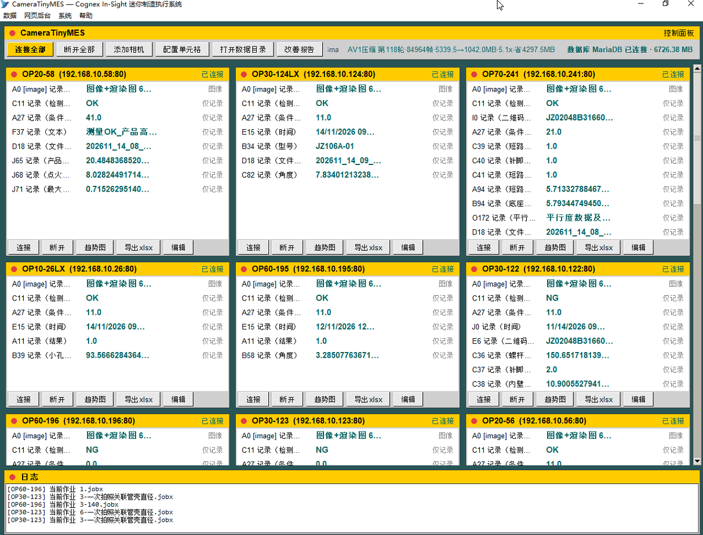

# 摸鱼笔记[17]-相似图片压缩存储

![摸鱼笔记[17]-相似图片压缩存储](images/moyu17-similar-image-compression/cover.png)
工业视觉系统在同一工位连续采集的图片通常高度相似：相机、光照和背景基本不变，只有工件、检测框和少量文字发生变化。逐张保存 JPEG 会重复记录大量相同内容。项目没有把图片当作互不相关的文件，而是按“相机 + 单元格 + 图片类型 + 配方”组织成时间序列，每 30 帧编码为一个独立的 AV1/IVF 分片，用帧间预测消除时间维度上的冗余。最终方案采用“JPEG 先入库、后台稳定后压缩、事务内替换原图”，并保留帧级时间索引和单帧读取兼容层。本文记录编码参数、表结构、原子迁移、读取合并、实测收益和实时分片踩坑，便于后续复刻。

## 摘要

工业视觉系统在同一工位连续采集的图片通常高度相似：相机、光照和背景基本不变，只有工件、检测框和少量文字发生变化。逐张保存 JPEG 会重复记录大量相同内容。项目没有把图片当作互不相关的文件，而是按“相机 + 单元格 + 图片类型 + 配方”组织成时间序列，每 30 帧编码为一个独立的 AV1/IVF 分片，用帧间预测消除时间维度上的冗余。最终方案采用“JPEG 先入库、后台稳定后压缩、事务内替换原图”，并保留帧级时间索引和单帧读取兼容层。本文记录编码参数、表结构、原子迁移、读取合并、实测收益和实时分片踩坑，便于后续复刻。

## 声明

本文内容由 AI 辅助生成，已经人工审核和编辑。

「本文是项目的记忆存档，力求以高信息密度记录关键细节，便于多年后复刻项目。」

## 背景与目标

图片采集入口会把原始位图等比缩放到最大宽度 640 px，再以 JPEG quality 85 保存；检测图形合成后的结果图也采用相同规格。相比原始 BMP，这一步已经显著降低了单张图片体积，但同一工位的连续 JPEG 仍有大量重复信息。

普通 ZIP、gzip 对单张 JPEG 的收益有限，因为 JPEG 已经完成帧内压缩，也不理解相邻图片之间的内容关系。内容哈希去重只适合字节完全相同的文件，只要时间戳、检测框或一个像素发生变化，就无法去重。

项目真正利用的是**时间冗余**：把相似图片看成低帧率视频的连续帧，让编码器保存关键帧及帧间变化，而不是为每张图重复保存完整画面。

| 方案 | 能处理的重复 | 主要问题 |
| --- | --- | --- |
| ZIP/gzip 压缩 JPEG | 文件内部少量剩余冗余 | 已压缩 JPEG 通常难以再明显缩小，不能利用帧间关系 |
| 哈希去重 | 字节完全一致的图片 | 检测框、文字或噪声变化后就会失效 |
| 手工差分图 | 与参考图的像素差异 | 需要自行处理尺寸、参考帧、颜色空间和随机读取 |
| AV1 帧序列 | 连续画面中的空间与时间冗余 | 需要 ffmpeg，单帧读取要先解码所属分片 |

## 整体数据流

当前实现分为采集写入和后台压缩两个阶段：

```text
相机采集
   │
   ├─ 原始图缩放、转 JPEG
   ├─ 合成检测结果渲染图
   │
   ▼
images 表：逐张 JPEG 立即持久化
   │
   │ 后台线程每 10 分钟扫描一次
   │ 只处理距今超过 10 分钟的稳定数据
   │
   ├─ 按 camera + cell + kind + job 分组
   ├─ 组内按时间排序，取最多 30 帧
   ├─ FFmpeg / SVT-AV1 编码为 IVF 码流
   │
   ▼
单个数据库事务
   ├─ INSERT image_streams：保存完整 AV1 分片
   ├─ INSERT image_frames：保存每帧时间和片内序号
   └─ DELETE images：删除已经被分片替代的 JPEG
```

核心原则是：**先确保原图已经落库，再异步优化存储。** 编码器不可用、编码失败或事务失败时，原图仍留在 `images` 表，采集主流程不需要等待视频编码。

主要代码位置：

```text
src/cameratinymes/images.py       # 缩放、JPEG 转码和渲染图合成
src/cameratinymes/worker.py       # 采集时直接写 images，启动后台压缩器
src/cameratinymes/videocodec.py   # AV1 编解码、后台压缩、读取合并
src/cameratinymes/storage.py      # 三张图像表、事务替换和查询接口
```

## 为什么从实时分片改为后台压缩

早期实现是在内存中缓存图片，满 30 帧或空闲 5 秒就封片编码。这个策略看似及时，但与实际生产节拍不匹配：工件上料和机构动作使相邻拍照间隔经常超过 5 秒，缓冲区还没积累多少帧就被空闲条件强制封片。

一次现场统计中：

| 指标 | 实时分片结果 |
| --- | --- |
| 总分片数 | 16,963 |
| 总帧数 | 41,869 |
| 只有 2～5 帧的分片 | 96.6% |
| 达到 30 帧的分片 | 0 |
| 实际综合压缩比 | 约 2.3× |
| 相对理想 30 帧分片的分片数量膨胀 | 12.2× |

大量短分片让 AV1 退化成以帧内编码为主，无法充分发挥帧间预测。单纯把空闲阈值从 5 秒调大到 60 秒虽然能改善压缩率，却也增加内存占用和崩溃时未落库数据的损失范围。

后台压缩把“数据可靠性”和“压缩效率”解耦：

| 对比项 | 实时内存分片 | 先入库再后台压缩 |
| --- | --- | --- |
| 采集写入 | 先进入内存缓冲 | 立即写 JPEG，完成后即可恢复 |
| 分片长度 | 受拍照间隔和空闲阈值影响 | 从历史数据按时间稳定地凑批 |
| 编码位置 | 采集路径附近 | 独立后台线程 |
| 编码失败 | 回退逐张 JPEG | 原图本来就在数据库，无需补偿 |
| 进程崩溃 | 可能丢失未封片内存帧 | 未压缩 JPEG 仍保留 |
| 历史图片 | 无法处理 | 可以分批压缩已有数据 |
| 读取接口 | 合并两种来源 | 保持不变 |

## 分组与封批规则

### 分组键

图片只在以下四个字段都相同的组内组成序列：

```text
(camera, cell, kind, job)
```

* `camera`：不同相机的视角不能混编；
* `cell`：同一相机的不同图片单元格可能代表不同视野；
* `kind`：`image` 原图与 `render` 渲染图内容不同，分别编码；
* `job`：配方切换后视野、产品或检测内容可能完全变化，必须进入新分片。

`job` 为空时使用 `NULL` 参与 SQL 分组，查询条件也要写成 `job IS NULL`，不能用普通等号匹配。

### 稳定窗口与批量参数

| 参数 | 默认值 | 作用 |
| --- | --- | --- |
| `COMPRESS_INTERVAL` | 600 秒 | 后台线程每 10 分钟扫描一轮 |
| `SETTLE_SECONDS` | 600 秒 | 只处理时间戳早于当前时间 10 分钟的数据 |
| `BATCH_FRAMES` | 30 | 每批最多 30 帧，同时作为 GOP 长度 |
| `MIN_BATCH_FRAMES` | 5 | 不足 5 帧不编码，保留 JPEG |
| `COMPRESS_MAX_BATCHES_PER_RUN` | 50 | 每轮最多处理 50 批，避免长时间占用资源 |

稳定窗口不是为了等“画面不再变化”，而是避免压缩线程紧跟采集写入边界处理数据，也让近期图片保持可直接读取的 JPEG 形式。每批之间主动休眠 50 ms，降低持续编码对采集和界面的影响。

只有 `kind IN ('image', 'render')` 的位图参与打包，点云等其他二进制类型原样保留。

## AV1 编码实现

### 输入与输出

`encode_frames(jpegs)` 接收按时间排列的 JPEG 字节列表，在临时目录中写成连续文件名：

```text
f_000001.jpg
f_000002.jpg
...
f_000030.jpg
```

FFmpeg 以 25 fps 的图像序列读取它们。这里的帧率主要用于满足视频时间基要求，**真实采集时间并没有丢失**，每张图片的原始时间戳仍单独保存在 `image_frames.ts` 中。

输出采用 IVF 容器，每个分片从关键帧开始，可独立解码；数据库保存的是完整 IVF 字节流，不依赖临时目录。

### 编码命令

核心参数如下：

```bash
ffmpeg -hide_banner -loglevel error -y \
  -framerate 25 -start_number 1 \
  -i f_%06d.jpg \
  -vf scale=trunc(iw/2)*2:trunc(ih/2)*2 \
  -c:v libsvtav1 -preset 10 -crf 32 \
  -g 30 -keyint_min 1 \
  -pix_fmt yuv420p -an -f ivf out.ivf
```

| 参数 | 含义 |
| --- | --- |
| `libsvtav1` | 使用 SVT-AV1 编码器 |
| `preset 10` | 偏向编码速度，降低后台 CPU 压力 |
| `crf 32` | 恒定质量模式，数值越大通常体积越小、损失越多 |
| `-g N` | GOP 长度设为当前批次帧数，最多 30 |
| `-keyint_min 1` | 配合短分片，不强制过长的最小关键帧间隔 |
| `yuv420p` | 通用 4:2:0 像素格式，降低体积并保证解码兼容性 |
| `scale=trunc(iw/2)*2:...` | 将奇数宽高向下调整为偶数，满足 4:2:0 编码要求 |
| `-an` | 不包含音频 |

程序通过 `subprocess.run` 捕获标准错误，Windows 下使用 `CREATE_NO_WINDOW` 防止每批编码弹出控制台。返回码非零或输出为空都视为失败，本批不执行原图删除。

CRF 32 是有损压缩，不应描述为“无损存储”。如果图片还要作为精密测量或算法训练的唯一原始依据，应重新评估分辨率、色度抽样和质量参数，必要时保留原图。

### FFmpeg 定位

运行环境按以下顺序查找可执行文件：

1. 显式环境变量指定的路径；
2. 当前进程 `PATH`；
3. 离线安装器默认目录；
4. Windows 用户和系统注册表中的 `PATH`。

最后一项解决安装器已经更新环境变量、但当前进程仍保留旧环境副本的问题。找不到 FFmpeg 时不启动后台压缩，采集端仍正常逐张保存 JPEG。部署前还要实际确认构建包含 `libsvtav1`，不能只检查命令是否存在。

## 数据库设计

### 单帧表

`images` 同时服务新采集、少量不足一批的数据、人工标注图片和压缩回退数据：

```sql
CREATE TABLE images (
    id      INTEGER PRIMARY KEY AUTOINCREMENT,
    ts      TEXT NOT NULL,
    camera  TEXT NOT NULL,
    cell    TEXT NOT NULL,
    job     TEXT,
    kind    TEXT NOT NULL,
    mime    TEXT,
    width   INTEGER,
    height  INTEGER,
    data    BLOB NOT NULL
);
```

SQLite 使用 `BLOB`，MariaDB 对应 `LONGBLOB`。时间戳统一为毫秒精度 ISO 8601 字符串，便于两个后端共用查询逻辑。

### 分片表

`image_streams` 一行对应一个完整 AV1/IVF 文件：

| 字段 | 含义 |
| --- | --- |
| `id` | 分片 ID |
| `ts_start` / `ts_end` | 首帧和末帧的真实采集时间 |
| `camera` / `cell` / `job` / `kind` | 序列分组信息 |
| `codec` / `container` | 当前固定为 `av1` / `ivf` |
| `frame_count` | 片内帧数 |
| `width` / `height` | 分片尺寸 |
| `size_bytes` | 码流大小，用于统计 |
| `data` | 完整 IVF 二进制 |

### 帧索引表

`image_frames` 把逻辑图片映射到分片内部：

```text
stream_id   → image_streams.id
frame_index → 片内序号，从 0 开始
ts          → 该帧真实采集时间
camera / cell / kind
width / height
```

`stream_id` 外键使用 `ON DELETE CASCADE`。常用索引包括：

```text
image_frames(camera, cell, kind, ts)
image_frames(stream_id, frame_index)
image_streams(camera, cell, kind, ts_start)
```

因此，AV1 负责压缩像素，关系表负责保留图片级检索能力；不能把整个分片只当作一个没有帧目录的大 BLOB。

## 原子替换与数据安全

后台压缩最关键的一步不是编码，而是替换原图。一个批次在同一个事务中完成：

```sql
BEGIN;

INSERT INTO image_streams (...)
VALUES (...);                 -- 获得 stream_id

INSERT INTO image_frames
(stream_id, frame_index, ts, ...)
VALUES (...);                 -- 按顺序写入全部帧索引

DELETE FROM images
WHERE id IN (?, ?, ...);       -- 只删除本批已编码的明确 ID

COMMIT;
```

任一步失败都回滚。这样不会出现“JPEG 已删除但分片没写全”的空档，也不会留下已经提交分片却重复保留全部原图的部分完成状态。

读取原始 BLOB 和编码发生在事务之前，随后按 ID 精确删除，避免使用大范围时间条件误删期间新写入的图片。存储层以同一线程锁协调读写；SQLite 与 MariaDB 共用这一套事务流程，只转换占位符和字段类型。

### 人工标注图片必须跳过

`annotations.image_id` 引用 `images.id`，并带级联删除。如果直接压缩并删除被标注图片，人工标注也会被删掉。因此候选查询显式排除：

```sql
AND i.id NOT IN (
    SELECT image_id FROM annotations WHERE image_id IS NOT NULL
)
```

这些图片暂时永久保留 JPEG。由于每轮都会重新查询，标注删除后，对应图片可重新成为候选。若未来要让标注直接引用分片帧，需要先把它改造成 `stream_id + frame_index` 关联并迁移历史数据，不能只改外键。

## 读取兼容层

查询图片时同时读取：

1. `images` 中的普通单帧；
2. `image_frames` 中符合相机、单元格、类型和时间范围的帧索引。

对分片帧按 `stream_id` 取出 IVF BLOB，FFmpeg 解码后重新输出 JPEG：

```bash
ffmpeg -hide_banner -loglevel error -y \
  -i in.ivf -fps_mode passthrough -an \
  -f image2 -c:v mjpeg -q:v 2 o_%06d.jpg
```

读取侧用 `frame_index` 从解码列表中取目标图片，并把普通单帧与分片帧统一成：

```text
(ts, kind, mime, width, height, jpeg_bytes)
```

最后按时间戳排序。历史查看和 xlsx 导出只调用这个兼容层，不需要知道底层是 JPEG 还是 AV1。

一次查询会缓存当前分片的解码结果，处理完该分片在结果集中的最后一帧后立即释放，避免长时间保留全部解码帧。帧序号越界时记录警告并跳过，不把损坏分片中的其他帧错位返回。

当前实现解码整个分片再按索引取帧，因此分片越长，随机单帧读取成本越高。30 帧是压缩率与读取延迟之间的折中，不宜只为了提高压缩比无限增大 GOP。

## 删除语义

普通 JPEG 可以按单张删除，AV1 分片则按整片处理。只要分片时间范围与删除区间重叠，就删除该分片及其所有帧索引，返回数量按片内帧数累计。

原因是片内帧存在编码依赖，单独删掉一条 `image_frames` 并不会从 IVF 中移除对应图像，反而会让索引与真实码流不一致。如果业务确实要求精确删除某一帧，需要重新编码剩余帧，而不是只删索引。

## 实测收益与质量

离线使用 30 帧 GOP 对三组工位图片进行测试，JPEG→AV1 的结果如下：

| 工位 | 类型 | 分辨率 | JPEG KB/帧 | AV1 KB/帧 | 压缩比 |
| --- | --- | --- | --- | --- | --- |
| A | 原图 | 640×480 | 17.1 | 1.6 | 10.5× |
| A | 渲染图 | 640×480 | 26.0 | 3.5 | 7.4× |
| B | 原图 | 640×535 | 82.9 | 7.0 | 11.9× |
| B | 渲染图 | 640×535 | 90.7 | 8.5 | 10.7× |
| C | 原图 | 640×535 | 55.3 | 20.4 | 2.7× |
| C | 渲染图 | 640×535 | 62.4 | 22.5 | 2.8× |

A、B 工位画面稳定，节省约 7～12 倍；C 工位画面变化较大，仍有约 3 倍收益。说明压缩率主要由画面内容和帧间变化决定，不能对所有工位承诺同一个倍率。

对应质量与速度测试：

| 指标 | 实测范围 |
| --- | --- |
| 像素差分工具的差异像素比例 | 约 0.02%～0.10% |
| PSNR | 34.69～44.57 dB |
| SSIM | 0.9977～0.9999 |
| 编码 30 帧 | 0.34～0.50 秒 |
| 解码 30 帧 | 0.23～0.63 秒 |

这些结果说明当前参数适合项目的追溯和展示场景，不代表对所有图像都“视觉无损”。上线时应使用自己的原图、检测文字和细小目标重新验证。

### 后台压缩的现场累计结果

产线截图中的主界面状态栏给出了后台压缩器的实际累计统计：

```text
AV1 压缩：第 118 轮，84,964 帧
5339.5 MB → 1042.0 MB，5.1×，节省 4297.5 MB
```

这组数据可以直接与早期实时分片的约 2.3× 对比：

| 指标 | 后台压缩现场累计值 |
| --- | --- |
| 已处理帧数 | 84,964 帧 |
| 有效压缩轮数 | 118 轮 |
| 压缩前 JPEG 总量 | 5339.5 MB |
| 压缩后 AV1 总量 | 1042.0 MB |
| 节省空间 | 4297.5 MB |
| 综合压缩比 | 约 5.12×，界面显示 5.1× |
| 综合节省率 | 约 80.5% |
| 平均每帧压缩前 → 压缩后 | 约 64.4 KB → 12.6 KB |

计算口径为：

```text
压缩比 = 压缩前字节数 / 压缩后字节数
节省率 = (压缩前字节数 - 压缩后字节数) / 压缩前字节数 × 100%
       = 4297.5 / 5339.5 × 100%
       ≈ 80.5%
```

它证明后台凑批方案已经在现场把综合压缩比从早期短分片的约 2.3× 提升到约 5.1×，与离线 30 帧 GOP 测试处于同一量级，但仍低于画面最稳定工位的 7～12×。这是正常的：现场累计值混合了不同工位、原图、渲染图和画面变化程度，不能只拿最高压缩比的工位推算全库收益。

状态栏数字来自压缩器进程内的累计计数器，用于观察本次运行期间实际完成的有效压缩工作量，并不是数据库从建库以来的永久总量；程序重启后计数会重新开始，已保存的 AV1 分片不会受影响。压缩前字节数统计本批原始 JPEG BLOB，压缩后字节数统计 IVF 码流，不包含所有关系表、索引和数据库页管理开销。因此它适合衡量图像载荷的收益，不等同于数据库文件一定同比下降，也不能与整个磁盘的占用直接画等号。

## 适用边界

| 场景 | 建议 |
| --- | --- |
| 同工位连续图片、背景稳定、通常批量查看 | 适合 AV1 分片 |
| 图片间隔较长但同属一个稳定序列 | 适合先入库再后台凑批 |
| 偶尔产生一张图片 | 保留 JPEG，避免短分片开销 |
| 高频随机读取单帧 | 缩短分片，或保留 JPEG/增加独立缩略图 |
| 高分辨率、高噪声、帧间差异很大 | 先实测，AV1 可能收益有限甚至膨胀 |
| 精密测量、法务证据或不可逆原始数据 | 谨慎使用有损编码，必要时保留原始文件 |
| 有人工标注外键 | 未迁移关联前不要删除对应 JPEG |

后台实现的分组键没有显式包含分辨率。复刻时最好把 `width、height` 也纳入候选条件，或在每批编码前确认尺寸一致；不同分辨率不应仅依赖编码器滤镜强行归一到同一序列。

## 验证清单

### 编解码验证

1. 用 30 张真实 JPEG 编码一个 IVF 分片，确认返回码为 0 且输出非空；
2. 解码后核对帧数和顺序，确认奇数尺寸缩放符合预期；
3. 对比关键文字、检测框和细小缺陷，记录体积、PSNR、SSIM 与耗时；
4. 分别测试稳定画面和变化较大的画面，不用单一工位代表全部数据。

### 数据安全验证

1. 压缩前记录本批 `images.id`、时间戳、总字节数和可选哈希；
2. 压缩后确认 `image_streams.frame_count` 与 `image_frames` 行数一致；
3. 确认每帧时间、顺序、宽高与原记录一致；
4. 确认只有本批 ID 被删除，带人工标注的图片仍在 `images`；
5. 模拟插入分片、插入帧索引和删除原图各阶段失败，事务必须完整回滚；
6. 停止后台线程或重启程序，未压缩 JPEG 应能在下一轮继续处理。

### 业务与运行验证

1. 历史查看和 xlsx 导出能混合返回旧 JPEG 与新 AV1 图片；
2. 按时间删除时分片整片删除，不留下孤立帧索引；
3. 禁用 FFmpeg 后采集仍正常，JPEG 持续增长但功能不中断；
4. 观察每轮批数、帧数、压缩前后字节数和节省空间；
5. 检查数据库文件实际收缩策略。SQLite 删除 BLOB 后空间可能先成为可复用空闲页，文件大小不一定立即下降；只有执行 `VACUUM` 才会重建文件，但它需要额外磁盘空间并可能造成长时间阻塞，不应在每批压缩后自动执行。

## 总结

大量相似图片的压缩重点不是寻找一个更强的单文件压缩算法，而是把数据组织成编码器能利用的序列。该项目用 AV1 消除帧间冗余，用 `image_streams + image_frames` 保留图片级时间与索引，用统一读取层隐藏格式差异，再通过“JPEG 先落库、稳定后分批、事务内替换”保证数据安全。真正决定最终效果的，除了 CRF 和 preset，还有分片是否足够长、分组是否正确、随机读取是否可接受，以及失败时原图是否始终还在。

## 效果图

| 产线运行界面 | 后台 AV1 压缩统计 |
| --- | --- |
|  |  |

## 完整源码

以下附 `src/cameratinymes/videocodec.py` 完整内容：

```python
"""AV1 帧序列压缩：把连续 A0 图像打成 IVF 分片后入库。

相机连续拍摄的画面变化很小，按 GOP 分片做帧间预测，压缩率远高于逐张 JPEG。
每个分片独立可解码，片内保留 30 帧或空闲 5 秒即封片。
"""

from __future__ import annotations

import logging
import os
import shutil
import subprocess
import sys
import tempfile
import threading
import time
from datetime import datetime
from pathlib import Path

log = logging.getLogger(__name__)

# 默认编码参数（可按需调整）
SEGMENT_FRAMES = 30          # 每片最多帧数（同时是 GOP 长度）
SEGMENT_IDLE_SECONDS = 5.0   # 空闲多久后封片
AV1_CRF = 32
AV1_PRESET = 10

def encode_frames(jpegs: list[bytes]) -> bytes | None:
    """JPEG 帧序列 → AV1(IVF) 码流；失败返回 None。"""
    if not FFMPEG or not jpegs:
        return None
    with tempfile.TemporaryDirectory(prefix="ctm_av1_") as tmp:
        root = Path(tmp)
        for i, data in enumerate(jpegs, start=1):
            (root / f"f_{i:06d}.jpg").write_bytes(data)
        out = root / "out.ivf"
        cmd = [
            FFMPEG, "-hide_banner", "-loglevel", "error", "-y",
            "-framerate", "25", "-start_number", "1",
            "-i", str(root / "f_%06d.jpg"),
            "-vf", "scale=trunc(iw/2)*2:trunc(ih/2)*2",
            "-c:v", "libsvtav1", "-preset", str(AV1_PRESET), "-crf", str(AV1_CRF),
            "-g", str(max(1, len(jpegs))), "-keyint_min", "1",
            "-pix_fmt", "yuv420p", "-an", "-f", "ivf", str(out),
        ]
        creationflags = subprocess.CREATE_NO_WINDOW if sys.platform == "win32" else 0
        proc = subprocess.run(cmd, capture_output=True, text=True,
                              creationflags=creationflags)
        if proc.returncode != 0:
            log.warning("AV1 编码失败: %s", proc.stderr.strip()[:400])
            return None
        data = out.read_bytes()
        return data or None

def _installer_candidates():
    """离线安装器的默认落点：%LOCALAPPDATA%\\ffmpeg 与 %ProgramFiles%\\ffmpeg。"""
    roots = []
    for env in ("LOCALAPPDATA", "ProgramFiles"):
        base = os.environ.get(env)
        if base:
            roots.append(Path(base) / "ffmpeg")
    for root in roots:
        yield root / "bin" / "ffmpeg.exe"
        if root.is_dir():
            for sub in sorted(root.iterdir(), reverse=True):
                if sub.is_dir():
                    yield sub / "bin" / "ffmpeg.exe"

def _registry_path_entries():
    """进程环境可能早于安装器启动，补读注册表里的用户 / 系统 PATH。"""
    if sys.platform != "win32":
        return []
    import winreg

    entries: list[str] = []
    for hive, key in (
        (winreg.HKEY_CURRENT_USER, r"Environment"),
        (winreg.HKEY_LOCAL_MACHINE,
         r"SYSTEM\CurrentControlSet\Control\Session Manager\Environment"),
    ):
        try:
            with winreg.OpenKey(hive, key) as reg:
                value, _ = winreg.QueryValueEx(reg, "PATH")
            entries.extend(os.path.expandvars(value).split(os.pathsep))
        except OSError:
            pass
    return entries

def find_ffmpeg() -> str | None:
    """定位 ffmpeg：环境变量 → PATH → 安装器默认目录 → 注册表 PATH。"""
    custom = os.environ.get("CAMERATINYMES_FFMPEG")
    if custom and Path(custom).is_file():
        return custom
    found = shutil.which("ffmpeg")
    if found:
        return found
    for path in _installer_candidates():
        if path.is_file():
            return str(path)
    exe = "ffmpeg.exe" if sys.platform == "win32" else "ffmpeg"
    for entry in _registry_path_entries():
        entry = entry.strip().strip('"')
        if entry and (Path(entry) / exe).is_file():
            return str(Path(entry) / exe)
    return None

FFMPEG = find_ffmpeg()
if FFMPEG:
    log.info("AV1 编码器 ffmpeg: %s", FFMPEG)

def available() -> bool:
    return bool(FFMPEG)

def encode_frames(jpegs: list[bytes]) -> bytes | None:
    """JPEG 帧序列 → AV1(IVF) 码流；失败返回 None。"""
    if not FFMPEG or not jpegs:
        return None
    with tempfile.TemporaryDirectory(prefix="ctm_av1_") as tmp:
        root = Path(tmp)
        for i, data in enumerate(jpegs, start=1):
            (root / f"f_{i:06d}.jpg").write_bytes(data)
        out = root / "out.ivf"
        cmd = [
            FFMPEG, "-hide_banner", "-loglevel", "error", "-y",
            "-framerate", "25", "-start_number", "1",
            "-i", str(root / "f_%06d.jpg"),
            "-vf", "scale=trunc(iw/2)*2:trunc(ih/2)*2",
            "-c:v", "libsvtav1", "-preset", str(AV1_PRESET), "-crf", str(AV1_CRF),
            "-g", str(max(1, len(jpegs))), "-keyint_min", "1",
            "-pix_fmt", "yuv420p", "-an", "-f", "ivf", str(out),
        ]
        creationflags = subprocess.CREATE_NO_WINDOW if sys.platform == "win32" else 0
        proc = subprocess.run(cmd, capture_output=True, text=True,
                              creationflags=creationflags)
        if proc.returncode != 0:
            log.warning("AV1 编码失败: %s", proc.stderr.strip()[:400])
            return None
        data = out.read_bytes()
        return data or None

def decode_stream(data: bytes) -> list[bytes]:
    """AV1(IVF) 码流 → JPEG 帧列表；失败返回空列表。"""
    if not FFMPEG or not data:
        return []
    with tempfile.TemporaryDirectory(prefix="ctm_av1d_") as tmp:
        root = Path(tmp)
        src = root / "in.ivf"
        src.write_bytes(data)
        cmd = [
            FFMPEG, "-hide_banner", "-loglevel", "error", "-y",
            "-i", str(src), "-fps_mode", "passthrough", "-an",
            "-f", "image2", "-c:v", "mjpeg", "-q:v", "2",
            str(root / "o_%06d.jpg"),
        ]
        creationflags = subprocess.CREATE_NO_WINDOW if sys.platform == "win32" else 0
        proc = subprocess.run(cmd, capture_output=True, text=True,
                              creationflags=creationflags)
        if proc.returncode != 0:
            log.warning("AV1 解码失败: %s", proc.stderr.strip()[:400])
            return []
        return [p.read_bytes() for p in sorted(root.glob("o_*.jpg"))]

def load_images(storage, camera: str, cell: str, kind: str | None = None,
                start: datetime | None = None, end: datetime | None = None):
    """合并旧版单帧 images 与 AV1 分片，返回 [(ts, kind, mime, w, h, jpeg)]。"""
    rows = list(storage.query_images(camera, cell, kind=kind, start=start, end=end))
    frames = storage.query_stream_frames(camera, cell, kind=kind, start=start, end=end)
    if frames:
        cache: dict[int, list[bytes]] = {}
        last_index: dict[int, int] = {}
        for _ts, _kind, sid, idx, _w, _h in frames:
            last_index[sid] = max(last_index.get(sid, 0), idx)
        for ts, frame_kind, sid, idx, width, height in frames:
            if sid not in cache:
                blob = storage.get_image_stream(sid)
                cache[sid] = decode_stream(blob) if blob else []
            decoded = cache[sid]
            if 0 <= idx < len(decoded):
                rows.append((ts, frame_kind, "image/jpeg", width, height, decoded[idx]))
            else:
                log.warning("分片 %s 缺少第 %s 帧，已跳过", sid, idx)
            if idx >= last_index.get(sid, 0):
                cache.pop(sid, None)
    rows.sort(key=lambda r: r[0])
    return rows

class ImageStreamWriter:
    """按 相机+单元格+类型 缓冲 JPEG 帧，满片或空闲时异步编码入库。"""

    def __init__(self, storage, enabled: bool = True):
        self.storage = storage
        self.enabled = bool(enabled and FFMPEG)
        self._lock = threading.Lock()
        self._cond = threading.Condition(self._lock)
        self._active = 0            # 正在编码的分片数（关闭时等待归零）
        self._buffers: dict[tuple[str, str, str, str], list[tuple]] = {}
        self._ready: list[tuple[tuple[str, str, str, str], list[tuple]]] = []
        self._last_add: dict[tuple[str, str, str, str], float] = {}
        self._stop = threading.Event()
        self._thread: threading.Thread | None = None
        if not self.enabled:
            log.warning("未找到 ffmpeg，AV1 帧序列压缩不可用，回退为 JPEG 单帧入库")
        else:
            self._thread = threading.Thread(target=self._loop, name="av1-writer", daemon=True)
            self._thread.start()

    # ---------- 对外接口 ----------

    def add_frame(self, ts: datetime, camera: str, cell: str, kind: str,
                  data: bytes, width: int | None, height: int | None,
                  job: str | None = None) -> bool:
        """投递一帧；返回 False 表示编码不可用，调用方应回退 JPEG 入库。

        作业名（jobx 配方）进缓冲键：换配方后帧自然落到新分片，一个分片不混两种配方。
        """
        if not self.enabled:
            return False
        key = (camera, cell, kind, job or "")
        with self._lock:
            buf = self._buffers.setdefault(key, [])
            if buf and (buf[0][2], buf[0][3]) != (width, height):
                # 尺寸变化（配置改动）：旧片立即封口
                self._ready.append((key, self._buffers.pop(key)))
                buf = []
                self._buffers[key] = buf
            buf.append((ts, data, width, height))
            self._last_add[key] = time.monotonic()
            if len(buf) >= SEGMENT_FRAMES:
                self._ready.append((key, self._buffers.pop(key)))
        return True

    def flush_camera(self, camera: str) -> None:
        """相机断开时把该相机所有未封片缓冲立即编码。"""
        self._take_and_encode(lambda key: key[0] == camera)

    def flush_all(self) -> None:
        """把所有未封片缓冲立即编码（停机/关窗时调用）。"""
        self._take_and_encode(lambda key: True)

    def close(self) -> None:
        if not self.enabled:
            return
        self._stop.set()
        if self._thread:
            self._thread.join(timeout=5)
        self.flush_all()
        # 等其它线程（相机断开触发的封片）编码完成，避免紧接着关闭数据库
        with self._cond:
            self._cond.wait_for(lambda: self._active == 0, timeout=30)

    # ---------- 内部 ----------

    def _loop(self) -> None:
        while not self._stop.wait(FLUSH_INTERVAL):
            with self._lock:
                ready, self._ready = self._ready, []
                now = time.monotonic()
                for key, last in list(self._last_add.items()):
                    if now - last >= SEGMENT_IDLE_SECONDS and key in self._buffers:
                        ready.append((key, self._buffers.pop(key)))
                        self._last_add.pop(key, None)
            for key, frames in ready:
                self._encode(key, frames)

    def _take_and_encode(self, match) -> None:
        with self._lock:
            ready, self._ready = self._ready, []
            for key in list(self._buffers):
                if match(key):
                    ready.append((key, self._buffers.pop(key)))
                    self._last_add.pop(key, None)
        for key, frames in ready:
            self._encode(key, frames)

    def _encode(self, key: tuple[str, str, str, str], frames: list[tuple]) -> None:
        if not frames:
            return
        with self._cond:
            self._active += 1
        try:
            self._encode_inner(key, frames)
        finally:
            with self._cond:
                self._active -= 1
                self._cond.notify_all()

    def _encode_inner(self, key: tuple[str, str, str, str], frames: list[tuple]) -> None:
        data = encode_frames([f[1] for f in frames])
        if data is None:
            self._fallback(key, frames)
            return
        try:
            self.storage.insert_image_stream(
                key[0], key[1], key[2],
                [(f[0], f[2], f[3]) for f in frames], data,
                job=key[3] or None)
        except Exception:
            log.exception("AV1 分片入库失败，回退 JPEG 单帧")
            self._fallback(key, frames)

    def _fallback(self, key: tuple[str, str, str, str], frames: list[tuple]) -> None:
        for ts, data, _w, _h in frames:
            try:
                self.storage.insert_image(ts, key[0], key[1], key[2], data, "image/jpeg",
                                          job=key[3] or None)
            except Exception:
                log.exception("JPEG 回退入库失败")

# =====================================================================
# 后台 AV1 压缩守护线程
# =====================================================================

COMPRESS_INTERVAL = 600       # 守护线程跑一次的间隔（秒）= 10 分钟
SETTLE_SECONDS = 600          # "稳定窗口"：最近一张图距现在 ≥ 此数才动（秒）
BATCH_FRAMES = 30             # 每批打包帧数（GOP 长度）
MIN_BATCH_FRAMES = 5          # 少于此数的批次跳过（不值得编码）
COMPRESS_MAX_BATCHES_PER_RUN = 50  # 每轮最多压缩多少批（防长时阻塞）

class BackgroundImageCompressor:
    """后台守护线程：扫描 images 表，批量打包成 AV1 分片后删除原图。

    与实时 ImageStreamWriter 不同——等图片在 images 表"稳定"后（最近一张距今 ≥ SETTLE_SECONDS）
    才攒够 BATCH_FRAMES 帧一起编码，GOP 帧间预测充分发挥，压缩比回归 README 实测的 3-10×。

    关键安全措施：
    - 跳过所有有 annotations 引用的 images 行（保留给人工复核）
    - 写 streams + 删 images 在同一事务内（任一失败全部回滚）
    - 编码失败不删原图，数据不丢
    - 线程守护 + try/except 包裹循环，崩溃自动重建
    """

    def __init__(self, storage, interval: float = COMPRESS_INTERVAL,
                 settle: float = SETTLE_SECONDS,
                 batch: int = BATCH_FRAMES):
        self.storage = storage
        self.interval = interval
        self.settle = settle
        self.batch = batch
        self._stop = threading.Event()
        self._thread: threading.Thread | None = None
        self._stats = {"runs": 0, "frames": 0, "orig_bytes": 0,
                       "new_bytes": 0, "saved_bytes": 0}

    @property
    def enabled(self) -> bool:
        return bool(FFMPEG)

    @property
    def stats(self) -> dict:
        """只读快照：返回 {'runs', 'frames', 'orig_bytes', 'new_bytes', 'saved_bytes'}。"""
        return dict(self._stats)

    def start(self) -> None:
        if not self.enabled:
            log.warning("未找到 ffmpeg，后台 AV1 压缩不可用")
            return
        if self._thread and self._thread.is_alive():
            return
        self._stop.clear()
        self._thread = threading.Thread(target=self._loop,
                                        name="av1-background-compressor",
                                        daemon=True)
        self._thread.start()
        log.info("后台 AV1 压缩守护线程已启动（间隔 %ss, 稳定窗口 %ss, 每批 %d 帧）",
                 self.interval, self.settle, self.batch)

    def stop(self) -> None:
        self._stop.set()
        if self._thread:
            self._thread.join(timeout=5)
            self._thread = None
        log.info("后台 AV1 压缩守护线程已停止；累计：%d 轮, %d 帧, 节省 %.1f MB",
                 self._stats["runs"], self._stats["frames"],
                 self._stats["saved_bytes"] / 1024 / 1024)

    def run_once(self) -> None:
        """手动触发一次压缩（测试或调试用）。"""
        self._run_batch()

    # ---------- 内部 ----------

    def _loop(self) -> None:
        while not self._stop.wait(self.interval):
            try:
                self._run_batch()
            except Exception:
                log.exception("后台 AV1 压缩轮次异常")

    def _run_batch(self) -> None:
        """一轮压缩：扫描所有可压缩分组，按批打包。"""
        before_ts = datetime.fromtimestamp(time.time() - self.settle).isoformat(
            timespec="milliseconds")

        try:
            groups = self.storage.list_compressible_groups(
                before_ts, min_frames=MIN_BATCH_FRAMES)
        except Exception:
            log.exception("查询可压缩分组失败")
            return

        if not groups:
            return

        log.info("后台 AV1 压缩：发现 %d 个可压缩分组", len(groups))
        batches_done = 0
        total_frames = 0
        total_orig = 0
        total_new = 0

        for camera, cell, kind, job, _cnt in groups:
            if self._stop.is_set():
                break
            while batches_done < COMPRESS_MAX_BATCHES_PER_RUN:
                if self._stop.is_set():
                    break
                result = self._compress_one_batch(camera, cell, kind, job, before_ts)
                if result is None:
                    break  # 这个分组已经不够 BATCH_FRAMES 了
                frames, orig_bytes, new_bytes = result
                batches_done += 1
                total_frames += frames
                total_orig += orig_bytes
                total_new += new_bytes
                # 每个批次之间稍微让渡一下 CPU
                time.sleep(0.05)

        if total_frames > 0:
            saved = total_orig - total_new
            ratio = total_orig / total_new if total_new > 0 else 0
            self._stats["runs"] += 1
            self._stats["frames"] += total_frames
            self._stats["orig_bytes"] += total_orig
            self._stats["new_bytes"] += total_new
            self._stats["saved_bytes"] += saved
            log.info(
                "后台 AV1 压缩本轮完成：%d 批, %d 帧, %.1f MB → %.1f MB, "
                "压缩比 %.1fx, 节省 %.1f MB",
                batches_done, total_frames,
                total_orig / 1024 / 1024, total_new / 1024 / 1024,
                ratio, saved / 1024 / 1024,
            )

    def _compress_one_batch(self, camera: str, cell: str, kind: str,
                            job: str | None, before_ts: str) -> tuple[int, int, int] | None:
        """对一个 (camera, cell, kind, job) 分组尝试打包一批。

        返回 (帧数, 原始字节, 压缩后字节)；不够帧数返回 None。
        """
        # 1. 取 BATCH_FRAMES 帧的 id + ts + 尺寸
        rows = self.storage.query_images_for_compress(
            camera, cell, kind, job, before_ts, self.batch)
        if len(rows) < MIN_BATCH_FRAMES:
            return None  # 不够一批，跳过

        # 如果刚好 > BATCH_FRAMES，只取前 BATCH_FRAMES 个
        if len(rows) > self.batch:
            rows = rows[:self.batch]

        ids = [r[0] for r in rows]
        ts_list = [datetime.fromisoformat(r[1]) for r in rows]
        widths = [r[2] for r in rows]
        heights = [r[3] for r in rows]

        # 2. 下载这些 images 的原始数据（单独查询，避免一次拉太多）
        jpeg_data: list[bytes] = []
        orig_bytes = 0
        for image_id in ids:
            try:
                rows2 = self.storage._fetchall(
                    "SELECT data FROM images WHERE id=?", (image_id,))
                if not rows2:
                    return None  # 中途被删了，放弃这一批
                jpeg_data.append(bytes(rows2[0][0]))
                orig_bytes += len(rows2[0][0])
            except Exception:
                log.exception("查询 image id=%s 失败", image_id)
                return None

        if len(jpeg_data) < MIN_BATCH_FRAMES:
            return None

        # 3. 编码
        stream_data = encode_frames(jpeg_data)
        if stream_data is None:
            log.warning("后台 AV1 编码失败 %s/%s/%s（job=%s），跳过该批",
                        camera, cell, kind, job)
            return None

        # 4. 原子入库：写 streams + 删 images
        try:
            frames_meta = list(zip(ts_list, widths, heights))
            self.storage.insert_stream_and_delete_images(
                camera, cell, kind, job,
                frames_meta, stream_data, ids)
        except Exception:
            log.exception("后台 AV1 入库失败 %s/%s/%s", camera, cell, kind)
            return None

        new_bytes = len(stream_data)
        return (len(jpeg_data), orig_bytes, new_bytes)
```
