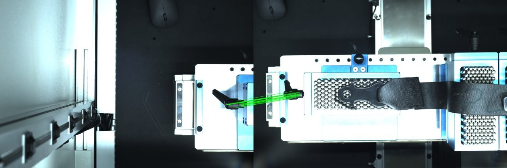
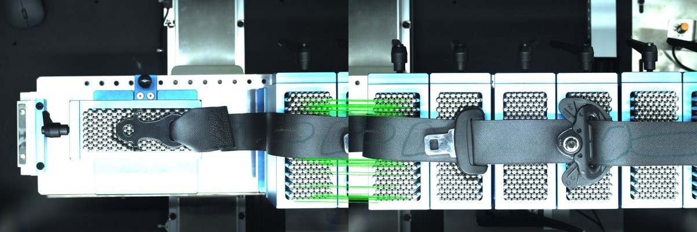
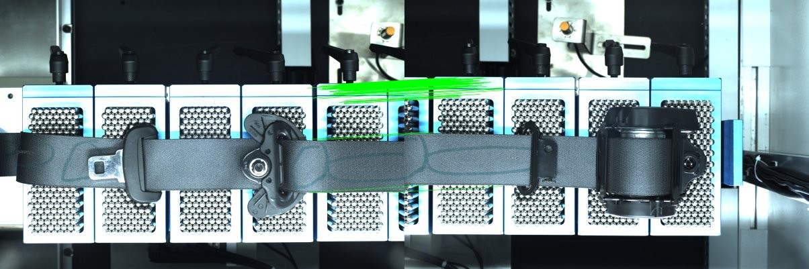
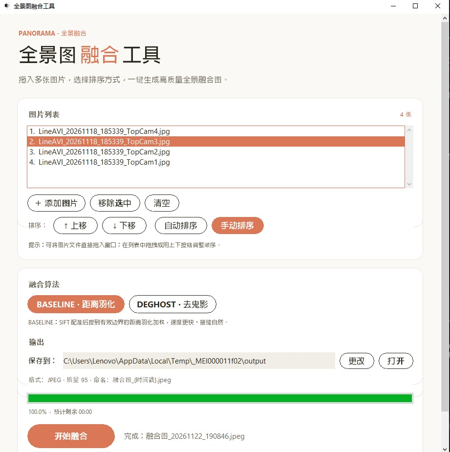
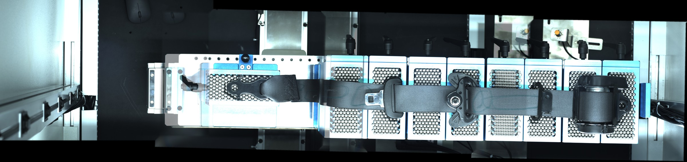
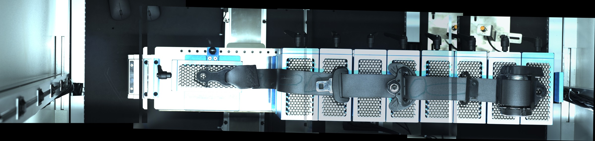
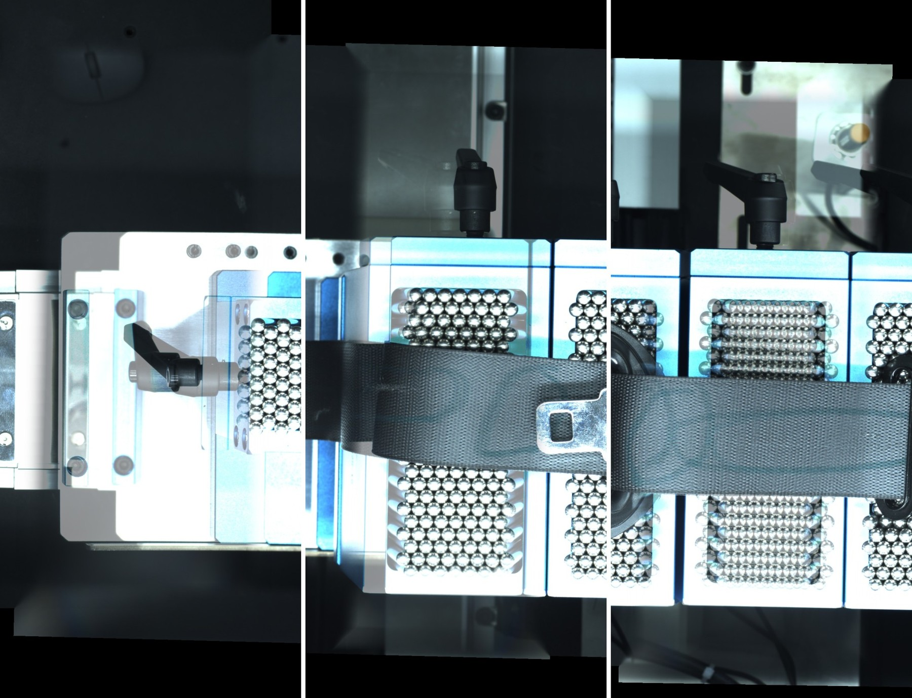

# 摸鱼笔记[18]-全景图拼接融合

工业视觉检测常需要把同一工位多台相机的画面拼成一张全景图：顶视四相机覆盖工装长轴，侧视相机记录立面，最终在一张图上完成追溯与展示。逐张存图再靠人工拼接既慢又容易错位；直接调用 OpenCV 的 `Stitcher` 又难以满足产线的非阻塞、可复现与故障兜底要求。本项目把全景拼接拆成三层落地：C# 工作进程 `PanoramaWorker` 对接产线做非阻塞拼接，Python 桌面工具 `panorama-gui` 把同一套算法包装成可拖拽的交互界面，`cs-xml-bundle` 把整套源码归档成单个 XML 便于复刻，`README.md` 是统一入口。算法核心是 **SIFT + 多候选区域配准 + ECC 精化**，融合提供 **BASELINE 距离羽化**（默认）与 **DEGHOST 去鬼影**（可选）两套。本文记录架构、配准与融合的关键实现、实测数据、GUI 非阻塞设计、源码归档方式以及已知边界，便于后续复刻。

## 声明

本文内容由 AI 辅助生成，已经人工审核和编辑。

「本文是项目的记忆存档，力求以高信息密度记录关键细节，便于多年后复刻项目。」

## 背景与目标

同一工位的多台相机沿工装长轴并排安装，视野有 20%～30% 重叠。拼接的难点不在"能不能拼上"，而在产线场景下的三个约束：

1. **不能阻塞主流程**：检测节拍固定，拼接必须异步完成，原图先落库再后台处理；
2. **配准必须鲁棒**：工装是重复纹理（球阵列、通孔板、安全带织带），内点数会失效，不能只靠 RANSAC 内点判定；
3. **结果必须可复现**：同一批图每次拼接结果应一致，失败时原图仍在，不能丢数据。

项目没有用 OpenCV 自带的 `Stitcher` 黑盒，而是把配准、变换链、融合拆开自己实现，便于在每一层加候选、加兜底、加进度回调。

## 项目总览

仓库入口与各模块定位如下（详见根目录 `README.md`）：

| 路径 | 说明 |
| --- | --- |
| `README.md` | 项目总览：算法、复现命令、加速基准、硬件选型 |
| `src/panorama_stitch.py` | Lab7 通用实现：柱面投影、SIFT + RANSAC、ECC 精化、接缝/羽化融合 |
| `src/PanoramaJobClient.cs` | 主程序侧非阻塞任务客户端：等图落盘、排队、状态展示 |
| `src/JustSmart.PanoramaWorker/` | .NET Framework 4.8 / OpenCvSharp 独立拼接工作进程（含 `avx2/` `cuda/` `rocm/` 加速实验） |
| `tools/panorama-gui/` | Python 桌面融合工具：拖图、排序、双算法、进度条、打包 exe |
| `tools/cs-xml-bundle/` | 源码 ⇄ XML 归档工具：把整套可读文本打成单文件并按 SHA256 还原 |
| `assets/型号A_20261118_185337_712/stitch/` | 型号A TopCam1～4 现场脚本、完整结果与统计报告 |
| `docs/` | 算法原理资料与本系列折腾笔记 |

## 整体数据流

产线侧的拼接不与检测主流程同步，而是一条独立的后台链路：

```text
主程序检测完成
   │
   ├─ 等待原图稳定落盘（文件大小 800 ms 不变，最长 120 s）
   ├─ 内存队列提交任务（只传路径，不传图像数据）
   │
   ▼
懒启动 JustSmart.PanoramaWorker.exe（单实例互斥）
   │
   ├─ 本地命名管道 + protobuf 传输任务
   ├─ 独立线程按 TopCam / SideBCam 分组
   │
   ▼
逐组拼接（SIFT 配准 → 变换链 → 融合 → 裁黑边）
   │
   ▼
保存至 <SessionFolder>/StitchedImage
   命名 LineAVI_<时间戳>_<组名>_Stitched.<扩展名>
```

核心原则是**先确保原图已经落库，再异步优化与拼接**。编码器不可用、配准失败或保存失败时，原图仍在，采集主流程不需要等待。工作进程无连接空闲 10 分钟后自动退出；日志位于系统临时目录的 `JustSmart_PanoramaWorker.log`。

## 核心工作进程：PanoramaWorker

`src/JustSmart.PanoramaWorker/` 是 .NET Framework 4.8、x64 的独立进程，依赖 OpenCvSharp 4.11 与 Google.Protobuf 3.17.1。主流程不等待拼接完成，任务通过命名管道 + protobuf 传入，工作进程内部按相机组独立线程拼接。

### 配准：SIFT + 四候选区域 + ECC 选优

重复纹理工装会让 RANSAC 内点数失效（球阵列在多个位置都能对上），因此配准不取内点最多的解，而是取 **ECC 相关系数最高**的解。完整步骤：

1. **预处理**：灰度化后做 CLAHE（`clipLimit=2.0`，8×8 网格），提升亮面金属的局部对比度；
2. **SIFT 特征**：`nfeatures=20000`，`contrastThreshold=0.004`（降低阈值以在低纹理台面上取得足够特征点）；
3. **特征匹配**：`BFMatcher(NORM_L2)` + 2-近邻，Lowe ratio 判据 `m.distance < 0.75 · n.distance`；
4. **粗配准**：`estimateAffinePartial2D`（RANSAC，重投影阈值 4.0 px，`maxIters=50000`，`confidence=0.9995`）估计 4 自由度相似变换（平移 + 旋转 + 尺度）；
5. **多区域候选**：对每一对图像尝试 4 个候选区域（全幅、A 右侧 40%/50%/60% vs B 左侧同比例），把局部偏移折算回全图后再统一评估；
6. **按 ECC 选优**：以 `findTransformECC`（`MOTION_EUCLIDEAN`）精化后的相关系数 `cc` 作为最终选择依据；
7. **ECC 亚像素精化**：以 SIFT+RANSAC 结果为初值，把配准误差压到亚像素级；
8. **兜底降级**：匹配不可靠时改用灰度归一化互相关（NCC）模板搜索，SideBCam 第一对允许 0.4～1.2 尺度搜索。

关键常量与 `PanoramaStitcher.cs` 一致：

```csharp
private const double Ratio = 0.75;
private const double RansacThreshold = 4.0;
private const int    MinInliers = 20;
private const int    MaxFeatures = 20000;
private const double MaxEccShiftPx = 150;
```

`DropUnreliable` 会在精化后丢弃不合格结果：ECC 相关系数低于 0.1 直接丢弃；ECC 精化后的平移偏差超过 20 px 或旋转角度超过 2° 时不采用 ECC 结果，回退到 RANSAC 初值。这些阈值是在现场 TopCam 数据上调出来的，复刻时需要用自己的相机重新验证。

### 变换链与画布

以最左相机为画布原点，逐级左乘把各相机映射到统一坐标系，取所有图像四角的外接矩形作为画布。画布面积上限为 **4 亿像素**（`canvasW * canvasH > 400_000_000` 时直接返回 `null` 终止任务），防止异常配准把画布撑爆内存。

### 融合：两套算法

#### BASELINE · 距离权重羽化（默认）

每幅图像的权重取"到自身有效区域边界的距离"（`distanceTransform`），在 `ramp` 像素内线性过渡并取 `sharpness` 次幂，使接缝处权重迅速衰减为单图贡献，避免多层平均产生重影。最后用累加权归一化，裁去黑边。

`PanoramaStitcher.Blend` 的核心权重计算：

```csharp
Cv2.DistanceTransform(grayPlaced, dist, DistanceTypes.L2, DistanceTransformMasks.Mask3);
dist.ConvertTo(weight, MatType.CV_32F, 1.0 / Math.Max(ramp, 1));
Cv2.Threshold(weight, weight, 1.0, 1.0, ThresholdTypes.Trunc);
for (int s = 1; s < Math.Max(sharpness, 1); s++)
    weight = weight.Mul(weight);          // sharpness 次幂，默认 4
```

默认 `ramp=80`、`sharpness=4`。优点是实现简单、速度快、无重影；缺点是接缝两侧亮度不一致时会出现亮度台阶（本流程未做增益补偿）。

#### DEGHOST · 去鬼影融合（可选）

对齐论文（瞿中等 2015）的思路，逐对执行：**增益匹配 → 最佳缝合线 DP → 限定区 smoothstep 融合 → 色差一致性选择**。配准由上层 SIFT+RANSAC+ECC 算好，此方法只专注融合。`PanoramaStitcher.cs` 中对应 `BlendDeghostSequential` → `FusePairDeghost` → `EstimateGain` / `BestSeamDp`。

需要说明：当前 Deghost 实现因缝合线动态规划回溯仅使用一维父节点数组，路径回溯会出错，尚未达到设计预期，因此默认仍使用 BASELINE。复刻时若要启用 Deghost，需先把缝合线回溯改为 H×W 二维父节点表（见项目记忆中的 Lessons Learned）。

### 像素级融合加速：AVX2 / CUDA / OpenCL

`avx2/`、`cuda/`、`rocm/` 是独立于 C# 主流程的融合内核实验，目标相同：Deghost 单对逐像素融合（增益应用、缝合带 smoothstep、色差一致性选择）。C/C++ 代码使用 Zig 0.16 构建（`addCSourceFile` + `link_libcpp`，C++17）。

基准（型号A 三对图层在 0.5 尺度下，画布 8763×2092，每组 15 次取中位数）：

| 实现 | 4→3 | 3→2 | 2→1 | 合计 |
| --- | --- | --- | --- | --- |
| 标量 C++ | 131.00 ms | 122.84 ms | 119.51 ms | 373.35 ms |
| AVX2 | 52.55 ms | 55.30 ms | 52.52 ms | 160.37 ms |
| AMD GPU（内核） | 7.31 ms | 7.26 ms | 7.31 ms | 21.88 ms |

- AVX2 相对标量 **2.33×**；GPU 内核相对标量 **17.1×**，相对 AVX2 **7.3×**。
- 但 GPU 单对上传约 151～168 ms、回读约 84～86 ms，**端到端约 250～260 ms，单次任务仍慢于 AVX2**；GPU 仅在数据常驻显存或批量任务摊薄传输时占优。
- `rocm/baseline_opencl.cpp` 进一步把整条 Baseline 流水线（SIFT 配准到融合）搬到 OpenCL，**不依赖 OpenCV**：ECC 精化用灰度相关局部搜索替代，NCC 模板兜底用放宽内点回退替代。本机 Radeon 630（gfx804）不受 ROCm 6.4 支持，通过 `LoadLibrary("OpenCL.dll")` 动态加载 AMD 驱动自带的 OpenCL 2.0 运行时。4 图端到端约 13.5 s（SIFT 1.3 s + 配准 10.6 s + 融合 1.6 s）。

### 实测配准数据

型号A 顶面四相机（TopCam1～4，原始 5472×3648，0.5 尺度处理）。文件编号与物理顺序不一致，经 SIFT 一致点诊断后采用 `TopCam4 → TopCam3 → TopCam2 → TopCam1`（其余方向组合内点最多仅 5～8 个，属重复纹理误匹配）。三对相邻画面的配准结果：

| 图像对 | 关键点 A/B | 粗匹配 good | 内点 | 内点率 | ECC cc | dx (px) | dy (px) | 旋转 | 重叠率 |
| --- | --- | --- | --- | --- | --- | --- | --- | --- | --- |
| TopCam4 → TopCam3 | 16864 / 8907 | 154 | 21 | 0.136 | 0.6898 | −2010.5 | −30.8 | −1.48° | 26.5% |
| TopCam3 → TopCam2 | 20000 / 20000 | 531 | 81 | 0.153 | 0.6890 | −2075.1 | +4.0 | +0.13° | 24.2% |
| TopCam2 → TopCam1 | 20000 / 20000 | 637 | 125 | 0.196 | 0.4975 | −1943.5 | −62.9 | +0.41° | 29.0% |

（数值为 0.5 尺度下的像素，`dx/dy` 表示同一物点在右相机中的坐标减去左相机中的坐标。）

全景输出 **8762 × 2091**（0.5 尺度），等效原始约 17524 × 4182。其中 TopCam2→TopCam1 的 ECC 相关系数仅 0.4975，因为重叠区以安全带织带为主、近似周期性纹理，像素相关性天然偏低；但内点 125 个且接缝目视连续，判定配准可用。

特征点匹配可视化（只画 RANSAC 内点）：

| TopCam4–TopCam3 | TopCam3–TopCam2 | TopCam2–TopCam1 |
| --- | --- | --- |
|  |  |  |

三处接缝的目视结论：TopCam4|3 夹具边缘单一锐利但存在亮度跳变；TopCam3|2 球阵列行列连续、接缝不可见；TopCam2|1 安全带连续、背景离焦区有轻微重影。

## 桌面融合工具：panorama-gui

`tools/panorama-gui/` 是面向普通用户的桌面工具，把 `PanoramaWorker` 的同一套算法包装成可拖拽的交互界面，用于离线快速融合任意多张图片。

### 技术栈与运行

```text
Python 3.13  ·  uv 包管理  ·  tkinterdnd2（拖拽）  ·  opencv-python / numpy / Pillow
打包：PyInstaller 6.x → dist/PanoramaFusion_YYYYMMDD_HHMMSS.exe（单文件、无控制台、带图标）
```

运行与打包：

```bash
uv run python app.py          # 开发运行
uv run python build.py        # 打包 exe，文件名带时间戳后缀
```

`pyproject.toml` 依赖：`opencv-python>=4.10`、`numpy>=2.0`、`Pillow>=10.0`、`tkinterdnd2>=0.4.2`，开发依赖 `pyinstaller>=6.10`。

### 功能特性

- **拖入多张图片**：支持文件或文件夹拖入（`tkinterdnd2` 的 `DND_FILES`），也可按钮添加；
- **排序**：列表内拖拽 / 上下按钮手动排序，或一键「自动排序」按相邻重叠强度串链；
- **双算法**：BASELINE 距离羽化 / DEGHOST 去鬼影，由用户选择；
- **进度反馈**：融合在后台线程执行，界面显示进度条与预估剩余时间，不阻塞 UI；
- **导出**：输出 `融合图_{timestamp}.jpeg`，JPEG 质量 95。

实际运行界面如下（型号A 四张 TopCam 已按 4→3→2→1 排序，选择 BASELINE 融合，进度条 100%，已导出 `融合图_20261122_190846.jpeg`）：

| 全景图融合工具主界面 |
| --- |
|  |

### 算法对齐：stitch_engine.py

`stitch_engine.py` 刻意对齐 `PanoramaStitcher.cs` 的常量与流程，保证桌面工具与产线工作进程结果一致：

```python
SCALE = 0.5
RATIO = 0.75
RANSAC_THRESHOLD = 4.0
MIN_INLIERS = 20
MAX_FEATURES = 20000
MAX_ECC_SHIFT_PX = 150.0
MAX_ECC_ROT_DEG = 5.0
RAMP = 80
SHARPNESS = 4
DIFF_THRESHOLD = 14        # Deghost 一致性选择色差阈值
MAX_CANVAS_PIXELS = 400_000_000
```

所有耗时步骤通过 `progress(fraction, text)` 上报进度，供 UI 显示进度条与预估时间。配准失败（内点不足、画布过大等）抛出 `StitchError`，信息可直接展示给用户。

### 非阻塞 UI 设计

融合可能耗时数秒到数十秒，绝不能卡住 Tk 主线程。实现采用 **后台线程 + 队列 + after 轮询**：

```python
self._q = queue.Queue()          # 主线程与工作线程通信
# 工作线程：stitch_engine 内部逐步骤 progress(frac, text) → self._q.put(...)
# 主线程：self.root.after(100, self._poll_queue) 轮询取消息，更新进度条与标签
```

窗口关闭时设置 `self._closing` 标志，工作线程检测到后退出，避免进程残留。窗口尺寸按屏幕高度自适应（`max(560, min(900, screen_h - 150))`），内容区可滚动，避免小屏下底部按钮被裁切。

### 打包踩坑

- **`--windowed` 下标准输出为 None**：部分库（如 cv2）导入期会写 `stdout`，若不重定向会在执行业务代码前崩溃。`app.py` 启动时先把 `sys.stdout / sys.stderr` 兜底重定向到 `os.devnull`；
- **`tkinterdnd2` 运行库**：必须 `--collect-all tkinterdnd2`，否则打包后拖拽失效；同时 `--collect-all cv2` 收集 OpenCV 运行时；
- **图标资源**：`--add-data "assets;assets"`，运行时通过 `sys._MEIPASS` 读取 `fusion.ico`；
- **Tkinter 控件属性命名冲突**：自定义控件若覆盖了 Tkinter 内部保留属性会导致运行时错误，需避免；
- **匹配精度**：早期曾用「前 32 维粗筛 + 完整 128 维精筛」的两级匹配想加速，结果导致匹配数量虚增、拼接尺寸异常，已改回精确全维 2-NN 匹配。

## 源码归档工具：cs-xml-bundle

`tools/cs-xml-bundle/` 解决一个实际问题：把整套项目源码贴给 AI 或归档时，散文件不好传输，整盘二进制备份又太重。它用 Go 单文件（仅标准库）把项目里的**可读文本文件**打成一个 XML，再按相对路径逐字节还原。

### 打包与解包

```powershell
# 打包（Agent 用命令行，避免交互等待）
& "tools\cs-xml-bundle\bin\bundle_cs_to_xml.exe" `
  -src "D:\path\PanoramaStitchingPy" -out "D:\temp\psp_bundle.xml"

# 解包
& "tools\cs-xml-bundle\bin\extract_xml_to_files.exe" `
  -xml "D:\temp\psp_bundle.xml" -out "D:\temp\psp_extracted"
```

- 不传 `-out` 时默认输出 `<项目名>_bundle_yyyyMMdd_HHmmss.xml`，时间戳区分多次打包；
- 默认跳过目录 `.git .vs .svn .hg .idea .vscode bin obj packages node_modules TestResults`，`-all` 可关闭；
- **按内容而非扩展名判定文本**：无 NUL 且控制字符比例低即视为文本；含 NUL 的二进制文件跳过并在结尾列出；
- `-max-mb` 控制单文件上限，默认 64 MB；
- 解包后逐个核对包内 SHA256，末尾报告不一致文件；**拒绝绝对路径、盘符与 `..` 越界路径**，已存在且内容不同的文件默认跳过（`-force` 覆盖）。

### 编码规则

每个 `<file>` 节点属性为 `path encoding size sha256`，正文即文件内容（XML 转义）。末尾 `<summary files skipped bytes/>` 记录统计。还原时按 `encoding` 决定写回方式：

| XML 中 encoding | 含义 | 还原方式 |
| --- | --- | --- |
| `utf-8` | UTF-8 无 BOM 文本 | 直接写回 |
| `utf-8-bom` | UTF-8 带 BOM | 写回时补 `EF BB BF` |
| `utf-16le` / `utf-16be` | UTF-16 文本，XML 内以 UTF-8 呈现 | 重新编码并补 BOM |
| `base64` | GBK/Big5 等非 UTF-8 文本，原字节 base64 | 解码原样写回 |

这套编码规则保证 C# 项目里常见的 UTF-8 BOM、UTF-16 源文件能被正确往返还原，不会因为编码转换丢失字节。验证流程是打包 → 解包到另一临时目录 → 用 PowerShell 对比所有文件 SHA256，要求 `mismatch=0`。

## 算法边界与已知问题

| 场景 / 问题 | 说明 |
| --- | --- |
| 相似变换的局限 | 模型只含平移 / 旋转 / 尺度，未建模透视。近平面工装检测面足够，但不同高度的物体（桌面、工装立面）会有残余错位——这是视差而非配准错误 |
| TopCam4 有效纹理少 | 视野大部分为空台面，整幅匹配内点仅 21 个，必须依赖右侧局部区域，鲁棒性弱于其余两对 |
| TopCam2→1 的 ECC cc 偏低 | 重叠区以安全带织带为主，近似周期性纹理，像素相关性天然偏低（0.4975），内点 125 可用但需目视确认 |
| 亮度差异未补偿 | 四台相机曝光 / 光源不一致，接缝处可见亮度台阶（4\|3 处最明显）。当前未做增益补偿或直方图匹配 |
| Deghost 未达预期 | 缝合线 DP 回溯用一维父节点数组导致路径错误，需改为 H×W 二维父节点表后再启用 |
| 画布黑角 | 相机相对画布有旋转时，全景边角存在少量黑边，已按外接矩形裁切，但斜边无法完全去除 |
| GPU 端到端不占优 | 单次拼接的上传 / 回读开销未被摊薄，端到端 AVX2 优于 AMD GPU；GPU 仅适合批量或数据常驻场景 |

更高画质可考虑：对接缝两侧做增益补偿（重叠区均值 / 直方图匹配）、改用多频段（Laplacian pyramid）混合、毫米级量测场景改用单应配准或离线相机标定后使用固定变换。

## 验证清单

### 配准验证

1. 每对图像生成内点匹配可视化，核对关键点、good、内点、ECC cc 与位移方向是否合理；
2. 对 TopCam4→3 这类存在歧义的对，把候选解分别半透明叠加，目视确认夹具无重影后再采用；
3. 检查位移是否与相邻对量级一致（如 −2010 / −2075 / −1943），明显偏小的候选通常是误匹配；
4. 分别测试稳定纹理与周期纹理画面，不用单一工位代表全部数据。

### 融合验证

1. BASELINE 与 DEGHOST 各跑一次，对比三处接缝的重影与亮度；
2. 检查全景黑边裁切是否干净、画布尺寸是否在 4 亿像素上限内；
3. 同一批图重复拼接，确认结果一致（无随机性导致的抖动）；
4. 模拟配准失败、编码器缺失、保存失败，确认原图仍在、任务状态正确上报。

### GUI 与打包验证

1. 拖入文件 / 文件夹、手动排序、自动排序、移除、清空均正常；
2. 融合过程中进度条与预估时间实时更新，界面可拖动、不卡顿；
3. 关闭窗口后后台线程退出，无残留进程；
4. 导出文件命名为 `融合图_{timestamp}.jpeg`，质量 95；
5. 打包后的 exe 在无 Python 环境的机器上能运行，图标与窗口模式正常，拖拽有效。

### 归档验证

1. 打包目标项目到临时目录；
2. 解包到另一个临时目录；
3. 对比解包文件与原文件 SHA256，要求 `mismatch=0`；
4. 确认二进制文件被跳过并在 summary 中列出，越界路径被拒绝。

## 总结

全景拼接从算法验证变成可落地的工程，关键是**分层**：核心配准与融合稳定后，用工作进程对接产线（非阻塞、容错、原图不丢），用桌面工具降低使用门槛（拖拽、进度、可视化），用归档工具保证源码可复刻。真正决定拼接质量的，不是某个单一算子，而是配准的鲁棒性（多候选区域 + ECC 选优 + NCC 兜底）和融合的接缝处理（距离羽化的权重衰减、去鬼影的缝合线选择）。产线实测中，4 张 5472×3648 图像在 0.5 尺度下拼成 8762×2091 的全景，三处接缝连续、无重影，验证了当前方案在近平面工装检测场景下的可用性；亮度补偿、透视建模与 Deghost 缝合线修复则是后续提升画质的明确方向。

## 效果图

| BASELINE 距离羽化 | DEGHOST 去鬼影 |
| --- | --- |
|  |  |

| 全景预览（封面） | 接缝检查 |
| --- | --- |
|  |  |
